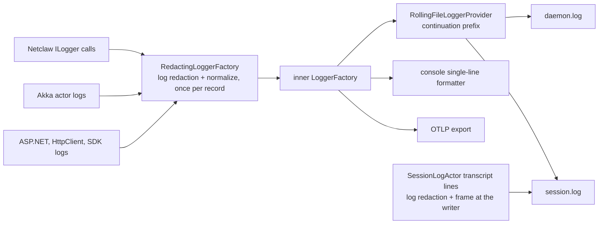

# Text Safety

This document explains where untrusted text leaves Netclaw, and which component
makes it safe at each exit. It is the canonical architecture document for
people. The testable rules live in two OpenSpec capabilities:
[`log-safety`](../../openspec/specs/log-safety/spec.md) and
[`text-safety-primitives`](../../openspec/specs/text-safety-primitives/spec.md).
This document links to those rules. It does not copy them.

Status: this document describes the code after the `close-log-redaction-gaps`
change.

Contents:

1. [The one rule: the sink decides](#1-the-one-rule-the-sink-decides)
2. [Terminal and operative sinks](#2-terminal-and-operative-sinks)
3. [The sink map](#3-the-sink-map)
4. [Which helper do I use?](#4-which-helper-do-i-use)
5. [Architecture guidelines](#5-architecture-guidelines)
6. [Future scenarios](#6-future-scenarios)
7. [Known gaps](#7-known-gaps)
8. [How we know it works](#8-how-we-know-it-works)

## 1. The one rule: the sink decides

The consumer of a text value decides how to make it safe. The same value can
need different treatment at different exits:

- A log line needs secrets masked and line breaks framed, so that a reader
  cannot mistake content for a new record.
- A JSON trace field needs control characters escaped as `\uXXXX`.
- An approval prompt needs bidi controls and backticks escaped, so that the
  person who decides sees the real text.
- A tool result for the model needs its original value, or the model cannot
  use it.

So "sanitize" is not one operation. Two helpers that look alike can both be
correct for different sinks. Before you add or merge a helper, find its sink in
the map below.

## 2. Terminal and operative sinks

A **terminal sink** stores text that a person or a tool reads but does not act
on: log files, the console, the OTLP log export, and crash logs. Terminal sinks
redact secrets by default. The worst result of a too-broad mask is lost
diagnostic text.

An **operative sink** delivers text that the receiver uses: tool results to the
model, tool calls, approval prompts, chat replies, alerts, and HTTP responses.
Operative sinks do not redact by default. Redaction changed values that
receivers used twice before:

- #1992: redaction removed `X-Amz-Signature` from presigned upload URLs that an
  MCP tool returned, and uploads failed.
- #1333: redacted placeholders were written back into files.

A value can go to both kinds of sink. Then each sink gets its own copy. The log
copy is masked, and the operative copy stays as it is.

### Log redaction

Terminal sinks use log redaction: `SecretOutputRedactor.RedactForLogging`.
It applies the shared rules of `SecretOutputRedactor.Redact`, and then the
log-only rules. Operative sinks that redact use `Redact` only. A log-only rule
can mask a value that a receiver needs, so it must never reach an operative
sink. The log-only rules:

| Rule | Masks | Keeps |
|---|---|---|
| Next-line value | `API_KEY=`, a line break, and then `abc123`: the value on the next line. The rule masks the value only when `Redact` masks the same key and value on one line. | `max_tokens=` and then `4096`; `API_KEY=` and then `$API_KEY`; `token:` and then any line |
| Presigned URL signature | The value of `X-Amz-Signature`, `X-Goog-Signature`, `Signature`, and `sig` in any query position | `?signed=true&sigma=2`; `sig={signature}` |

The stage also masks a structured value that its template marks as a secret,
as in `LogInformation("Authorization: Bearer {Token}", token)`. It renders the
template with its values, and `SecretOutputRedactor.FindLogMasks` marks each
character that log redaction masks. A value is masked when its own span holds
a masked character that redaction of the value alone does not mask. The span
comes from the placeholder position, not from a search for the value text. The
routing keys (`SessionId`, `SubSessionId`, `LogSource`, `ActorPath`) and
`AuthorizationAttemptId` are never masked by this rule. This work runs only
for a record whose message log redaction changed.

## 3. The sink map

This diagram shows the log path. One stage redacts each record before the
inner factory fans it out to the providers.

### Terminal sinks (log safety)

Each "Redaction" cell below means log redaction (`RedactForLogging`).

| Sink | Owner | Redaction | Framing |
|---|---|---|---|
| `daemon.log` | `RedactingLoggerFactory`, then `RollingFileLoggerProvider` | The stage, once per record | The file sink: continuation prefix |
| `session.log`, routed records | Same as `daemon.log` | The stage | The file sink |
| `session.log`, transcript lines | `SessionLogActor.WriteTranscript` | At the writer; truncated fields are redacted before the cut, and streamed thinking deltas are joined before redaction | At the writer |
| Console | `RedactingLoggerFactory`, then the stock single-line formatter | The stage | The stage normalizes line breaks in the message and the exception text; the formatter keeps one line |
| OTLP log export | `RedactingLoggerFactory`, then OpenTelemetry | The stage, including each structured value, each template-marked value, and each scope value | Not needed: records are structured |
| `crash-*.log` and its stderr fallback | `CrashLogWriter` | A required redactor parameter | Not needed: one file per crash |
| Startup configuration failure (`daemon.log` and stderr) | `StartupConfigurationFailure` | Its own instance of the stage, because the host does not exist yet | The file sink |
| Crash monitor fallback on stderr | `DaemonCrashMonitor` | At the writer | Not needed: one line |
| Session-dispatcher failure beacon | `RollingFileLoggerProvider` | At the beacon | At the beacon |
| `provider-probe.log` (CLI) | `ProbeDiagnosticsLog` | At the writer | Each entry on one line |
| Tool call log attributes (`Args`, `Rationale`) | `ToolCallLogFormatter` | At the formatter, before it truncates or hashes a value; the stage again | The stage |
| `{session}.log` and `headless-errors.log` (`netclaw chat -p`) | `HeadlessChannel` | At the writer; streamed deltas are joined before redaction | None: the eval scripts read multi-line records verbatim, and they tell a quoted header from a real one by its time |

`RedactingLoggerFactory` wraps the daemon's one `ILoggerFactory`. Every daemon
logger comes from it, including Akka and framework loggers, so a new log call
needs no extra step. `LogTextFraming` in `Netclaw.Configuration` holds the
line-break and continuation rule that the stage and both text sinks share.

### Operative sinks (unchanged by log safety)

| Sink | Owner | Rule |
|---|---|---|
| Tool results to the model | `DispatchingToolExecutor` | Redact by default. MCP output and `file_read` opt out. |
| Background job output to the model | `BackgroundJobManagerActor`, `JobOutputLog` | Redact each line and the joined tail. |
| MCP approval prompts | `McpApprovalMatcher` | Escape control, bidi, line-separator, and BOM characters, and backticks, as `\uXXXX`. |
| Shell policy decision trace | `ShellPolicyDecisionTraceBuilder` | Redact, then escape control, bidi, line-separator, and BOM characters as `\uXXXX`, with a length limit. |
| Adopted-context envelopes | `AdoptedContextContentBuilder` | Escape reserved marker lines and attribute values. |
| Lifecycle alerts and the 409 response | `DaemonLifecycleNotifier.SanitizeForLog` | Strip control characters and Unicode line separators; limit to 200 characters. |
| Chat markup that Netclaw builds | The builder, for example `SlackApprovalBlockBuilder.EscapeMarkdown` | Escape for the channel's markup. |
| MCP OAuth CLI errors | `McpClientManager.CreateSafeOAuthError` | Show Netclaw's own messages only. |

### Character sets

`TextControlCharacters` in `Netclaw.Configuration` is the one definition of the
bidi controls, the Unicode line separators (U+2028, U+2029), and the byte-order
mark (U+FEFF). Callers combine these sets with `char.IsControl`. A new caller
that escapes or rejects these characters must use this type, not a private
list. Two regex patterns stay separate on purpose:
`RegexPromptInjectionDetector` matches a wider range of invisible characters,
and `HeadlessChannel.SingleLine` folds every kind of line break.

### Identifier and path segments

These helpers build names from untrusted text. Two of them were identical and
now share `SessionStoragePaths.SanitizePathSegment`. The other four encode rules
that really differ, so they stay separate:

| Helper | Allowed characters | Replacement | Other rules |
|---|---|---|---|
| `SanitizePathSegment` (session folders) | letters, digits, `-` | `_` | none |
| `WebFetchTool.SanitizeForFilename` | letters, digits, `-` | `_` | trims `_`, at most 60 characters |
| `ReminderManagerActor.SanitizeActorName` | ASCII letters, digits, `_`, `-` | `-` | at most 60 characters, `reminder` when empty |
| `SanitizeWebhookId` | letters, digits, `-`, `_`, `.` | `-` | a new GUID when empty |
| `WebhookExecutionService.Sanitize` (actor names) | letters, digits | `-` | trims `-` |

A change to `SanitizePathSegment` output moves session folders, so an upgraded
daemon would not find them. Its tests pin its output.

## 4. Which helper do I use?

| You write text to... | Use |
|---|---|
| A log, through `ILogger` | Nothing. The stage redacts and normalizes every record. |
| A log file, outside `ILogger` | `SecretOutputRedactor.RedactForLogging`, then `LogTextFraming.Frame`. Redact before you truncate. Join streamed deltas before you redact. |
| Text that you shape for a log value, such as a preview or a word list | `SecretOutputRedactor.RedactForLogging` on the source text, before you shape it. |
| A value that the model or a tool will use | Nothing by default. Redaction can break the value. Ask first. Never `RedactForLogging`. |
| A prompt or text that a person approves | `TextControlCharacters.EscapeAsUnicode` with the sets that the sink needs. |
| A file name, folder name, or actor name | The helper in the identifier table that matches the name's owner. Do not add a new one. |
| Markdown, JSON, or HTML | The format's own escaping. These are not text-safety helpers. |

## 5. Architecture guidelines

**Let the log stage redact.** A log call passes the exception and values as
they are.

- Follows: `_logger.LogWarning(ex, "Refresh failed for '{Name}'", name)`.
- Breaks: `_logger.LogWarning(SecretOutputRedactor.RedactForLogging(ex), ...)`.
  The stage already does this for every record, so the call adds cost and a
  second place to change.

**Use log redaction for log text, and only for log text.**

- Follows: `SessionLogActor.Clip` calls `RedactForLogging` before it truncates
  a transcript field.
- Breaks: a log writer that calls `Redact`. It misses the log-only shapes, such
  as a presigned URL signature.
- Breaks: a tool result for the model that calls `RedactForLogging`. The model
  gets a presigned URL without its signature, and the upload fails (#1992).

**Redact before you truncate.** A cut can split a secret into a fragment that
no pattern matches.

- Follows: `TextTruncation.EllipsisAppend(SecretOutputRedactor.Redact(text), 1000)`,
  as `SessionLogActor.Clip` and `OAuthRefreshGrantHandler` do.
- Breaks: `SecretOutputRedactor.Redact(TextTruncation.EllipsisAppend(text, 1000))`.

**Redact before you reshape.** The stage finds a secret by its shape, such as
`password=hunter2`. Text that a call site has already cut into words, joined, or
reordered no longer has that shape, so the stage cannot find the secret.

- Follows: `SQLiteMemoryRecallCoordinator` logs only the plan words that survive
  redaction of the text they came from.
- Breaks: logging `string.Join("|", tokens)` built from user text. A live check
  found `lexicalTerms=use|password|hunter2` in `daemon.log` this way.
- Breaks: redacting each streamed delta alone. A token split across two deltas
  matches no pattern. `SessionLogActor` and `HeadlessChannel` join the deltas
  of one run and redact the run once.

**Do not redact a value that a receiver uses.** Give the receiver the original,
and give the log its own masked copy.

- Follows: MCP tool output reaches the model unchanged, and `session.log` masks
  the same result.
- Breaks: redacting MCP tool output for the model. Presigned upload URLs lost
  their signature, and uploads failed (#1992).

## 6. Future scenarios

| Scenario | Support |
|---|---|
| A new log provider or exporter | Supported. It sits behind the inner factory, so it gets redacted records with no extra step. |
| A new component that logs through `ILogger` | Supported. Nothing to add. |
| A new file that bypasses `ILogger` | Manual. The writer must call `SecretOutputRedactor.RedactForLogging` and `LogTextFraming.Frame`, and add tests. |
| A new secret shape that only logs can mask | Add a log-only rule in `SecretOutputRedactor.Logging.cs`, with a test that `Redact` keeps the text. |
| A new operative sink | Manual. Decide its rule from its consumer, and add a row to the sink map. |

## 7. Known gaps

- `SanitizeForLog` lets bidi controls through to alerts and the 409 response.
  See #2749.
- `WebhookExecutionService.Sanitize` can keep non-ASCII letters in an actor
  name. See #2750.
- The next-line rule covers `=` only. A header name with `:` at the end of a
  line, and its value on the next line, stays unmasked.
- The signature rule does not match a URL-encoded parameter (`%3Fsig%3D`),
  `x-ms-signature=`, or `"sig":"..."` in JSON.
- The header rules that need a line start do not match after the Akka prefix
  (`[INFO][...][akka://...] X-Api-Key: abc`). The template rule uses the
  rendered template, which has no prefix, so the attribute and the message
  can differ for such a record.
- The template attribute `{OriginalFormat}` is redacted as text. A template
  such as `Authorization: Bearer {Token}` shows `***REDACTED***` in place of
  `{Token}`.
- A crafted MCP argument value makes the approval display throw. See #2771.
- The headless CLI session log is redacted but not framed. Its eval readers
  rely on verbatim records.
- CodeQL `cs/log-forging` cannot see the stage. Dismiss its alerts with a
  reference to this document and the framing tests.

## 8. How we know it works

- `RedactingLoggerFactoryTests`: message, structured values, scopes,
  exceptions, exception text that needs escaping, false positives such as
  `max_tokens=4096` and `authorizationAttemptId=`, the log-only rules,
  template-marked values, the exempt keys, and the fail-closed path.
- `SecretOutputRedactorLoggingTests`: each log-only rule masks its shape in
  logs and `Redact` keeps it; the negative cases; the attempt ID fix; and the
  mask map.
- `ActorLogRedactionRoutingTests`: an Akka record masks a template-marked
  value.
- `DispatchingToolExecutorTests`: a presigned URL reaches the model unchanged,
  when its signature comes first too.
- `LogRedactionRoutingTests`: `ILogger<T>`, framework, and Akka records go
  through the stage, including a provider registered after it.
- `LogRecordFramingTests` and `ConsoleLogFramingTests`: content cannot forge a
  record in the file or on the console.
- `SessionLogActorTests`: transcript redaction, framing, redaction before
  truncation, a secret split across thinking deltas, and the presigned-URL fork
  (design D5).
- `HeadlessSessionLogTests`: the headless CLI log masks a split secret and raw
  tool arguments, and keeps tool results verbatim.
- `TextSafetyCharacterizationTests`, `ApprovalEntryValidationCharacterTests`,
  and `SanitizeForLogCharacterTests`: golden outputs that pin each caller of the
  shared character sets.
- `TextControlCharactersTests`: a scan of every UTF-16 code unit pins each set.
