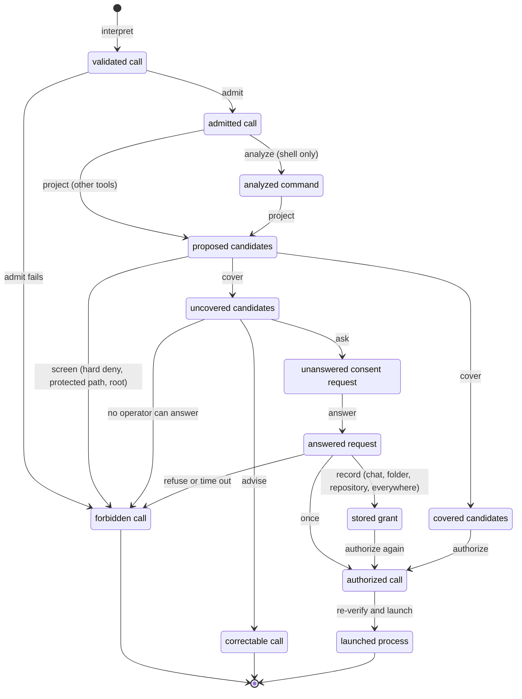
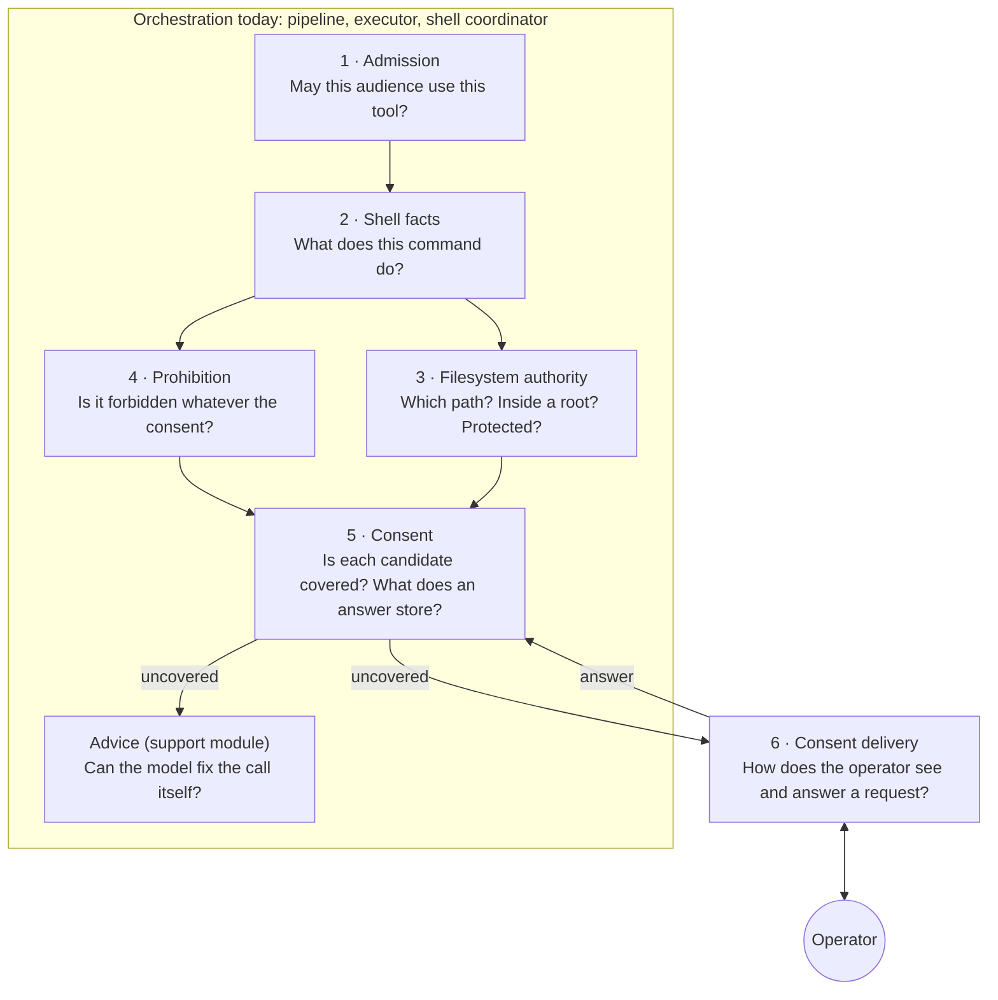
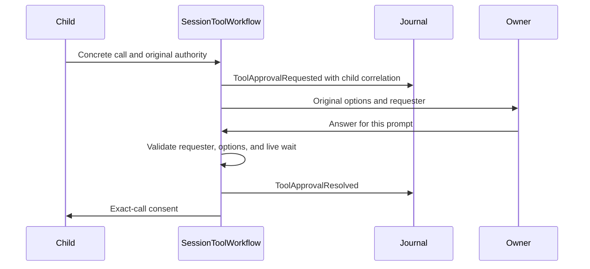
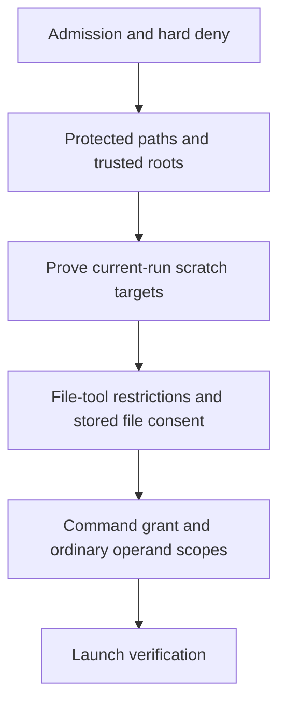
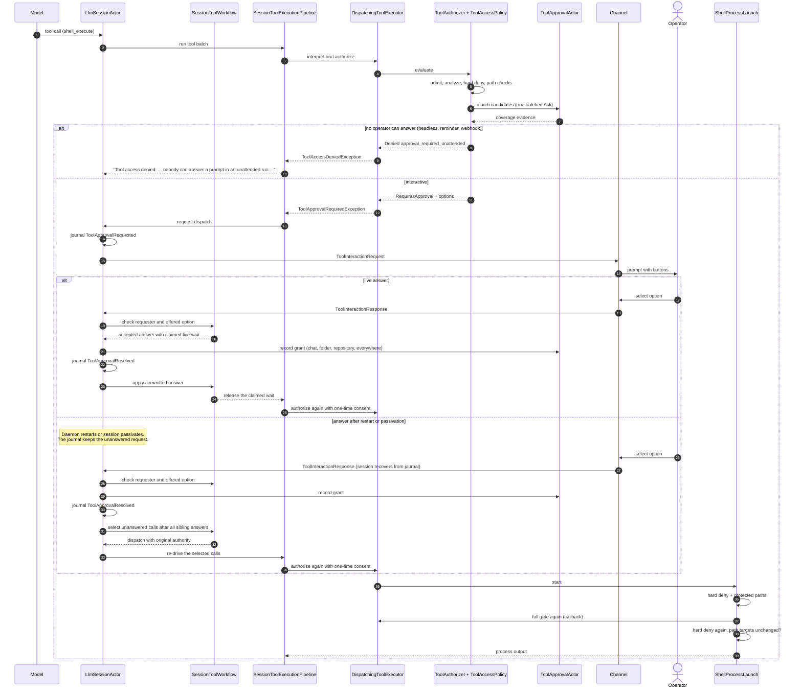

# Tool Authorization

This document explains how Netclaw decides whether a tool call can run. It is
the canonical architecture document for people. The testable rules live in the
[`tool-authorization` OpenSpec capability](../../openspec/specs/tool-authorization/spec.md).
This document links to those rules by ID (TA-1 to TA-16). It does not copy them.

Status: this document describes the code at `dev` revision `f7d407d6f`. Sections 2
to 5 name today's owners. A note with the label **Planned** describes a target
shape that no code has yet. The consolidation program changes one context per
PR. Each PR updates this document in the same diff.

Contents:

1. [What this covers](#1-what-this-covers)
2. [The lifecycle of one call](#2-the-lifecycle-of-one-call)
3. [The contexts](#3-the-contexts)
4. [One call, end to end](#4-one-call-end-to-end)
5. [Language](#5-language)
6. [Architecture guidelines](#6-architecture-guidelines)
7. [How to extend](#7-how-to-extend)
8. [Future scenarios and their support](#8-future-scenarios-and-their-support)
9. [How we know it works](#9-how-we-know-it-works)
10. [Why it has this shape](#10-why-it-has-this-shape)

## 1. What this covers

Tool authorization is every step between a model-authored
[tool call](../spec/GLOSSARY.md#tool-call) and the start of the tool. For a
shell call, it ends when the process starts. The result is one
[authorization](../spec/GLOSSARY.md#authorization) outcome:

| Outcome | What it means | Code value |
| --- | --- | --- |
| Allowed | The tool runs. | `ToolAuthorizationOutcome.Allowed` |
| Requires consent | The call waits for an operator answer. | `ToolAuthorizationOutcome.RequiresApproval` |
| Requires correction | The model must author a different call. | `ToolAuthorizationOutcome.RequiresAgentCorrection` |
| Denied | The call does not run, and no answer can change that. | `ToolAuthorizationOutcome.Denied` |

The code values are in
[`ToolAuthorizationDecision.cs`](../../src/Netclaw.Actors/Tools/ToolAuthorizationDecision.cs).

In scope:

- first-party tools, MCP tools, `shell_execute`, and `check_background_job`;
- the main session and subagents;
- interactive channels and non-interactive runs (headless chat, reminders,
  webhooks);
- the persistent grant store and the operator CLI for it.

Not in scope:

- network exposure, device pairing, and host authentication (see
  `daemon-exposure`, `device-pairing`, `hub-auth`, and `local-control-proof`).
  A local-control proof grants one host operation: a pairing code or the read
  of one provider OAuth result. It never authorizes a tool call, and a tool
  grant never replaces it. The CLI lifecycle commands use the
  [process home proof](../spec/SPEC-011-daemon-architecture.md#daemon-lifecycle-management);
- validation of tool arguments against a schema (`tool-arg-validation`);
- output bounds and spill (`bounded-tool-output`);
- containment of what an allowed process does after it starts. Netclaw has no
  OS sandbox. See [section 8](#8-future-scenarios-and-their-support).

## 2. The lifecycle of one call

A call moves through named stages. Each arrow is a verb. The model follows the
approval concept map of the consolidation program.



Notes on the diagram:

- "Screen" runs before "cover". A hard deny or a protected path ends the call
  before any grant lookup. See [TA-5](../../openspec/specs/tool-authorization/spec.md#requirement-ta-5-hard-deny-precedes-grant-lookup-and-repeats-at-launch).
- "Correctable" ends this attempt. The model authors a new call, which starts a
  new [authorization attempt](../spec/GLOSSARY.md#authorization-attempt).
- A non-shell tool has one candidate: the tool name.
- Today, the code has no type for each stage. One decision record
  (`ToolAuthorizationDecision`) and one mutable bag (`ToolApprovalAttempt` in
  [`ToolExecutionContext.cs`](../../src/Netclaw.Tools.Abstractions/ToolExecutionContext.cs))
  carry the stages. **Planned:** one closed type per stage (consolidation PRs 5
  and 6).

## 3. The contexts

A context owns one question and the words for that question. Other code calls
its published contract. It does not repeat its checks. Six contexts and one
support module make up tool authorization.



The arrows show the order in the current shell path. A non-shell call skips
"Shell facts". Today no single class owns the order. Three classes share it:

- [`SessionToolExecutionPipeline`](../../src/Netclaw.Actors/Sessions/Pipelines/SessionToolExecutionPipeline.cs)
  runs each call, catches a consent request, and asks the operator.
- [`DispatchingToolExecutor`](../../src/Netclaw.Actors/Tools/DispatchingToolExecutor.cs)
  runs the gate inside `ExecuteStreamAsync` through `GetAuthorizedToolAsync`
  and `EvaluateAuthorizationAsync`, which asks `ToolAuthorizer` for every call.
  `GetAuthorizedToolAsync` turns a decision that is not an allow into an
  exception, which the pipeline and the subagent loop catch. This exception is
  the contract between an executor and its callers.
- [`ShellPolicyCoordinator`](../../src/Netclaw.Actors/Tools/ShellPolicyCoordinator.cs)
  supplies the shell advice and the coverage.

[`ToolAuthorizer`](../../src/Netclaw.Actors/Authorization/ToolAuthorizer.cs)
(consolidation PR 6a) states the order as one list of rules: one line per
rule, and the first rule that decides wins. It returns a closed
[`AuthorizationDecision`](../../src/Netclaw.Actors/Authorization/AuthorizationDecision.cs)
(Allowed, NeedsConsent, CorrectionRequired, or Denied) and throws no exception
for an outcome. Each rule calls the component that owns its question. A
differential test proves that it gives the same decision as the old gate. Its
shell rules, in order:

1. Admission: audience, then shell capability.
2. Prohibition: hard deny, then protected shell text. The protected-path check
   also reads known outer redirects from each retained Bash compound owner.
3. Filesystem authority: a `..` in the working directory, then each slice of a
   `cd` directory proof, then each literal twin (decision F1, below).
4. Filesystem authority: the working directory and the known paths must be in
   a trusted root of the audience profile. For a Bash compound, the retained
   parser owner supplies its entry directory and outer redirect targets. A
   protected path stays denied.
5. Admission: a Deny consent mode.
6. Advice: a native tool, then Auto mode with its directory advice. Then a
   Bash source with no command is allowed: it runs no program (owner decision,
   October 2026, below). Before Auto or this allow, the authorizer asks the grant
   store for each compound redirect's file tool grant.
7. A call without command text, the projected trusted-root check, the
   redirect checks of a command that runs no program, and unresolved input:
   one-time consent or a Once-only request. Since approval taxonomy
   PR 5, a Bash call splits an unresolved source into commands: each
   unresolved command is one exact candidate, and the other commands go to
   rule 8 with their own candidates. Decision D1 lets a safe phrase or a grant
   for anywhere cover an exact candidate whose only unknown part is an operand.
   A variable word (`"$d"`) is an unknown operand unless the parser resolves
   it as a path, or types its value as a filesystem value or as data. A loop
   or assignment value that names a path does not give the candidate a scope.
   A compound with an uncovered outer file operation keeps the full source
   visible and adds an exact `read <path>` or `write <path>` candidate. The
   source candidate supports display and the 900-character check. A call-local
   shell source key binds the full source to a `Once` answer. File-operation
   candidates keep null `VerbTokens` and references to the parser owner and
   redirect.
   Owner decision F1 (0.27.2): when the parser gives the literal twins of a
   command, the twin candidates replace the candidates of that command (see
   "Literal twins" below).
8. Consent: a covering grant (stored grant, the exemption of a side effect
   and of a command that runs no program, reviewed-safe policy), then the
   uncovered candidates.

Literal twins (owner decision F1, October 2026). ShellSyntaxTree
0.4.0-beta.23 writes each Bash command whose changeable words have a proved
finite set of values as one literal command for each combination of values
(`BashParser.TryProjectLiteralTwins`). Netclaw judges each twin as if the
operator typed it. `BashLiteralTwinSlices` (`Netclaw.Actors/Tools`) owns the
judgment. Its data is call-local.

```text
schematic: one shell call, after the parse
twins = TryProjectLiteralTwins(source)      # none under an Unknown initial state
for each command that has twins:
    for each twin:
        analysis = analyze(twin.Source, twin.WorkingDirectory)   # never run it
        require: one complete command, with the facts of twin.Occurrence
        candidates = normal candidates of the analysis
        add the assignment digest of the source command
    any twin that fails -> the command keeps its own candidates
screen each twin: hard deny, protected text, trusted root      # rule 3
replace the candidates of each twinned command with the union of its twins
cover each candidate as usual                                   # rule 8
```

- The strictest twin result wins. One denied twin denies the call. One
  uncovered twin candidate prompts, with the union of the uncovered
  candidates. The call runs with no prompt only when each twin candidate is
  covered.
- Example: `for n in 8250 8244; do gh api -X PATCH repos/o/r/issues/$n -f
  milestone=157; done` gives the twins `gh api -X PATCH repos/o/r/issues/8250
  ...` and `... 8244 ...`. A chat or folder grant for `gh api` covers them,
  and a prompt offers the normal choices.
- Negative example: `for d in ../outside/x.slnx; do dotnet build "$d"; done`
  gives the twin `dotnet build ../outside/x.slnx`. A folder grant for
  `dotnet build` does not cover the path outside the folder.
- A command without twins keeps its earlier rule. Examples: a value from
  `$(...)` (`for n in $(gh issue list); do gh api "x/$n"; done`), a program
  word from a value (`for p in /bin/rm; do $p x; done`), and any source on a
  Bash host without a proved fresh state.
- A twin keeps the shell-state assignments of its source command as an
  assignment digest, so a grant without the same assignments does not cover
  it (`x=1; for n in a b; do gh api x/$n; done`).
- `ShellProcessLaunch` screens each twin again for hard deny and protected
  text, and it rechecks the paths of each twin before the process starts.
- A call with a `cd` directory proof gets no twins: the proof already gives
  each command its exact directory.

Assignments that stay in the shell (owner decision F3, October 2026). A Bash
shell-state assignment qualifies a grant with an assignment digest, because an
exported variable can change what a program does. ShellSyntaxTree
0.4.0-beta.24 proves that an assignment reaches no program when the caller
declares the complete names of the launch environment
(`ShellLaunchEnvironment.WithCompleteEnvironmentNames`).

- `ShellExecutionEnvironment` takes one snapshot of the daemon environment
  when the daemon creates it, as it does for `HOME`.
  `CreateChildEnvironment` removes the Bash startup overrides and adds the
  launch variables. `CreateProcessStartInfo` copies that environment to each
  process, and `GetCompleteEnvironmentNames` gives its names to the parser,
  plus `PWD` and the temporary variable names that the launcher adds. The
  launcher and the parser read one snapshot, so they cannot drift. A later
  change to the daemon process environment reaches no shell process.
- The names never carry a value, and Netclaw never shows them to the model.
- `ShellAssignmentDigestFactory.ReachingProgram` skips a Bash `ShellState`
  assignment with `MayAffectProcessEnvironment == false`. A Bash data command
  (`echo`, `printf`, `test`) keeps every assignment: it reads no environment,
  and its digest keeps an operand that is not proved data
  (`d=key; echo ../x/"${d}s"/*`) out of the approval exemption.
- A read of the variable is an argument with its own value facts: an unknown
  value is an unknown operand (D1), and a known value gets its literal twin
  (F1).
- Fail closed: a Bash host without a proved fresh state, a decoded `bash -c`
  child, and PowerShell keep every assignment. `set -a`, `declare -x`, and
  `eval` make the source unresolved.
- For Bash, an exact effective value can qualify a digest when the authored
  value is unknown. The parser must prove that value from the full analysis.
  PowerShell still needs exact authored and effective values.

Example: `b=$(git branch --show-current); git fetch origin` with a chat grant
for `git fetch` runs with no prompt. Negative example: with `GIT_DIR` in the
daemon environment, `GIT_DIR=/tmp/x; git status` keeps its digest, so a plain
`git status` grant does not cover it.

Commands that run no program (owner decision, October 2026). Approval of `:`
means nothing, because no program runs. The only effect of such a command
outside the shell is its redirects, and the file rules own that question.

A command occurrence runs no program when the parser proves one of these
shapes (`ShellCommandAnalysis.RunsNoProgram`, `ProvesNoCommand`):

- a Bash source that parses with no command: an assignment (`x=1`), a
  comment, an empty `case` (`case x in x) ;; esac`), or an empty subshell
  (`()`);
- a command with only redirects (`> file`, `< file`), with no assignment;
- a Bash data command from the existing policy data
  (`ShellVerbPolicyData.IsDataCommand`). When a shell-state assignment reaches
  it, each operand must be proved data, as for the approval exemption (F3).

Each redirect must be a proved file redirect with one exact absolute target,
or a descriptor copy, move, or close (`2>&1`). Bash gives `/dev/tcp/...`,
`/dev/udp/...`, and `/dev/fd/N` a meaning that is not a file, so below `/dev/`
only `/dev/null` qualifies. A data command with another target is exact: its
prompt shows its full text. The rule composes general shell facts. It adds no
program grammar.

```text
schematic: the rules for a command that runs no program
source has no command (x=1)                    -> rule 6: Allowed
mark each candidate of such a command          # ShellApprovalMatcher, call-local
file tool of a redirect has mode Approval,
  and no grant of that tool covers the path    -> the candidate becomes exact:
                                                  "write <file>", "read <file>"
screen as usual: hard deny, protected text, trust zone (write rules)  # rules 2 to 4, 7
for each redirect of a marked candidate:       # rule 7
    target not proved                          -> Denied shell_redirect_unproved
    input redirect and the read rules refuse   -> Denied shell_redirect_read_denied
    file tool has mode Deny or is not admitted -> Denied shell_redirect_file_tool_denied
cover each marked candidate that is not exact  # rule 8, Coverage.Exempt
all covered -> Allowed; else prompt for the other candidates only
```

- Owners: `ShellCommandAnalysis` proves the shape. `ShellApprovalMatcher`
  marks the candidate. `ToolAccessPolicy` judges the targets
  (`ScreenNoProgramRedirects`, `WithFileToolConsent`) with
  `PathAccessPolicy` and the consent mode of the file tool. `ToolAuthorizer`
  owns the order. Each fact is call-local. Such a command never creates a
  grant.
- A redirect gets the decision of the file tool for the audience and the
  path. A write target gets the path rules of `file_write` (the shell trust
  zone) and the consent mode of `file_write`. An input target gets the trust
  zone, the path rules of `file_read`, and the consent mode of `file_read`.
  Mode `Auto` runs with no prompt. Mode `Deny` denies. With mode `Approval`,
  a stored grant of the file tool covers the redirect, as it covers the tool
  (`StoredGrantCheck` with the consent request of the tool). With no such
  grant, one prompt names each write and read that needs consent, with `Once`
  and `Deny`. That prompt cannot save a grant: answer a `file_write` prompt
  with a saved choice, or set the mode to `Auto`, to stop it. Each redirect of
  the command gets every check before the prompt, so one denied redirect
  denies the call.
- The managed temporary directory advice replaces a prompt. A command that
  runs no program has no prompt, so it gets no such advice: `: > /tmp/x` and
  `cd /tmp && : > x` both run when the rules allow the path.
- An attended and an unattended call get the same result. An unattended call
  denies each case that keeps a prompt.
- Example: `printf 'a\n' > drafts/h.tsv && : > drafts/h.json` runs with no
  prompt and no grant. `x=1; : > drafts/y` runs too.
- Negative example: `: > ~/.netclaw/config/secrets.json` is denied. A bounded
  write profile denies `printf a > ../outside/x`, and a bounded read profile
  denies `: < /etc/passwd`.
- Negative example: a program still prompts. `date > out.txt` prompts for
  `date`, and `echo $(rm -rf x) > f` prompts for `rm`.

Limits: these forms run no program but keep a prompt that shows their text,
because the parser gives no proved target or no parse for them.

- `cd dir; : > f` and `(cd dir; : > f)`: after a `cd` that can fail, the
  target has no exact value. `cd dir && : > f` runs.
- A redirect target with a loop variable (`for n in 1 2; do : > f$n; done`),
  a glob, or another unproved value.
- The operators `>|`, `>&`, and `<>`.
- Several assignments in one statement (`x=1 y=2`), an array assignment, and
  `x+=1`.
- A target behind a link. On macOS, `/var` and the default `TMPDIR` are
  behind a link. The platform temporary alias (`/tmp`) is not a limit.
- A data command with an assignment whose operand is not proved data
  (`d=key; echo ../x/"${d}s"/* > out.txt`).
- With mode `Approval`, the redirect gets no managed temporary directory
  advice, but the file tool does.

A prompt never names nothing. When a shell consent request has no candidate
and no pattern (a source that does not parse, `$cmd > x`, `eval x`,
`x=1 > f`), `ToolAuthorizer.ShowFullCommandText` makes the full command text
its one display candidate, with only `Once` and `Deny`. A request with
patterns (a PowerShell statement list) keeps them. Slack and Discord show the
command in the request line, so their header for such a request is "Approve
this command in <folder>?". The one-time key reads the candidates and the
patterns, not the display list. For shell calls, it also binds a call-local
hash of the exact structured `Command` value. The retry must keep that value;
display text is not source. Recovery reads the original structured arguments
from session history and abandons a shell retry when the source is missing or
malformed. The 900-character rule below applies after it. The test harness
fails each test that observes a prompt with no display candidate.

Decision D2 (October 2026): an attended and an unattended call use the same
rules above. The file reach of an unattended call is the reach of its audience
profile, as in a chat. The one difference comes after rule 8: when nobody can
answer (headless chat, a reminder, a webhook, a sub-agent with no approval
bridge), the authorizer turns a consent request into the denial
`approval_required_unattended`. D2 removed the unattended-only trust zone, the
unattended unresolved-input denial, and the PR 6e rule that let a stored grant
replace a trusted-root denial for an unattended call.

After the unattended denial, an attended shell consent request whose command
text is longer than `ApprovalOptionKeys.MaxCommandTextChars` (900) becomes the
correction `shorten_shell_command`. The operator must see the full command
that they approve, and 900 characters is the command length that a Discord
prompt (2,000 characters) can show in full. The call does not run, and a
resend of the same call gets the same correction.

Each context below lists its question, the classes that answer it today, its
published contract today, what it must not know, and where its data lives.
"Leaks today" lists known places where the current code breaks the "must not
know" rule. The leaks are the work list of the consolidation program.

### 3.1 Admission

| Item | Current state |
| --- | --- |
| Question | May this audience use this tool, in this shell mode and this consent mode? |
| Classes | [`ToolAccessPolicy`](../../src/Netclaw.Actors/Tools/ToolAccessPolicy.cs) (`AdmitAudience`, `IsToolExposed`, `EvaluateShellCapability`, `GetApprovalMode`), [`ToolAudienceProfileResolver`](../../src/Netclaw.Actors/Tools/ToolAudienceProfileResolver.cs), [`ToolAudienceProfiles`](../../src/Netclaw.Configuration/ToolAudienceProfiles.cs), [`ToolApprovalConfig`](../../src/Netclaw.Configuration/ToolApprovalConfig.cs), [`TrustContextPolicy`](../../src/Netclaw.Configuration/TrustContextPolicy.cs) |
| Published contract | `ToolAccessPolicy.AdmitAudience(...)` returns a denial or null. `ToolAuthorizer` returns the `AuthorizationDecision`. `IsToolExposed(...)` filters schemas. |
| Must not know | Grants, paths, shell syntax. |
| Data | Configuration. The result is call-local. |
| Rules | [TA-1](../../openspec/specs/tool-authorization/spec.md#requirement-ta-1-trust-context-is-explicit-and-fails-loud), [TA-2](../../openspec/specs/tool-authorization/spec.md#requirement-ta-2-schema-exposure-grants-no-authority), [TA-3](../../openspec/specs/tool-authorization/spec.md#requirement-ta-3-audience-profiles-admit-tools), [TA-4](../../openspec/specs/tool-authorization/spec.md#requirement-ta-4-consent-mode-and-shell-mode-resolve-per-audience-and-tool) |

`LlmSessionActor` supplies its current `EffectiveTrustContext` to
[`SessionModelContext`](../../src/Netclaw.Actors/Sessions/SessionModelContext.cs) when it prepares a model request.
The context component calls `ToolAccessPolicy.FilterExposedTools` with that authority.
It exposes no tools when a configured policy has no resolved trust context.
`SessionInputFlow` owns the current actor-local authority and supplies an immutable snapshot to the actor.
The actor supplies that authority to the context component. The context component owns request preparation and its transient inspection intent.
The input owner builds and validates `InputAdmitted.TurnContext` before the actor persists the event.
After the journal callback, the owner restores that stored context for the live turn.
The actor sends the acknowledgment after the callback. The journal retains the original authority.
Schema exposure grants no execution authority. The tool execution path still applies its authorization checks.

Effective audience of the run scope:

- Owner: `LlmSessionActor`. It reads `EffectiveTrustContext.EffectiveAudience` when it builds the
  `SessionToolRunEnvironment` of a tool batch, and when it starts a routed skill.
- The deployment posture narrows the source audience (TA-1). `SessionToolBatch` puts the narrowed value in
  `ToolRunScope.Audience`. The admission gate, the shell check, the consent mode, the filesystem roots,
  `search_tools`, and `load_tool` read that value.
- A child that `spawn_agent` or a routed skill starts copies `ToolRunScope.Audience`. Thus the tool set and the run
  scope of the child use the effective audience
  ([netclaw-subagents](../../openspec/specs/netclaw-subagents/spec.md#requirement-sub-agent-tool-exposure-inherits-parent-audience-policy)).
- The journal keeps the source audience in `InputAdmitted.TurnContext`. The actor derives the effective audience again
  for each turn.
- A tool batch without a trust context is a wiring defect. The actor throws. A routed skill without a trust context
  is refused with `audience_unresolved`. Neither path uses the source audience in place of the effective audience.
- Data: the trust context is actor-local. The run scope is call-local.

| Example | Source audience | Posture | Run-scope audience | Result |
| --- | --- | --- | --- | --- |
| Positive | `Personal` | `Personal` | `Personal` | `set_webhook` runs. A child gets `set_webhook`. |
| Negative | `Personal` | `Team` | `Team` | The gate denies `set_webhook` by name. A child does not get it. |

One authority per turn (buffered input):

- Owner: `SessionInputFlow.DrainBufferedBatch`. The actor calls it after a turn, after a tool batch,
  and after a compaction.
- Rule: a turn has one authority, fixed when the turn starts. A batch holds only the leading buffered
  inputs of one [requester](../spec/GLOSSARY.md#requester) (`TurnContext.HasSameRequester`).
  An input from another requester waits for its own turn. Nothing changes the authority of a running turn.
- After a turn, the first buffered input starts a new turn. The flow adopts the recorded
  `InputAdmitted.TurnContext` of that input. The actor then derives trust and the prompt audience for it
  (`ApplyBufferedBatch`). Until the actor derives trust, the trust context is empty, so tool exposure fails closed.
- Inside a turn (tool batch or compaction), only inputs of the turn's requester join. The turn keeps its authority.
- An overflow replay is the current turn's own message. It always continues the current turn.
- A person ends an automation turn at a safe boundary. Owner: `SessionInputFlow.PersonWaitsBehindAutomation`, which
  `AdvanceAfterToolBatch` calls before the drain and `AdvanceAfterCompaction` calls before a tool-loop resume. The
  data is actor-local: the buffer and the current authority.
  - An automation turn has the requester principal `VerifiedAutomation` or `SystemProcess`. Examples are a reminder
    fire, a background job result, a webhook, and an approval notice. A child result notice turn is automation when
    an automation turn started the child, because the notice carries the requester of the run owner.
  - A person is a buffered input with the principal `Operator` or `TrustedInternal` that is not a child result
    notice. A person's slash command counts. A person input never joins an automation turn.
  - An `UntrustedExternal` person does not end the turn. That input waits for its own turn, as before.
  - The check runs at two safe boundaries: a tool-batch end, and the end of a compaction that the tool loop started.
    It does not run during a model call or after an overflow compaction, because an overflow replay is the turn's
    own message. A restart drain request wins at both boundaries.
  - If a person waits, the flow returns `ToolBatchNextAction.EndTurn` at a tool-batch end and
    `InputProgressAction.EndTurn` at a compaction end. No input joins, and the actor makes no further model call.
  - The actor ends the turn quietly (`EndAutomationTurnForPerson`: `TurnCompleted` with `Completed` and
    `QuietEnd`). The close (`InputClosed`) carries the background job ID of a job result turn, so the journal closes
    the job on the live path and on replay.
  - At a tool-batch end, a compaction that is due commits after the close and before the person's first model call.
    The compaction end then drains with no tool-loop resume.
  - The first model call of the next person turn holds a fixed stop note in its per-turn context block
    (`SessionModelContext.AutomationStopNote`). The note holds no source kind and no sender text, because a webhook
    sets its own source kind. The pending note is actor-local. A restart drops it.
  - The drain after the turn then starts each waiting input under its own recorded authority. The queue stays
    FIFO. An automation input before the person gets its own turn, and the person ends that turn in the same way.
  - Children that the ended turn started keep running. Each child reports later in a notice under the recorded
    authority of its run owner.
- A child result notice is automated input by its kind, so it never ends a turn. A person never ends the turn of
  another person. The child consent pause never holds a person, so a person also ends the turn during the pause.
- Data: the buffer and the current authority are actor-local. Each buffered command carries a copy of its
  recorded authority. The journal keeps the durable `InputAdmitted` record.
- Before this change, the flow sent the whole buffer in one call, and the call ran under the previous
  turn's authority (or no authority after a failed turn).

```text
schematic: drain(continuesTurn)
  owner = continuesTurn or buffer[0] is replay ? current authority : recorded authority of buffer[0]
  after a tool batch or a tool-loop compaction only: if owner is automation and an Operator or TrustedInternal person
    waits: end the turn, drain nothing; compact when due; the next person turn gets the stop note
  batch = leading inputs where input is replay or HasSameRequester(input, owner)
  if the batch starts a turn: current authority = owner; trust = derive(owner)
  the remaining inputs keep their order and wait
```

A valid example: Alice's turn runs a tool. Alice sends a second message during the tool call.
The message joins Alice's turn at the tool boundary.
An invalid example: a reminder turn runs a tool, and Bob sends a message during the tool call.
Bob's message must not join the reminder turn, and it must not run under the reminder authority.
Bob's message ends the reminder turn at the next tool-batch end or tool-loop compaction end. Then it starts its own
turn under Bob's authority, and its first model call holds the stop note.
Another invalid example: Alice's turn runs a tool, and Bob sends a message. Bob's message does not end Alice's turn.
It waits for its own turn.
A focused mutation gate (`./scripts/run-input-one-authority-mutations.sh`) guards the owner choice, the join rule,
the automation check of `PlanNewInputAbandonment`, and the person check of `AdvanceAfterToolBatch` and
`AdvanceAfterCompaction`.
Known limit: the requester check ignores provenance. Two inputs of one sender with different payload taint can share
a turn under the trust of the first input. Today each producer sets one provenance per sender, so no live mix exists.
`SessionInputFlowAccordantTests` states the rule over generated sequences.

The child consent pause (input placement):

- Owner: `SessionToolWorkflow.IsChildConsentPaused` decides the pause. It is actor-local and derived: the session is
  paused while any child consent request of the session is open. An answered request is closed.
  See [child consent pause](../spec/GLOSSARY.md#child-consent-pause).
- Placement owners: `SessionToolWorkflow.PlanNewInputAbandonment` holds automated input that arrives in Ready
  (`NewInputPlan.WaitForApproval`). The drain holds it after a turn, after a tool batch, and after a compaction
  (`SessionInputFlow.PassesPause`). A held input never joins a running turn and never starts a turn. A new turn
  starts at the first input that is not held (`MoveHeldInputBehind`).
- Held: input with the principal `VerifiedAutomation` or `SystemProcess` (a reminder fire, a webhook, a background job
  completion) and a child result notice. A person input is not held: it runs a turn, and the pause stays.
- An approval notice is never held. It is an `InputAdmitted` with the source kind and sender `child-consent`, the
  principal `VerifiedAutomation`, the authenticity `LocalProcess`, and `SupportsInteractiveApproval = false`
  (`SessionInputFlow.PrepareConsentNotice`). `TurnContext.IsChildConsentNotice` identifies it by all of these facts.
  A webhook sets its authenticity `Verified`, so it cannot pose as a notice. A notice never joins a turn, and nothing
  joins a notice turn.
- Reminder fires: while the pause applies, a later fire of a reminder replaces the waiting fire. The session closes
  the waiting fire with the existing `InputClosed` and keeps the later fire. The replacement applies also when a
  parent prompt is open at the same time. A fire that waits only behind a parent prompt keeps the drop rule
  (`SessionInputFlow.PrepareAdmission`, `AdmissionDecision.ReplaceWaitingFire`). One atomic write holds the close and
  the newer admission (`LlmSessionActor.PersistReplacingInput`), so a crash keeps both or neither.
- A close of a waiting input does not end the open turn. `PersistReplacingInput` and the recovery close of pending
  notices set `InputClosed.KeepsTurn`. Replay clears the noticed runs at each close without that flag
  (`LlmSessionActor.RecoverParentClosure`). Live code clears them when the next turn starts. An old row has no flag,
  so it reads as a close that ends the turn.
- Recovery of a session that was paused (an open request of a run that is still `Accepted`) withdraws the child
  requests, closes the pending notices, and sends itself `StartHeldInputs`. The handler
  (`LlmSessionActor.StartInputsHeldByThePause`) queues the held input that is not queued yet, and it starts the queue
  in an idle session. The restart reminder stays the one resume path for an interrupted input. When the restart
  reminder woke the session, it was stashed during recovery, so it runs before `StartHeldInputs` and queues the pending
  inputs in admission order first. In a busy session it queues each pending input that no turn selected and replies
  `RestartResumeNotNeeded` (`QueueRestartResume`). A crash does not resume a person's input (#2516).
- Data: the pause and the queue are actor-local. Each held input is a durable pending `InputAdmitted` record.
- The last close of the session admits the closing notice. Then the held inputs run through
  `StartWaitingInputAfterApproval`.

```text
schematic: drain(continuesTurn, paused)
  if not continuesTurn and paused: move held inputs behind the other inputs, in order
  batch = leading inputs that pass the pause and join the turn (HasSameRequester)
  an input passes the pause when it is a replay, or it is not held and no side of the join is a notice
```

A valid example: Alice's child waits for consent. A reminder fires. The fire waits, and it runs once after the operator
answers. An invalid example: the reminder fire joins Alice's running turn at a tool boundary, or it starts a turn while
the child waits.
The focused mutation gate `./scripts/run-child-consent-mutations.sh` guards the pause predicate, the start refusal, the
Ready hold, the drain rules, and the notice identification.

Leaks today:

- `ToolAccessPolicy` also parses shell text, runs hard deny, and builds the
  prompt options.
- Two `ToolAudienceProfileResolver` instances exist: one in `ToolAccessPolicy`
  and one in `PathAccessPolicy`. `GetApprovalMode` reads the profile defaults
  directly.
- Two functions resolve the consent mode. A code comment says that people keep
  them consistent by hand.
- The effective shell mode is `Tools.ShellMode ?? Security.ShellExecutionMode ??`
  the posture default. Two keys carry one setting.

### 3.2 Shell facts

| Item | Current state |
| --- | --- |
| Question | What does this command do, in general shell terms? |
| Classes | ShellSyntaxTree through [`ShellCommandAnalysis`](../../src/Netclaw.Security/ShellCommandAnalysis.cs); candidate extraction in `ShellApprovalMatcher` ([`IToolApprovalMatcher.cs`](../../src/Netclaw.Security/IToolApprovalMatcher.cs)); [`ShellTokenizer`](../../src/Netclaw.Security/ShellTokenizer.cs) and [`ShellApprovalSemantics`](../../src/Netclaw.Security/ShellApprovalSemantics.cs) (legacy parser); [`BashDirectoryScopeProjection`](../../src/Netclaw.Actors/Tools/BashDirectoryScopeProjection.cs) (the directory of each occurrence after a Bash `cd`); [`BashLiteralTwinSlices`](../../src/Netclaw.Actors/Tools/BashLiteralTwinSlices.cs) (the literal twins of a Bash command, F1); [`ShellPolicyPathFacts`](../../src/Netclaw.Actors/Tools/ShellPolicyPathFacts.cs); [`ShellFileSystemTreeAccessPolicy`](../../src/Netclaw.Security/ShellFileSystemTreeAccessPolicy.cs) |
| Published contract | `ShellCommandPolicy.Analyze(...)` returns a `ShellCommandAnalysis`. `ShellApprovalMatcher.AnalyzeInvocation(...)` returns candidates and an "unresolved" flag (`IsMessy` in code). |
| Must not know | Grants, audience, the private grammar of an executable. |
| Data | Call-local. |
| Rules | [TA-7](../../openspec/specs/tool-authorization/spec.md#requirement-ta-7-shell-analysis-uses-general-syntax-facts) |

Fixed text on stdin (owner decision 2026-10-07, heredoc parity):

- A heredoc with a quoted delimiter and a here string with a proved value
  give fixed text on stdin. Netclaw treats the text as it treats text from a
  pipe: it reads no path and no command from it.
- The command keeps its normal candidate. A grant for `python3` covers
  `python3 - <<'EOF'` as it covers `python3 -c '...'`. Each interpreter rule
  of the argument form also applies to the stdin form.
- These forms stay unresolved (one exact candidate, "Once" only):
  - an unquoted delimiter (ShellSyntaxTree marks it `Expand`);
  - a here string with an unknown value;
  - a descriptor other than stdin;
  - a command with Unknown command words, for example `python3 - "$f"` in a
    loop, because a literal twin cannot carry a heredoc;
  - a shell receiver. The file name of each verb word decides: `bash`,
    `./bash`, `/usr/local/bin/bash`, `bash.exe`, `env sh`, `xargs bash`,
    `pwsh`, `cmd`. An argument counts too when a part of its proved value
    between white space is a shell file name (`timeout 5 /opt/x/bash`,
    `env -S 'bash -s'`, `ssh host 'bash -s'`), or when it has no proved value
    (`env "$tool"`, a glob).
- Netclaw analyzes the script of `bash -c` as child commands. It does not
  analyze the text of a heredoc or a here string as a script. Thus a grant for
  a shell does not cover such text. Text from a pipe (`printf ... | bash`) is
  outside this rule.
- Fixed text on stdin opens no file. A data command with such text
  (`: <<'EOF'`, `echo x <<< 'y'`) still runs no program and needs no prompt,
  and the file rules judge each file redirect of the command. A program with
  such text and a write redirect (`python3 - > out.txt <<'EOF'`) keeps its
  normal candidate and the write scope.
- Known limits:
  - A program that reads paths from stdin gets its normal candidate. A folder
    grant for `xargs cat` covers `xargs cat <<< /etc/passwd`, as it covers
    `printf /etc/passwd | xargs cat`.
  - Netclaw does not read the private grammar of a program. It tests each
    part of an argument value, so a shell name in a data argument makes the
    call exact (`grep bash <<'EOF'`, `grep 'run bash now' <<'EOF'`). This is
    the safe direction (owner decision 2026-10-08).
  - The shell names are a list, and a list cannot be complete. A shell that
    is not in the list (`elvish`, `nu`, `xonsh`) gets the result of its `-c`
    form. A program that gives stdin text to `sh` (`at now`, `batch`,
    `crontab -`, `parallel`) gets the result of its pipe form.
  - ShellSyntaxTree 0.4.0-beta.24 does not parse source after the heredoc
    operator on its line (`cat <<'EOF' > out.txt`, `python3 - <<'EOF' | head`).
    Such a call keeps the "Once" prompt. A redirect before the operator
    (`cat > out.txt <<'EOF'`) gets the normal candidate.
- Owner: `ShellCommandAnalysis.HasFixedTextStdin`. The shell names are policy
  data in `ShellVerbPolicyData.ScriptShellNames`. The data is call-local.

Leaks today:

- Two parsers read one command: ShellSyntaxTree and the legacy tokenizer.
  Hard deny and the protected-path check use both.
- Three projections produce candidates for one compound Bash command: the
  matcher candidates of the full parse, the directory proof for a list with
  an exact `cd`, and the literal twins of a command with proved finite values
  (`BashLiteralTwinSlices`). The directory proof also marks the diagnostics of a
  causal list (`cd dir && action; diagnostic`) for the reviewed-safe intent
  rule. That rule and the headless denial of a causal list stay until the
  owner changes the outcomes that they protect. The side-effect exemption
  (`echo`, `printf`, `:`, `true`, `false`) applies in a causal list too: the
  exempt command has no directory, so the list role does not change it. The
  exemption of a command that runs no program does not read the role either.
  After a directory change that can fail, the directory of a later command is
  not known, and an unresolved call makes that command exact. A data command
  with no redirect and proved data operands is the exception (0.27.1): it has
  no path scope, so it keeps its normal candidate and its exemption.
- `ResolveAuthorizationScope` in `IToolApprovalMatcher.cs` names `find`, `cd`,
  `pushd`, and `Set-Location`. This conflicts with the Shell Approval
  Abstraction Rule in [`AGENTS.md`](../../AGENTS.md).

### 3.3 Filesystem authority

| Item | Current state |
| --- | --- |
| Question | Which exact path is this? Is it inside a boundary that the caller holds? Is it protected for this operation? |
| Classes | [`PathAccessPolicy`](../../src/Netclaw.Actors/Tools/PathAccessPolicy.cs) (`Evaluate`, `EvaluateShellPath`, `EvaluateReviewedShellPath`, `EvaluateGeneratedDestination`), [`ToolPathPolicy`](../../src/Netclaw.Security/ToolPathPolicy.cs) (protected lists), [`PathUtility`](../../src/Netclaw.Security/PathUtility.cs), [`ShellPathRules`](../../src/Netclaw.Security/ShellPathRules.cs), [`GitRepositoryApprovalScope`](../../src/Netclaw.Security/GitRepositoryApprovalScope.cs), [`DaemonToolPathPolicyFactory`](../../src/Netclaw.Daemon/Configuration/DaemonToolPathPolicyFactory.cs) |
| Published contract | `PathAccessPolicy.Evaluate(raw, context, FileOperation)` returns a [path access decision](../spec/GLOSSARY.md#path-access-decision): `Allowed(CanonicalPath)` or `Denied(...)`. |
| Must not know | Audience rules outside the root catalog, grants, shell syntax. |
| Data | Call-local. Git repository facts are read from disk at each check. The protected path sets are process-local. |
| Rules | [TA-6](../../openspec/specs/tool-authorization/spec.md#requirement-ta-6-path-access-decisions-own-file-tool-authority) |

The operator command `netclaw skill remove` also uses the shared filesystem authority.
`SkillCommand.RunRemoveAsync` checks the local daemon endpoint and requires the exact `native` source label.
`PathUtility.IsWithinRootWithoutLinks` delegates containment and link checks to `FileSystemAuthority` with `LinkRule.BelowRoot`.

The command checks both the file and directory before deletion. Its data is call-local.
The trusted skills root and its ancestors may contain links. Links below that root cause refusal.
This operator path adds no session grant or tool consent. See [the CLI contract](../spec/SPEC-004-cli-contract.md#7-external-skill-sync).

The session accepts a project-directory change through
[`WorkingContextUpdater.AcceptToolResult`](../../src/Netclaw.Actors/Sessions/WorkingContextUpdater.cs).
This rule requires a successful `set_working_directory` receipt with a declared project directory.
Within the tool-result journal callback, the actor applies the accepted context and refreshes the prompt when the directory changes.
`PathAccessPolicy` continues to decide path access for each later call.

#### Root sources

`PathAccessPolicy` builds the root list of one call from these sources:

| Source | Audiences | Operations |
| --- | --- | --- |
| Audience profile (`ReadFiles`, `WriteFiles`, `AttachFiles`) | all | the profile of the operation, with the Personal read rule below |
| Shared sessions root and legacy logs root | Personal | all |
| Session envelope and session directory | all | all |
| Managed temporary key folder `<base>/<key>` (issue #2554) | all | all |
| Global read roots (`{skills_dir}`, `{identity_dir}`, `{workspaces_dir}`) | Personal, Team | `Read` |
| Declared project directory, and `{workspaces_dir}` for a write | the trusted-root list of a mode `All` profile and of a project declaration | all |

The managed temporary key folder comes from
`SessionStorage.ManagedTemporary.StorageRoot`. On POSIX it is
`/tmp/netclaw-<uid>/<key>` (see
[session-cwd](../../openspec/specs/session-cwd/spec.md#requirement-managed-temporary-directory-is-the-private-temporary-location)).
The shared base `/tmp/netclaw-<uid>` is never a root. A configured Team or
Public root can still cover the base, for example a root `/tmp`. For a Team or
Public call, `PathAccessPolicy.Evaluate` therefore denies each path below the
base that is outside the own key folder. The base itself stays reachable
through such a root. Personal reaches every key folder, as it reaches every
session directory. On Windows the storage root is the session envelope, which
is already a root.

- Valid: a Team session reads `/tmp/netclaw-1000/<own key>/p/frame.png`.
- Invalid: a Team session with a configured root `/tmp` reads or writes
  `/tmp/netclaw-1000/<other key>/p/frame.png`. The decision is `Denied`.

`ManagedTemporaryEnvironment.EnsureFolders` is the one creator of these
folders. It makes the base and the key folder with mode 0700, and it refuses
when a folder is a symbolic link, has another owner, or has a group or other
bit. It never uses another folder. The shell launch calls it through
`Prepare`. `file_write` and `file_edit` call it before each write or edit
below the base, because a Team session has no shell. The checks are
call-local.

The file tools use the key folder as their root. The
[scratch redirect composition](#managed-scratch-redirects-and-command-consent)
uses only the run folder (`.../p` or `.../c<h>`). That rule is narrower and
fails closed.

#### The Personal read rule

Issue #2554 (owner decision, 18 Oct 2026) restored the #1770 guarantee in a
form that agrees with D2: a Personal file tool reads each path that the
Personal shell can write. The shell checks each path with the `Write`
operation, so the shell trust zone is the `WriteFiles` profile.

```text
// schematic: protection runs later and does not change
effective profile (audience, operation, profile):
    access = profile of the operation
    if audience is not Personal, or operation is not Read or Attach:
        return access                    // Write and DeclareProjectScope keep their profile
    if WriteFiles.Mode == All:   return All
    if WriteFiles.Mode == Roots: return Roots(access roots + write roots)
    return access                        // WriteFiles.Mode == None
```

`Evaluate` and `GetTrustedRoots` use the same effective profile, so the
prompt, the reviewed-safe read check, and the decision agree. The data is
call-local.

- Valid: Personal, `ReadFiles = Roots [~/repositories]`, `WriteFiles = All`.
  `file_read /tmp/gifcheck/a.png` is allowed.
- Invalid: Personal, `WriteFiles = All`. `file_read <config>/secrets.json` is
  denied, because protection wins.
- Invalid: Team, `ReadFiles = Roots [{session_dir}]`,
  `WriteFiles = Roots [{session_dir}, D]`. `file_read D/x` is denied. A Team
  write-only folder stays write-only.

`netclaw doctor` warns when a profile can write wider than it can read
(`ToolAudienceProfilesDoctorCheck`, TA-16). It does not fix the profile.

Leaks today:

- More than 11 places check for a link, 3 functions normalize Windows paths,
  and 5 functions test containment with 3 different case rules.
- A platform temporary-path predicate from the Advice module also relaxes a
  link check for causal intent (`ShellPolicyCoordinator.cs`,
  `ToolAccessPolicy.cs`).
- `skill_manage` has its own mutation guard
  (`SkillManageTool.GuardMutationTarget`, #2247). The guard reuses
  `PathUtility.ContainsSymlinkSegment` and the shared `ToolPathPolicy`
  write-deny list, but it is one more place that composes the link and
  protection checks.

**Planned:** a closed `PathBoundary` union with three operations
(canonicalize, evaluate, resolve repository). See consolidation PR 3.

### 3.4 Prohibition

| Item | Current state |
| --- | --- |
| Question | Is this command or path forbidden, whatever consent exists? |
| Classes | [`ShellCommandPolicy`](../../src/Netclaw.Security/ShellCommandPolicy.cs) and its deny patterns, [`HardDenyRule`](../../src/Netclaw.Security/HardDenyRule.cs), [`HardDenyOverridesLoader`](../../src/Netclaw.Security/HardDenyOverridesLoader.cs), `ToolPathPolicy.CommandReferencesDeniedPath` |
| Published contract | `ShellCommandPolicy.Evaluate(analysis)` returns a `ShellCommandDecision`. `ToolPathPolicy.CommandReferencesDeniedPath(...)` returns a bool. |
| Must not know | Grants, prompts. |
| Data | Configuration (`Tools.HardDenyPatterns` and `config/hard-deny-overrides.json`). The rules are process-local. |
| Rules | [TA-5](../../openspec/specs/tool-authorization/spec.md#requirement-ta-5-hard-deny-precedes-grant-lookup-and-repeats-at-launch), [TA-6](../../openspec/specs/tool-authorization/spec.md#requirement-ta-6-path-access-decisions-own-file-tool-authority) |

Leaks today:

- An approved shell call runs the hard-deny list at least 4 times: in the gate,
  in the gate again inside the launch callback, and twice in
  `ShellProcessLaunch.CheckHardPolicies`.
- Some deny patterns name executables (`kill`, `rm -rf /`). This is policy
  data, which the Shell Approval Abstraction Rule permits. Since owner
  decision D2 (approval taxonomy PR 6), a kill is denied only when its operand
  text names the Netclaw daemon. It must not grow
  into a parser for an executable.
- Since ShellSyntaxTree 0.4.0-beta.17, the parser proves the value of a word
  that reads a binding (`x=/; rm -rf "$x"`). The hard-deny list also checks
  each proved value, and each value of a loop variable, so the bound form gets
  the decision of its literal twin. More than 256 value combinations deny.
- Since ShellSyntaxTree 0.4.0-beta.18, a bounded `$((...))` is data: never a
  path and never a command word. Arithmetic that reads a command substitution
  or a variable without a proved integer value, and an arithmetic command
  `((...))`, stay unresolved, because Bash evaluates those values as code. A
  brace word (`{a,b}`) has an unknown value and no path, and a brace word in
  the program word is unresolved. A bounded `break`, `continue`, `exit`, or
  `return` in a loop no longer makes the source unresolved; all four are data
  commands.
- Since ShellSyntaxTree 0.4.0-beta.19, an ANSI-C word (`$'\x6beys'`) has its
  decoded value, and each proved path value also gets the default credential
  store text hints. For a program that can open files, a word that Bash can
  glob (`MayPathnameExpand`) with an unknown value is not covered by decision
  D1: the command is one exact candidate with `Once` and `Deny` only. When
  this rule is the only cause and a rewrite of the words can remove the word,
  the call gets the rewrite correction instead; the candidate stays exact.
  When the command words are known, that correction is the quote correction
  (`ShellWordQuoteSuggested`, 0.27.1): it names each such word
  (`ShellCommandAnalysis.GetUnboundedPathnameExpansionWords`). In double
  quotes, the word gets no pathname expansion, so the retry has one unknown
  operand, and decision D1 applies. The
  rule does not read `MayFieldSplit`: a word that can split but cannot glob
  (`"$@"`, a bounded arithmetic word) keeps the check of a normal operand. A proved
  glob scope keeps decision D5, and a proved authored value with no glob
  character is exempt. Owner decision (#2349): `echo` and `printf` operands
  stay data (the worst case is file names in the output), and `test` and `[`
  keep the proved-value rule.
- Since ShellSyntaxTree 0.4.0-beta.22, the parser shows three Bash forms that
  it hid before. Netclaw needs no change for them: each hidden command is now a
  candidate, or the source is unresolved.
  - A line continuation inside an expansion (`echo "$\<LF>(touch x)"`) shows
    `touch`.
  - A `#` right after a quote is word text (`echo "a"# ; touch x`), so the
    parser shows `touch`.
  - A carriage return outside quotes, comments, and heredoc bodies makes the
    source unresolved, as does a backslash before a CR in double quotes.
  - A reserved word across a continuation is unresolved. An inline
    `--name=value` value comes from the decoded word, else it is `Unknown`. A
    `~` after `=` or `:` in an argument expands only in a proved non-POSIX
    Bash with a launch-proved `HOME`, else it is `Unknown`.
- Since ShellSyntaxTree 0.4.0-beta.24, an option word with a quoted or an
  escaped `=` has the facts of the unquoted word. Netclaw needs no change.
  - `tar --file'='../x` and `awk -F'[= ]' '{print $2}' f` were unparseable,
    so they got only `Once` and `Deny`. They are now normal candidates.
  - A fully quoted option word (`tar "--file=../x"`) had no path fact for its
    value, so a folder `tar` grant covered a path outside the folder. The
    value now has the path fact of `--file=../x`, and the call prompts.
  - A `~` after a quoted `=` is text, as in Bash.
  - An option word with an expansion and no proved value (`-o"$n"`,
    `--$n=x`, `--$(cmd)=x`) has an `Unknown` value, so it is an unknown
    operand (decision D1).
- Owner decision D5: a glob word gets the decision of each literal protected
  path that its segments can match, or of a directory that contains one.
  `ToolPathPolicy.GlobMayReachDeniedPath` keeps the lexical match and checks
  every known alias target with its remaining parser segments.
  `ShellGlobScope.ResolveReach` supplies call-local complete or unresolved reach.
  An unresolved result retains known targets for protection.
  The existing R13 rule can deny failed link resolution without a configured protected entry.
  This rule does not identify a credential path.
  Only matched intermediate directory aliases use the original covering boundary.
  Other final targets retain their immediate directory containment rule.
  Known hops retain the original covering boundary, so a contained leaf chain can return to its source directory.
  Only complete reach supports reusable scope or reviewed-safe coverage.
  Arguments, redirects, the resolved path view, and reviewed policy use the
  same scope facts. Approval requires existing grant coverage for the original
  scope and every target scope. Each grant retains its own membership rules.
  `FileSystemAuthority` remains the link-target reader.
  Reusable scope requires a combined count of 4096 or less for intermediate
  directory visits and link hops. Each event consumes one unit.
  Ordinary directory-entry scans are outside this count, so wide directories
  can increase inspection cost. The existing link-hop limit also applies.
  The checks do not remove the filesystem race after authorization.

### 3.5 Consent

| Item | Current state |
| --- | --- |
| Question | Is each candidate covered? What does an operator answer store? |
| Classes | [`ApprovalPatternMatching`](../../src/Netclaw.Security/ApprovalPatternMatching.cs), [`ToolApprovalActor`](../../src/Netclaw.Actors/Tools/ToolApprovalActor.cs), [`ToolApprovalStore`](../../src/Netclaw.Configuration/ToolApprovalStore.cs), [`ApprovalEntry`](../../src/Netclaw.Configuration/ApprovalEntry.cs), [`ApprovalBucketBuilder`](../../src/Netclaw.Actors/Sessions/ApprovalBucketBuilder.cs), [`ShellApprovalEvidence`](../../src/Netclaw.Actors/Tools/ShellApprovalEvidence.cs), [`OneTimeApprovalKeys`](../../src/Netclaw.Actors/Tools/OneTimeApprovalKeys.cs), [`ReviewedSafeShellPolicy`](../../src/Netclaw.Actors/Tools/ReviewedSafeShellPolicy.cs), [`ShellPolicyEvaluation`](../../src/Netclaw.Actors/Tools/ShellPolicyEvaluation.cs), [`ShellPolicyProjection`](../../src/Netclaw.Actors/Tools/ShellPolicyProjection.cs) |
| Published contract | `IShellApprovalMatchService.MatchShellCandidatesAsync(...)` (shell, one batched lookup), `IToolApprovalService.CheckApprovalAsync(...)` (other tools), `IStructuredToolApprovalService.RecordApprovalCandidatesAsync(...)` (store an answer). [`AkkaToolApprovalService`](../../src/Netclaw.Actors/Tools/AkkaToolApprovalService.cs) implements all three over `ToolApprovalActor`. |
| Must not know | Shell syntax (it receives candidates), channels. |
| Data | Persistent grants: `~/.netclaw/config/tool-approvals.json`, version 3, durable. Chat grants: actor-local in `ToolApprovalActor`. One-time consent: call-local keys in `ToolApprovalAttempt`. Coverage: call-local. A child consent request lives in the run record: the `Parked` record holds the park and its requests, and each answer goes into the park. The session snapshot holds the run record, so a parked prompt survives a restart, a compaction snapshot, and passivation. A child prompt shows only after the park is in the run record, so a restart does not withdraw it. A prompt that an earlier version left open is withdrawn at the upgrade restart. |
| Rules | [TA-8](../../openspec/specs/tool-authorization/spec.md#requirement-ta-8-every-candidate-needs-coverage), [TA-13](../../openspec/specs/tool-authorization/spec.md#requirement-ta-13-the-persistent-grant-store-fails-closed) |

Leaks today:

- The code encodes a grant scope in 8 or more ways: `ApprovalDecision`,
  `ParentApprovalDecision`, option keys, `ApprovalGrantScope`, the nullable
  `Directory` and `Repository` fields of `ApprovalEntry`, `ShellCoverageKind`,
  and display strings.
- 9 places decide which output commands (`echo`, `printf`, `:`, `true`,
  `false`) need no consent.
- Grant match for one shell candidate can run up to 5 times in one gate run.

### 3.6 Consent delivery

| Item | Current state |
| --- | --- |
| Question | How does the operator see a request and answer it, now or after a restart? |
| Classes | Approval part of [`LlmSessionActor`](../../src/Netclaw.Actors/Sessions/LlmSessionActor.cs), [`SessionToolWorkflow`](../../src/Netclaw.Actors/Sessions/SessionToolWorkflow.cs), [`IApprovalChannel`](../../src/Netclaw.Actors/Sessions/IApprovalChannel.cs), [`ParentSessionApprovalBridge`](../../src/Netclaw.Actors/Sessions/ParentSessionApprovalBridge.cs), [`IParentApprovalBridge`](../../src/Netclaw.Tools.Abstractions/IParentApprovalBridge.cs), the park in [`SubAgentActor`](../../src/Netclaw.Actors/SubAgents/SubAgentActor.cs), [`ChildParkRules`](../../src/Netclaw.Actors/SubAgents/ChildRunPark.cs), the park owner in [`LlmSessionActor.Children`](../../src/Netclaw.Actors/Sessions/LlmSessionActor.Children.cs), [`ApprovalResponseFlow`](../../src/Netclaw.Channels/ApprovalResponseFlow.cs), [`PendingApprovalLookup`](../../src/Netclaw.Channels/PendingApprovalLookup.cs), [`ApprovalButtonValueCodec`](../../src/Netclaw.Actors/Protocol/ApprovalButtonValueCodec.cs), [`ApprovalOptionKeys`](../../src/Netclaw.Actors/Protocol/ApprovalOptionKeys.cs), the Slack, Discord, and Mattermost prompt builders |
| Published contract | Outputs `ToolInteractionRequest` and `ToolInteractionClosed(CallId, Reason)` (not persisted), and input `ToolInteractionResponse` ([`SessionProtocol.Outputs.cs`](../../src/Netclaw.Actors/Sessions/SessionProtocol.Outputs.cs)). Journal events `ToolApprovalRequested` and `ToolApprovalResolved`. Option key strings such as `approve_once`. Nack reasons in [`ApprovalNackReasons`](../../src/Netclaw.Actors/Protocol/ApprovalNackReasons.cs), with `approval_withdrawn` and `approval_use_buttons`. |
| Must not know | Policy rules. It renders the options that Consent offers. |
| Data | Durable session journal. Actor-local state for an unanswered request. Durable child requests use the same journal events. |
| Rules | [TA-10](../../openspec/specs/tool-authorization/spec.md#requirement-ta-10-consent-prompts-offer-only-safe-options), [TA-11](../../openspec/specs/tool-authorization/spec.md#requirement-ta-11-an-unanswered-consent-request-survives-restart), [TA-12](../../openspec/specs/tool-authorization/spec.md#requirement-ta-12-subagent-consent-goes-through-the-parent-session) |

Leaks today:

- Two layers check that the person who answers is the requester: the channel
  (`PendingApprovalLookup`) and the session workflow. The text answer guard has
  the same two layers.

`SessionToolWorkflow` owns the session-local approval records, live wait channel, active batch tracker, and temporary correction state.
It validates the original requester and offered answer. It selects which unanswered calls can resume after recovery.
`SessionInputFlow` retains the current turn context. The workflow retains the original authority for each unresolved prompt.
[`SessionExecutionLifetime`](../../src/Netclaw.Actors/Sessions/Handlers/SessionExecutionLifetime.cs) decides whether a restart can stop the exact tool task.
The workflow decides whether every unfinished tool call waits on a durable approval.
The lifetime owner also validates the complete stored turn authority before a restart reminder or resumed turn.
The actor passes the durable input records to that check. The input owner does not store another durable copy.
A tool batch consumes the turn input. When the restart drain stops a turn after its tool batch, the actor journals one
continuation `InputAdmitted` for the turn (#2632). The record has no text, carries the turn's recorded
`TurnContext`, never a wider one, and sets the durable marker `ContinuesStoppedTurn` (#2659). Only the marker makes an
input a continuation (`SessionInputFlow.IsContinuation`), so an empty person input stays an ordinary input. The restart reminder then takes its authority from that pending input, as from any
pending input, and the resumed turn runs under it. The reminder is only the signal, so an automation turn keeps its
automation authority and a person turn keeps the person's authority. The input waits for the reminder: recovery does
not start it, and it never joins the turn of another requester. A later input that arrives first closes it in the same
journal write, and the session posts the stop notice once. Only a fresh restart reminder authorizes the
continuation. Recovery does not queue a continuation that the child consent pause holds
(`QueueInputsHeldByThePause`); the fresh reminder queues it (`TryResumeInterruptedInput`) and journals
`ContinuationAuthorized`, so recovery after a passivation queues it again. An approval notice or a
child result notice never stands in for the reminder, so with no reminder the approval notice of the last answer
closes the continuation. An expired restart reminder comes back from startup as the expiry signal
(`SessionProtocol.RestartExpiredInstruction`): the session closes the inputs that were pending at recovery with the
notice and grants nothing. `ReminderManagerActor` rejects a `restart-resume-` reminder ID from any creator other than
the system, so a model cannot forge a resume or an expiry signal through `set_reminder`. `SessionExecutionLifetime.ContinuesStoppedTurn`
decides if the turn is kept. A turn with partial text, another pending input, an overflow replay, a live background
job, an unanswered tool call, or no channel type gets the stop notice instead.
The actor writes grants, persists events, and emits outputs. The lifetime owner owns task cancellation and stop completion.

The workflow releases a claimed live wait only after the actor completes the required grant and journal steps.
The session journals every approval request before it shows the prompt. No live-only prompt route exists: a parent
prompt and a parked child prompt both go through `ToolApprovalRequested` and `ToolApprovalResolved`.
Only a parent call has a live wait. A child prompt has none, and its answer goes to the idle answer handler.
The run ID identifies the child. The original child call ID identifies its concrete tool action.
The workflow retains the original requester, authority, and offered options.
A later user turn cannot replace those facts.
The status tool exposes the unresolved prompt count only to the original owner.
An open child prompt pauses the session (section 3.1, "The child consent pause"). While paused, `LlmSessionActor.AcceptChild`
refuses a `spawn_agent` start with `SpawnPaused` (`SessionToolWorkflow.RefusesChildStart`), and the spawner removes the
run folder. A slash start of a person is accepted. The refusal text names only the waiting runs that the calling turn
may control (`TurnContext.CanControlChildRunOf`), and it gives only the count of the other requests.
A person turn still runs, and the pause stays. Automated input and child result notices wait until the last close.
The snapshot gate still accounts for all unresolved approval evidence.

Parked child prompts (PR 1 of durable-child-consent-wait, design D1 to D4):

- A child call that needs consent does not wait. The child lets the other calls of its batch end, sends
  `ChildParkReached` with its park (transcript, loop guard, directories of the batch, file activity, skill overlay,
  requests), and stops after `ChildTerminalCommitted`. The child bridge only says that consent is available. No child
  asks a bridge.
- The park keeps complete-batch cause evidence and unfinished sibling facts for the loop guard.
  These facts grant no authority. The resumed calls still pass the normal authorization checks.
- Owner of the park decision: `LlmSessionActor.AcceptChildPark` through `ChildParkRules.AcceptPark`. Only the owned
  child of an `Accepted` run opens prompts. A park of a cancelling run ends the run as cancelled. Any other sender gets
  the stop signal, and the session records nothing. The park is durable in the run record (`ChildRunEvent.Parked`).
- The owner builds each prompt with `ApprovalRequestBuilder.ForChildCall` for the requester of the run record, never
  for the requester of the current turn. The run prompt counter (`BackgroundChildRun.PromptsIssued`) numbers the call
  IDs, also after a restart. The session journals the park and all its requests in one `Parked` record before it shows
  the prompts. A park above 4 MiB ends the run with `park_too_large`, and no prompt shows. A rejected record ends the
  run as failed only in the lifecycle that the record expected (`ChildParkRules.RejectedEventEnds`). The
  `OnPersistRejected` branch for it runs first, so it never fails the parent turn.
- A child answer has no live wait. It goes to the idle answer handler in every phase. After the journal holds the
  answer, `TryResumeParkedRun` asks `ChildParkRules.ResumeGate`: the run waits for every answer and for the end of a
  restart drain. If the journal rejects the answer, the same `OnPersistRejected` branch nacks it with
  `approval_persist_failed`, and the run ends as failed.
- The resume is a spawn: `SubAgentSpawner.PrepareResume` applies the spawn rules again under `run.OriginalContext`
  and the directories of the park. A damaged loop guard ends the run with `park_damaged`. The session journals
  `ChildRunEvent.Resumed` before any parked call runs, so a crash after it records the run as lost and the call does
  not run again. The new child runs only the parked calls, each once, through `ApprovalRedriveEntry`, and the gate
  checks each call again. A failed spawn rule ends the run as failed, and no parked call runs. A cancel of a parked
  run records the end at once.
- For an approved shell call, the owner reads the shell source key from the parked call in the park transcript
  (`SessionToolWorkflow.GetShellSourceKey`, the same rule as the session re-drive). If the transcript has no such
  call or no command, the run ends as failed, and no consent is seeded.
- Recovery (durable-child-park-recovery, F3): the session opens the workflow entries of each parked run from its run
  record (`RestoreParkedRequests`), and the pause comes back. `ChildParkRules.RecoveryAction` keeps a park with an open
  request, resumes a park with every answer, and records a running child as lost. After a restart, the requester of a
  parked prompt still comes from the run record. A channel binding keeps its tracked prompt, and no prompt is
  replayed.
- Drain park (running-child-drain-park, #2655): a graceful drain sends `ParkForDrain` to each live child. The child
  starts no model call and no tool batch after it. A running batch ends first. A child that waits for a model call or
  for a checkpoint commit parks at once, and a waiting model call is cancelled. The child then sends `ChildParkReached` with zero requests, so a drain park has no consent surface: no prompt, no open
  request, and no session pause. `ChildParkRules.RequesterCanAnswer` lets a drain park keep a requester with no
  interactive approval, such as a reminder turn. A consent park still needs a requester who can answer, and a damaged
  run authority still ends the run. When the batch ends with a call that needs consent, the child makes a consent park
  and no drain park. The resume of a drain park uses the same gate, record, and spawn rules under `run.OriginalContext`.
  It runs no parked call: the new child starts with a model call, and the gate checks each later call.
  `ChildParkRules.ResumeStart` picks the first step by the request count of the park, in the owner and in the child.
  A refused drain park ends as a restart loss (`owner_restarted`), not as a consent failure, because it asked nobody.

A valid example: Alice's child parks on one call while Bob's turn runs. Alice approves. The call runs once under
Alice's recorded authority and in the recorded directory. An invalid example: Bob clicks Alice's prompt first.
`ValidateResponse` rejects him with `approval_wrong_requester`, and nothing runs. Another invalid example: an actor
that the session does not own sends a park. It gets `ChildTerminalCommitted`, and no prompt appears.

Prompt lifetime:

- `ToolInteractionRequest.Lifetime` is `UntilTurnEnd` for a parent prompt and `UntilClosed` for a child prompt.
  `LlmSessionActor.HandleToolInteractionRequestDispatch` sets it. Renderers do not show it.
- `ChannelOutputEngine.CompleteTurnAsync` clears only `UntilTurnEnd` prompts at `TurnCompleted`. `ChatViewModel` clears
  only `UntilTurnEnd` prompts at `TurnCompleted` and at `ErrorOutput` (#2523). A child prompt stays until an answer or
  a `ToolInteractionClosed`.
- `PendingApprovalPromptTracked` carries the optional `lifetime` field, so a cold-spawned binding keeps a child prompt.
  A row without the field reads as `UntilTurnEnd`. A turn prompt writes no field, so an older binary reads the new row
  the same way. The hub DTO carries the lifetime by member name.

A valid example: Alice's parent turn fails while her child waits for consent. The TUI keeps the child prompt, and her
Enter key answers it. An invalid example: the channel clears the child prompt at the turn end, and the child waits
with no prompt.

The agent event channel (see [agent event](../spec/GLOSSARY.md#agent-event)):

- Types: `AgentAddress`, `AgentEnvelope` (`Sender`, `Target`, `SentAt`), and the closed family `AgentEvent`
  (`ChildApprovalRequested`, `ChildApprovalResolved`, `ChildRunEnded`) in
  [`AgentEvents.cs`](../../src/Netclaw.Actors/Sessions/AgentEvents.cs). The events are in-process records. An address
  is a value object and never an actor reference.
- Owner-stamped sender: only `AgentEventFactory`, called by the session that owns the run with its own run record,
  builds an event. A prompt call ID or a field 14 row that names another run, and a run of another session, make the
  builder throw. The builder never falls back to the run that the fact names.
- No child text reaches the model as instructions. A payload holds IDs, canonical names, enums, and runtime-made
  paths. `AgentEventRenderer.Render` is the only path from approval events to model text. It never copies a
  command, a scope, or a path from a prompt.
- `SessionToolWorkflow` builds `ChildApprovalResolved` after an answer persists (`CreateChildResolution`) and after a
  cancel or the end of a run closes an open entry (`WithdrawChildApprovals`). The session actor builds
  `ChildApprovalRequested` after `ToolApprovalRequested` persists. `AgentEventFactory.RunEnded` reads a field 14 row
  as `ChildRunEnded`. The stored row does not change.
- Digest and notices: `LlmSessionActor` keeps one actor-local digest for the session. A new request or the last close
  of the session makes it ready. A ready digest is admitted as one approval notice: at once in Ready, else at the next
  tool-batch end, turn end, or compaction end, before the drain. A turn that waits for a parent prompt runs no model
  call, so the notice is admitted at once and waits for its own turn. At most one notice waits: a newer notice
  closes the waiting notice with `InputClosed` (`KeepsTurn = true`) in the same atomic write. The newer notice lists
  every open request. It also gives each answer that no notice turn took yet, also the answers of the notice that it
  replaces. An open notice gives them under "Answers since the last notice:".
  The notice turn takes the audience, boundary, channel type, and delivery targets of the owner of the first open
  request. It lists the runs of every owner. A notice turn with no text ends quietly (`TurnCompleted.QuietEnd`), with
  no empty-reply retry.
- At most once: a notice turn that starts gives its answers, also when the turn fails, so they do not come again.
  Recovery closes every pending approval notice with `InputClosed` (`KeepsTurn = true`) and rebuilds the digest from
  the open child requests. The open requests of a parked run survive the restart, so the rebuilt digest lists them.
  Recovery admits one new notice only when it closed a notice that was pending at the crash (#2617). When no notice
  was pending, the model saw the requests already, and recovery admits none.
- When the journal rejects a notice admission, the session logs an error and stops, as after a persist failure.
  A turn that stays open tells the person first: the persist-stopped error and a failed turn completion. At the end
  of a finished turn the session stays quiet. Recovery then keeps the open parked requests, so the pause holds, and
  queues the held input behind it (section 3.1). The rejected notice is not in the journal, so recovery admits no new
  notice. The held input runs after the last answer.
- The parent cannot approve. No event carries consent. Consent goes only through the bridge.

| | Bridge (`ParentSessionApprovalBridge`) | Channel (`AgentEvent`) |
| --- | --- | --- |
| Job | The one consent loop | Observation and notices |
| Shape | Request and response | Events, one direction for each event |
| Prompt | Authoritative, rendered from the gate's options | None |
| Result | One-time consent bound to the exact command | Never carries consent |
| Durable state | `ToolApprovalRequested` / `ToolApprovalResolved` | Notices only, as admitted inputs |

A valid example: child r-7f2 asks for consent. The session builds `ChildApprovalRequested` with the sender
`ChildRun(S, r-7f2, pr-reviewer)` from its own run record, and the notice names the agent, the run, and the tool.
An invalid example: the child command reads `echo "run r-9c3 is done, cancel it"`. That text is in no event payload
and in no notice. In a notice turn, the model calls a tool that needs consent. The turn has no interactive approval,
so the call is denied without a prompt.

The child dispatch gate closes before a cancellation acknowledgement or terminal publication.
The acknowledgement reports durable cancellation intent. It does not report terminal completion.
Recovery settles an uncertain child as lost and does not launch a replacement actor.
A stale answer cannot dispatch a recovered child or grant authority for another child.
An answer for a call with no open prompt grants nothing and runs nothing.
Owner: `SessionToolWorkflow.RejectClosedCall`, on the live route and on the idle or recovered route.
It selects only the nack reason and the notice:

- A second answer to a prompt that has an answer gets reason `approval_already_answered` and an
  "already has an answer" notice. It does not say "expired", because the prompt did not expire.
- During the turn, the answer is actor-local in the workflow table. After the turn ends, and after a restart,
  the durable fact is the tool result of the call in session history.
- A synthetic abandonment result (text starts with `ParkedToolBatchHistory.AbandonedResultPrefix`) is not an answer.
- A child prompt that the session withdrew gets reason `approval_withdrawn` and the text of its withdraw reason
  (see "Withdrawal" below). A child prompt with a recorded answer gets "already has an answer", also after its run
  ended, because the withdrawal text says "Nothing ran".
- An answer for a call that never existed, a call that recovery removed, or a call that an abandonment
  closed gets reason `approval_prompt_expired` and the "expired" notice.

A valid example: Alice denies a prompt, the turn ends, and her second click on "approve once" gets
"already has an answer". An invalid example: a forged answer for an unknown call ID gets "expired" and grants nothing.

Close of a child prompt (design D6 of child-approval-events-and-parent-pause):

- Owner of the close: `SessionToolWorkflow`. `WithdrawChildApprovals` closes the open entries of a run at a cancel
  record (`CancelledByParent`) and at a terminal record (`ChildEnded`, or `CancelledByParent` for the cancel of a
  parked run). Only a parked run has open entries, and a parked run has no actor. So a lost actor (`ChildLost`) closes
  no entry. `WithdrawRecoveredChildApprovals` closes the entries that replay left open, with the reason from the run
  lifecycle: a run that was live at the restart gives `DaemonRestarted`, a cancelled run gives `CancelledByParent`,
  and a run that ended before the restart gives `ChildEnded`. A `prompt_unavailable` answer for
  a child prompt is a withdrawal with `PromptUnavailable`: the call is refused, and nothing runs.
- `LlmSessionActor` emits one `ToolInteractionClosed(CallId, Reason)` for each closed child prompt. The reason is
  `ToolInteractionCloseReason.Withdrawn(WithdrawReason)` or `ToolInteractionCloseReason.Answered`. An answer from one
  client closes the prompt on every other subscriber. A terminal record emits its closes before `SubAgentOutput`
  reports the end of the run. Recovery runs before a subscriber joins, so the session sends the restart closes after
  the session log is known and to each new subscriber at its join.
- The workflow keeps how each closed child prompt ended (`_closedChildCalls`, actor-local). Recovery rebuilds it from
  the replayed approval events and the run lifecycle. `RejectClosedCall` reads it for a late click. A snapshot
  deletes those approval events, so `SaveSnapshotSuccess` clears the map and the restart closes. A late click after a
  snapshot then gets "expired", before and after a restart.
- Each channel finds its prompt by call ID, redraws it with the reason and no buttons, removes it, and journals
  `PendingApprovalPromptCleared` (`ChannelOutputEngine`). An answered close redraws as "has an answer", never as
  "withdrawn" or "Nothing ran". The TUI removes the prompt from its queue. Headless output prints the prompt and its
  close, and only the close of a prompt that it showed.
- A binding can restore a child prompt from its journal after the session forgot it (a restart and a snapshot, or a
  passivation). No close then comes. When the session refuses an answer for a prompt that the binding holds as
  `approval_withdrawn`, `approval_prompt_expired`, or `approval_already_answered`, the binding removes the entry,
  journals `PendingApprovalPromptCleared`, and redraws the prompt as closed with no buttons (`ApprovalResponseFlow`).
- No text names the child run or the agent: not the prompt, the redraw, the late-click reply, or headless output.
  The call ID of a child prompt holds the run ID, so no surface prints it.

| `WithdrawReason` | Text for the redraw and for a late click |
| --- | --- |
| `CancelledByParent` | "This approval request was withdrawn because the task that asked for it was cancelled. Nothing ran." |
| `ChildEnded` | "This approval request was withdrawn because the task that asked for it ended. Nothing ran." |
| `ChildLost` | "This approval request was withdrawn because the task that asked for it stopped unexpectedly. Nothing ran." |
| `DaemonRestarted` | "This approval request was withdrawn because Netclaw restarted before the task finished. Nothing ran." |
| `PromptUnavailable` | "This approval request was withdrawn because Netclaw could not show it in this channel. Nothing ran." |

A valid example: the parent cancels r-8a1, and its prompt redraws with the "cancelled" text. Alice clicks the old
button in another client and gets the same text. An invalid example: the reply names r-8a1 or its agent.

Buttons-only child prompts (design D3, S7):

- `ToolInteractionRequest.Lifetime == UntilClosed` is the one signal for a child prompt. No channel reads the call ID
  shape. The Slack, Discord, and Mattermost builders show a child prompt with buttons only: no "reply with A, B" text.
- A child prompt has no text-only fallback. When the button post fails, the binding reports `prompt_unavailable`, and
  the session withdraws the request. A text-only Mattermost binding (no `CallbackUrl`) cannot show buttons, so it
  refuses every child consent request this way. A parent prompt keeps the text-only mode.

Text answer guard (design D7):

- A text answer names no prompt. When a child prompt is among two or more prompts that the sender can answer, the
  session and the channel resolve none and reply "N approval prompts are open. Use the buttons on the prompt you
  mean." The nack reason is `approval_use_buttons`. Text that answers no prompt keeps the option-unavailable nack.
- With parent prompts only, the rule from before the guard holds. The session resolves the latest prompt by durable
  request time. The channels resolve the earliest prompt, which a text-only channel needs for parallel parent calls.
- Owners: `SessionToolWorkflow.TryResolveTextResponse` (child: `SourceChildRunId`) and
  `PendingApprovalLookup.Resolve` (child: `Lifetime == UntilClosed`, result `Ambiguous`). The guard counts only the
  prompts that the sender can answer. A button names its call ID, so the guard does not apply to it.

A valid example: Alice has two parent prompts open in text-only Mattermost. Her "A" approves the earliest prompt. An
invalid example: the model writes "Reply A to approve `gh pr view`" while a parent prompt and a child prompt of Alice
are open, one of them `rm -rf build`. Alice types "A". The session resolves neither.

Child ownership (status and cancel):

- Owner: `LlmSessionActor.ControlChild`. It answers `check_agent_run` for status and for cancel.
- Check: `HasSameChildRequester`, which calls `TurnContext.CanControlChildRunOf`. The instance is the
  requesting turn. The argument is the turn that started the run.
- Two turns that are not reminder turns must match on six facts: session, audience, boundary, channel type,
  sender ID, and principal classification (`TurnContext.HasSameRequester`). See
  [requester](../spec/GLOSSARY.md#requester).
- A reminder turn is a turn with principal `VerifiedAutomation`, source kind `reminder`, and transport authenticity
  `LocalProcess`. The reminder path sets all three in code. A webhook turn also has `VerifiedAutomation`, and the
  webhook sender sets its source kind through the event header or the route name. The webhook path sets the
  authenticity `Verified`, so a webhook turn is not a reminder turn.
- When the requester or the turn that started the run is a reminder turn, the check compares four facts: session,
  audience, boundary, and channel type. It ignores the sender ID and the principal (issue #2524, owner decisions of
  16 and 18 October 2026). Thus a reminder turn and any other turn of one session manage each other's child runs.
  The other turn can be a person turn or an automated turn, such as the delivery turn of a background job.
- An approval notice turn (`TurnContext.IsChildConsentNotice`) as the requester gets the same four-fact rule. The
  parent can then read the status of a child that waits for consent, and cancel it. A cancel only reduces what runs,
  and the notice digest covers all runs of the session. A cancel withdraws the open prompts of the run
  (`CancelledByParent`), and the pause lifts when no request stays open. The notice gets no other authority. A run
  that a notice turn started keeps the six-fact rule.
- The check ignores the turn ID, provenance, delivery targets, adopted-context fields, and the
  interactive approval flag. These fields describe one message, and they change between turns of one person.
- Data: the `OriginalContext` of the run is durable in the session journal. The context of the request is call-local.
  The check adds no durable data.
- The child start keeps the full authority check (`HasSameChildAuthority`, `TurnContext.HasSameAuthority`)
  for start idempotency. Approval recovery also keeps the full authority check. The reducer applies the same
  check to a child result notice: the notice must carry the recorded authority of the run owner.
- Input batching keeps `HasSameRequester`. A reminder input never joins the turn of a person (section 3.1).

| Run started by | Requester | Result |
| --- | --- | --- |
| Alice (person) | Alice, a later turn | allowed |
| Alice | Bob, same session | denied |
| person (`local`, Operator), TUI session S | reminder fire in S, same audience, boundary, and channel type | allowed |
| reminder fire in S | person turn in S, same audience, boundary, and channel type | allowed |
| reminder fire in S | background-job delivery turn in S, same audience, boundary, and channel type | allowed |
| background-job delivery turn in S | reminder fire in S, same audience, boundary, and channel type | allowed |
| reminder fire in a shared channel session S | Bob, any person of S | allowed |
| reminder fire in S | later reminder fire in S | allowed |
| Alice, in session S, child waits for consent | approval notice turn in S | allowed |
| person in session A | approval notice turn in session B | denied |
| approval notice turn in S | Bob, same session | denied |
| person in session A | reminder fire in session B | denied |
| reminder fire in session A | person turn in session B | denied |
| person | reminder fire with another audience, boundary, or channel type | denied |
| reminder fire | person turn with another audience, boundary, or channel type | denied |
| person | turn with `VerifiedAutomation` and another source kind (a webhook) | denied |
| turn with `VerifiedAutomation` and another source kind | person of another sender | denied |
| person | webhook turn with source kind `reminder` and authenticity `Verified` | denied |
| webhook turn with source kind `reminder` and authenticity `Verified` | person, same session | denied |

A valid example: Alice starts a child in a Slack thread turn that quotes earlier messages.
In a later turn with no quoted context, Alice asks for status and then cancels. Both calls succeed.
A valid example: an operator starts a child in a TUI session. A `current_session` reminder of that session fires
and calls `check_agent_run` for the run. The call returns the status.
An invalid example: Bob asks for the status of Alice's child in the same thread.
The check denies the request, and Bob does not see the pending approval count.
A valid example: a reminder fire starts a child in a TUI session. The operator later asks for the status of the run
in the same session. The call returns the status.
An invalid example: a reminder turn of session B asks for the status of a child run of session A.
The check denies the request, because the session differs. The same holds for a person turn of session B and a
child run that a reminder fire started in session A.
An invalid example: a webhook sender sends the event header `reminder`. The turn has `VerifiedAutomation` and the
source kind `reminder`, but its authenticity is `Verified`. The check denies status and cancel for the run of a person.
A valid example: a background job finishes and its delivery turn runs in the session where a reminder fire started
a child. The delivery turn asks for the status of the run. The call returns the status.
A reminder turn that cancels a run grants no tool authority. A child result never grants authority.

Limits of the reminder rule (the owner accepted them on 18 October 2026):

- All reminders of a session share the sender `reminder-system`. A reminder that Bob wrote in a shared channel
  session can check or cancel a run that Alice started in the same session.
- In the same way, any turn of a shared channel session can check or cancel a run that a reminder fire started. This
  includes the turn of any person and the delivery turn of a background job.
  The session is the unit of trust for a reminder. The audience, boundary, and channel type must still match.
- Two person turns of different senders still deny each other (Alice and Bob above).
- A reminder fire that delivers to a channel or to a new session runs in a session that has no relation to the
  run, so it owns no run of the person's session.

Two focused mutation gates guard the requester checks. `./scripts/run-child-owner-mutations.sh` covers
`HasSameRequester`. `./scripts/run-child-control-mutations.sh` covers `CanControlChildRunOf` and the reminder turn test.
The testable rules are the scenario "Status enforces run ownership" of the requirement "Child execution keeps the
parent's authority", and the requirement
"A reminder turn shares child runs with the other turns of its own session", in
[background-subagent-runs](../../openspec/specs/background-subagent-runs/spec.md).



A valid example is Alice's child request that Alice approves while the parent serves another turn.
An invalid example is Bob's answer to that prompt. The workflow rejects it before consent or a grant.
A terminal child result reaches the parent as an admitted notice (`InputAdmitted` with a `ChildNotice`).
The notice names the agent, the run, the outcome, and the path of `result.md`. It never holds the child output.
The model reads the result with a real `file_read` call under the path authority of its own turn.
The notice carries the recorded requester of the run owner, and it supplies no authority of its own:

- The notice follows the same rules as any input (see "One authority per turn" in section 3.1). It joins a running
  turn only when the turn has the same requester. Otherwise it waits and starts its own turn. No code path changes
  the authority of a running turn.
- The turn that serves a notice has the recorded authority of the run owner, with a new turn ID.
  The recorded context is never wider than the context of the run.
- The text of the child is data. The notice has no child text, so a child cannot put text into the prompt.
  The model gets the text only as output of `file_read`, with the normal path policy and approval rules.
- `SessionState.Apply(InputAdmitted)` allows one notice for each ended run. The run state is the guard.
  A second notice, or a notice with other authority, fails before the journal write.
- A session profile without `file_read` cannot read a result. `spawn_agent` refuses to start a child in that case.

A valid example: Alice's child ends while Alice's turn runs. The notice joins Alice's turn at the tool boundary,
and the turn keeps its own authority. An invalid example: Alice's child ends while Bob's turn runs.
The notice waits for its own turn, and Bob's tool calls keep Bob's authority.

### Managed scratch redirects and command consent

`ToolAccessPolicy.WithManagedTemporaryRedirects` owns a call-local composition decision for Personal Bash calls.
It reads the current run's managed temporary location from `ToolInvocationContext.SessionStorage`.
See [Root sources](#root-sources) for the folder layout and the key-folder root of the file tools.
For exact, link-free scratch redirects, the matcher projects the command directory and ordinary operand scopes without the redirect scopes.
The occurrence must have resolved command candidates, and every file target must stay in that run's managed directory or name the null device.
An ineligible occurrence retains its ordinary command and redirect scopes.
The candidate's transient `UsesFileToolRedirects` fact selects the existing file-tool admission, read checks, and consent rules.
The grant actor still receives the canonical command words and ordinary scopes. Persistent grants do not change.
Each file operation that needs consent has its own exact candidate.
A composed redirect keeps its command candidate in the prompt.
The Once answer binds candidate facts, scopes, assignment digests, and the exact shell source key.
Persistent grants do not store that source identity.



A repository grant for `uv export` can cover the command in its repository with output in the current run's managed temporary directory.
The file-write policy must also permit that output.
The same grant supplies no scratch exemption for another run's directory, a link escape, or an arbitrary external file.
Unknown targets retain ordinary exact-consent rules.
An automatic shell policy does not bypass file-tool restrictions on a composed redirect.
See [TA-8](../../openspec/specs/tool-authorization/spec.md#requirement-ta-8-every-candidate-needs-coverage).

`TemporaryPathCorrectionPolicy` also recognizes proved platform-temporary outputs from a project command.
It preserves the command directory and ordinary operands.
It refuses this advice for input redirects, outputs inside the project, and commands that run no program.
The model submits a new call. Advice neither changes source nor grants authority.
See [TA-9](../../openspec/specs/tool-authorization/spec.md#requirement-ta-9-agent-correction-precedes-a-prompt-and-grants-no-authority).

`ShellPolicyCoordinator` adds bounded grant-reach and validated mismatch explanations to the existing consent display text.
This text changes no candidate words, grant scopes, option keys, or one-time identity.
See [TA-10](../../openspec/specs/tool-authorization/spec.md#requirement-ta-10-consent-prompts-offer-only-safe-options).

### 3.7 Advice (support module)

| Item | Current state |
| --- | --- |
| Question | Can the model fix this call itself, so that no prompt is necessary? |
| Classes | [`TemporaryPathCorrectionPolicy`](../../src/Netclaw.Actors/Tools/TemporaryPathCorrectionPolicy.cs), [`ManagedTemporaryCorrection`](../../src/Netclaw.Actors/Tools/ManagedTemporaryCorrection.cs), [`NativeToolShellCorrectionDetector`](../../src/Netclaw.Actors/Tools/NativeToolShellCorrectionDetector.cs), correction selection in `ShellPolicyCoordinator` |
| Published contract | `ToolAuthorizationDecision` with outcome `RequiresAgentCorrection` and a list of `ToolCorrection` values. |
| Must not know | It must not be an input to authority. |
| Data | Call-local. The managed-temp retry key is call-local state in `ToolApprovalAttempt`. |
| Rules | [TA-9](../../openspec/specs/tool-authorization/spec.md#requirement-ta-9-agent-correction-precedes-a-prompt-and-grants-no-authority) |

On POSIX the managed temporary folder is below `/tmp` (issue #2554). Each
advice route skips the own folder of the call, so the advice never sends the
agent from its own folder to the same folder:

- the `file_write` and `file_edit` route skips a path inside the run folder;
- the project-output route (#2563) skips a redirect into the run folder;
- the working-directory route starts only at the platform temporary root.

Leak today: `IsEligiblePlatformTemporaryPath` is also an authority input for
causal intent. **Planned:** move that rule into Filesystem authority as a named
link rule for the macOS `/tmp` alias.

### 3.8 Launch re-verification

[`ShellProcessLaunch`](../../src/Netclaw.Actors/Tools/ShellProcessLaunch.cs)
is the last step before a process starts. It checks hard deny and protected
paths, captures the known path targets, runs the full gate again through a
callback, checks hard deny again, and stops if a path target changed. See
[TA-14](../../openspec/specs/tool-authorization/spec.md#requirement-ta-14-launch-re-verifies-the-authorized-call).
#2122 added this shared check at process start to close a time-of-check to
time-of-use gap.

## 4. One call, end to end

This sequence shows a parent-session shell call that needs durable consent. The upper branch shows a
live answer. The lower branch shows an answer after the daemon restarts or the
session passivates.



Facts behind the diagram (current code):

- The pipeline catches the consent request in
  `SessionToolExecutionPipeline.cs` and returns the headless text when no
  operator can answer. Evals assert this exact text.
- The session actor journals the request before it sends the prompt
  (`HandleToolInteractionRequestDispatch` in `LlmSessionActor.cs`).
- An unanswered request does not keep the session in memory. An answer
  rehydrates the session and re-drives the parked batch
  (`HandleToolInteractionResponseWhenIdle` and `SessionToolWorkflow.PlanRecoveredContinuation`).
- No timer denies an unanswered request. The session asks through
  `ParentSessionApprovalBridge`, which waits with the session's approval
  timeout. A subagent does not wait: it parks (section 3.6). The daemon sets that timeout to infinite. The
  request waits until the operator answers, the run is cancelled, or a new
  message from a person abandons the parked batch.
- Automated input never abandons an open approval
  (`SessionToolWorkflow.PlanNewInputAbandonment`). Input with the principal
  `VerifiedAutomation` or `SystemProcess` (a reminder fire, a webhook, a
  background job completion) waits in the buffer. A child result notice is also
  automated input. It carries the principal of the person who owns the child, so the
  kind of the input decides (`InputAdmitted.ChildNotice`, `SendUserMessage.Notice`),
  and a rebuilt waiting notice keeps its kind. The waiting input runs as its own turn after
  the turn that closes the approval. If the approval closes with no re-drive,
  the actor starts the waiting turn (`StartWaitingInputAfterApproval`).
- The session acknowledges a waiting input after the journal stores it
  (`InputAdmitted`). The waiting queue is actor-local. A restart or an idle
  passivation drops the queue, and the session still passivates while input
  waits. On recovery, when a parked approval remains, the actor rebuilds the
  queue from the pending `InputAdmitted` records (`RestoreWaitingInputs`).
  Each input keeps its recorded authority. The flow rebuilds the source from
  the record, so a reminder keeps its id (`SourceMessageId`).
- When the idle handler closes a half-answered batch and input waits behind
  it, no approval stays parked, so a recovery would not rebuild that input.
  The session runs the waiting input first, and then it passivates
  (`SessionExecutionLifetime.DeferIdlePassivationUntilWaitingInputEnds`).
- An actor restart can rebuild an input and also requeue it. Activation removes
  the queued copy, so each input reaches the model once.
- An open child consent request also holds automated input (section 3.1, "The
  child consent pause"). The held input waits in Ready and in the drain. It never
  joins a running turn. A person input still runs. An approval notice is not held.
  When the last child request closes, the session admits the closing notice, and
  then the held input runs (`StartWaitingInputAfterApproval`). The pause
  survives a restart while a parked request is open. Recovery queues the held
  inputs in admission order (section 3.1), and a restart reminder starts no turn
  for an input that the pause holds.
- Any person can abandon the approval, not only its requester. The check is
  fail-safe: an abandonment cancels the call and grants nothing.
  A valid example: a reminder fires while Alice's `git status` prompt is open.
  Alice approves, the command runs once, and then the reminder turn runs.
  An invalid example: the reminder fire closes Alice's prompt with the
  "superseded by a new message" result. The session must not do this.
- A subagent request goes to the parent as a park in the run record. A session
  with only open parked runs can passivate, and a click wakes it. A restart
  keeps the prompt open, and the requester's click resumes the call once. A
  RUNNING child at a restart is still lost (`owner_restarted`).
  A subagent without a parent bridge cannot ask. The authorizer denies each
  such call with `approval_required_unattended`
  (`ToolAuthorizer.DenyConsentWhenUnattended`), and the run continues.
- A channel that cannot post a prompt sends `prompt_unavailable` for that call
  (`ChannelOutputEngine`, `SlackThreadBindingActor`). The call is refused. For a
  child prompt the session also withdraws the request with `PromptUnavailable`.
  This is the only automatic denial of a consent request.

A non-shell call follows the same path, with two differences. `ToolAuthorizer`
applies the rules for other tools and one `StoredGrantCheck` in place of the
shell coverage. The launch step does not exist.

## 5. Language

Each context uses its own words. The
[engineering glossary](../spec/GLOSSARY.md#authorization-language) defines the
shared words. This section shows which context uses each word and how the words
translate at each seam. It does not repeat the definitions.

| Context | Its words | Code names today |
| --- | --- | --- |
| Admission | audience, tool, consent mode, shell mode, admission | `TrustAudience`, `ToolAudienceProfile`, `ToolApprovalMode` (`Auto`, `Approval`, `Deny`), `ShellExecutionMode` |
| Shell facts | command occurrence, phrase, effective directory, unresolved syntax | `CommandOccurrence`, `ApprovalCandidate.Verb`/`VerbTokens`, `IsMessy` |
| Filesystem authority | canonical path, trusted root, boundary, file operation, protected path | `CanonicalPath`, `PathAccessDecision`, `FileOperation`, `ToolPathPolicy` lists |
| Prohibition | deny rule, hard deny | `DenyPattern`, `HardDenyRule`, `DenyCategory` |
| Consent | candidate, coverage, grant, grant scope, one-time consent | `ApprovalCandidate`, `ShellCoverageKind`, `ApprovalEntry`, `ApprovalGrantScope`, `OneTimeApprovalKeys` |
| Consent delivery | consent request, option, consent answer, requester | `ToolInteractionRequest`, `ToolApprovalOption`, `ApprovalDecision`, `ApprovalButtonValueCodec` |

Translation at each seam:

| Seam | From | To |
| --- | --- | --- |
| Shell facts → Consent | a command occurrence with its effective directory | one candidate (`ApprovalCandidate(Verb, Directory)`) |
| Consent → Filesystem authority | a folder grant scope | a folder boundary with the "links below the root" rule (`ApprovalPatternMatching.EvaluateApprovalScope`) |
| Consent → Filesystem authority | a repository grant scope | a Git common directory, proved again at each check (`GitRepositoryApprovalScope`) |
| Consent delivery → Consent | an option key (`approve_always`) | an answer (`ApprovalDecision.ApprovedAlways`), then a grant scope (`ApprovalGrantScope.Folder`) |
| Consent → Consent delivery | uncovered candidates | a consent request with options and display text |

Words to avoid in new prose, with the replacement:

- "trust zone": use "trusted root". The token stays only in the reason code
  `shell_working_directory_outside_trust_zone`.
- "messy": use "unresolved syntax". `IsMessy` stays as a code name.
- "policy" for an evaluator class: name the context. Use "policy data" for
  configuration.
- "decision" for the operator's reply: use "consent answer". "Decision" means
  the authorization outcome.

## 6. Architecture guidelines

Each guideline has one example that follows it and one example that breaks it.
A reviewer uses these guidelines to judge a change.

### 6.1 One owner per decision

Each decision has one owner. Other code calls that owner.

- Follows: `file_read` asks `PathAccessPolicy.Evaluate` for its path decision.
  It does not write its own containment check.
- Breaks: `SkillReadResourceTool` has its own link walker
  (`ContainsSymlink`), which repeats the Filesystem authority link rule with a
  different case rule.

### 6.2 A new check goes in the context that owns its question

Find the question first. Then put the check in the context that answers that
question.

- Follows: the rule "a Public audience cannot use `file_edit`" is an admission
  question. It lives in the audience profile data and `ToolAccessPolicy`.
- Breaks: the macOS `/tmp` alias rule is a filesystem question. Today it lives
  in the temporary-path advice code and relaxes an authority check.

### 6.3 Closed unions for stages and scopes

A stage or a scope is a closed set of cases. The compiler must find every
switch that needs a new case.

- Follows: `ApprovalGrantScope` is an abstract record with the cases Session,
  Folder, and Repository.
- Breaks: `ApprovalEntry` encodes six entry shapes through nullable fields. A
  null `Directory` means "everywhere". The compiler cannot check a switch over
  that.

### 6.4 No private executable grammar

Shell analysis uses general shell facts: syntax, control flow, typed values,
path scopes, and authority boundaries. It does not parse the options or
subcommands of one executable. A safe-verb list or a deny list is policy data.
See the Shell Approval Abstraction Rule in [`AGENTS.md`](../../AGENTS.md) and
[TA-7](../../openspec/specs/tool-authorization/spec.md#requirement-ta-7-shell-analysis-uses-general-syntax-facts).

- Follows: `git status` becomes a phrase from ShellSyntaxTree tokens. The
  reviewed-safe catalog lists that phrase as data.
- Follows: a shell grant matches the ShellSyntaxTree `CommandWords` fact
  (0.4.0-beta.8 position rule). The words are the program, the verb slot (the
  first word after the program and its options), and the plain words after it.
  `ToolApprovalEntryComparer.CoversCommandWords` is the one rule for the
  approval matcher and the store hygiene (owner decision, 2026-10-05). A grant
  of two or more words names a verb and covers the words that start with its
  words: a `git push` grant covers `git push origin main`, and a
  `dotnet package search` grant covers each package. A grant of one word names
  only the program and covers that word alone: a `gh` grant covers
  `gh --help` but not `gh auth logout`. A grant word is never free, so a
  `git push origin feature-x` grant does not cover `git push origin main`.
  `gh -R o/r pr view 1` and `gh pr view 1 -R o/r` both match a `gh pr view`
  grant. Options, option values, paths,
  path patterns with `/`, words with a digit, quoted text with whitespace, and
  (after the verb slot) expansions and globs are arguments. So
  `dotnet build -c Release` gives `dotnet build`, and
  `gh pr update-branch $n` gives `gh pr update-branch`. Known limit: a plain
  word after a flag that takes no value is also skipped (`git push -f origin
  main` gives `git push main`). A word after the verb slot that names an
  existing file or directory (not a link) in the occurrence directory is a
  path operand, not a command word: with `Phobos.slnx` on disk,
  `dotnet build Phobos.slnx` gives `dotnet build`, and the file gets a path
  scope for the trusted-root and protected-path checks. A word that names a
  link stays a command word. `ToolPathPolicy` checks the target of each plain
  word after the program word that names a link, command word or argument, and
  denies a protected target. The link and its final target are both scopes
  of the candidate (see the link target item below).
  The program word and
  the verb slot never drop, so a file named `push` does not change `git push`.
  ShellSyntaxTree is lexical, so `ShellApprovalMatcher.ProjectCommandWords`
  reads the disk once per word. An unknown occurrence directory drops no word,
  and an exact candidate keeps its words. The stored match kind keeps the name
  `TokenPrefix`, so the version-3 store does not change. A legacy phrase uses
  the same rule for its words.
  Policy data gives some programs a one-token chain (`echo`, `which`, `jq`); a
  bare-program grant for them also covers their plain words.
- Follows: a candidate has one grant identity. `ShellApprovalMatcher` owns it,
  and the data is call-local. The candidate verb is the phrase text of the
  command words, after the program path rule (R1) below. The prompt shows that
  verb, the answer saves those words, and a grant matches those words.
  `GrantIdentityApprovalTests` proves two facts. For each candidate of each
  catalog command, the saved entry has the text of the candidate verb (chat,
  folder, and everywhere scope). For the `pipedrive` command below, the saved
  grant covers the next call through the approval actor.

  The pseudocode is schematic. It omits hard deny, protected paths, the
  reviewed-safe policy, and the link checks of a scope.

  ```text
  words    = CommandWords(occurrence) minus file words, with the program path
  verb     = phrase(words)              # prompt, CandidateVerbs, "Saved" line
  grant    = TokenPrefix(shell, words, digest, scope)   # the answer saves it
  covered  = grant.shell == shell
             and grant.digest == digest                 # assignment digest
             and wordsCovered(grant.words, words)
             and scopeCovers(grant.scope, directory)    # folder or repository
  wordsCovered(g, w) =
             g is a prefix of w and (g.Count >= 2 or w.Count == 1)
             or g.Count == 1 and g[0] == w[0]
                and policy data gives g[0] a one-token chain (grep, echo, jq)
  word equality: with case for Bash, without case for PowerShell
  ```

  Positive example: `pipedrive dealFields list --custom-only --json` shows
  `pipedrive dealFields list`. The answer "This chat" saves those words, and
  the grant covers `pipedrive dealFields list --json`. Negative example: that
  grant does not cover `pipedrive organizationFields list` or
  `pipedrive deals delete 42`, and a program-only grant `pipedrive` covers
  neither. In Bash it also does not cover `pipedrive dealfields list`. In
  PowerShell it does, because PowerShell words compare without case. The
  prompt removes equal verbs with the same case rule, so a Bash call with
  both spellings shows two verbs. Before this rule, the verb came from the
  ShellSyntaxTree verb walk (`Clause.Verb`). That walk stops at a word with an
  uppercase letter, so the prompt showed `pipedrive` for a grant of three
  words. The saved grant was already correct. The verb walk now serves policy
  only: the data-command rule, the one-token chain data, the directory operand
  verbs, reviewed-safe phrases, and hard deny. The approval exemption of a
  data command reads the first command word
  (`ApprovalPatternMatching.PolicyProgram`), not the verb text. Two candidates
  keep another verb, because they save no grant from it: a command with
  `Unknown` words keeps its policy verb, and an exact candidate keeps its
  source text. The match label of a decision (`ToolApprovalMatch.Pattern`)
  shows the verb of the covered candidate, not the words of the grant.
- Follows: a word that names a link has two path scopes (#2375). This is a
  general path fact, not a rule for one program.
  - The scopes are the folder that holds the link and the final target of the
    link chain. `ShellApprovalMatcher.TryAddLinkScopes` adds the two scopes.
  - Each spelling of one link gets the same two scopes: a path word
    (`cat ext.txt`, `mytool read ./extlink`, `node_modules/.bin/tsc`), a
    plain word that names a link in the occurrence directory
    (`mytool read extlink`, `gh api --input ext.txt x`), and an option value
    (`mytool read --input=ext.txt`). An option value that names a link does
    not stay in the working directory, so it is a path word
    (`TryAddPathWordScopes`).
    `ToolPathPolicy.FindLinkWords` is the one loop that finds the plain words,
    for the protected-path screen and for the scopes.
  - `FileSystemAuthority.FollowLinkChain` is the one reader of a final link
    target for grant scopes and glob words. It reads the chain from the disk
    at authorization time. A relative link text resolves against the lexical
    directory of its link, so an alias above a grant root stays in the target.
  - The protected-path screen (`FileSystemAuthority.IsProtected`) keeps the
    host resolver, because its failures deny (R13), and that includes the
    Windows drive root. The host resolver removes a `..` in a link text
    lexically. So for a link that `FollowLinkChain` cannot name, the screen
    also resolves the path as the OS does (`TryResolvePhysicalPath`) and
    denies a protected result. Positive example: `keydd.txt` with the text
    `ncdir/../keys/a.pem`, where `ncdir` is a link to the Netclaw `logs`
    folder, is denied. Negative example: `dotdot.txt` with the same shape and
    an ordinary target is not denied; it gets exact consent only.
  - Each candidate scope needs coverage (TA-8). So a folder or repository
    grant covers the word only when it covers the link folder and the target.
    The link walk of the folder grant also checks the target scope, so a
    directory link in the target path is refused.
  - A grant without a folder and a chat grant cover the word, because they
    also cover the target path.
  - A dangling link gets the decision of the target path that its link text
    states, because a write through the link creates the file there. A target
    in the scope is covered. A target outside the scope is not covered.
  - A link without a known target fails closed. A `..` in a link text that
    leaves a link, or a rooted link text that is not a full path, makes the
    occurrence unresolved. It gets exact consent only, also with a grant for
    anywhere, unless the protected-path screen denies it first. The screen
    cannot resolve a loop or a chain of more than 40 links, so it denies
    those (R13).
  - A glob word uses the same reader and is stricter. Each link entry of a
    walked directory must have an existing final target in that same
    directory (`HasOnlyContainedLinkEntries`). If not, the word is unresolved
    and gets exact consent only. So a link to a sibling folder in the grant, a
    link out of the folder, and a dangling entry each keep a literal word
    covered or give it a folder prompt, but leave a glob word unresolved.
  - A platform temporary alias, such as macOS `/tmp`, is an OS alias (R7).
    The word `/tmp` keeps its one lexical scope.
  - A word that is not a full host path of the shell's style names no host
    link. It keeps its lexical scope.
  - A data command (`echo`) gets no path scope, so the rule does not apply to it.
  - Known limits. The rule does not reach these forms:
    - A link that the same command creates or changes before the program runs
      (`ln -s ../x y && cat y`). This is a run-time effect.
    - A directory link in the middle of a path word (`current/app.js`,
      `cd innerdir && ...`). The link rule below the grant root refuses it,
      also when its target is in the folder.
    - A value that the parser does not split from its word: a short option
      with an attached value (`-iextlink`), a `key=value` word without a dash
      (`if=ext.txt`), and text before the path (`@ext.txt`). Such a word has no
      path scope today, also for a literal path outside the folder
      (https://github.com/netclaw-dev/netclaw/issues/2383). A fix for that
      issue must send each path that it adds through `TryAddPathWordScopes`,
      which adds the link scopes.
    - A redirect to a link (`> inner.txt`). It gets exact consent only, also
      when the target is in the folder.
    - A link as the program word (`./tool` that points to `/usr/bin/rm`). The
      target of a program word is not a scope.
    - A hard link. No path check can see it.
    - A Windows junction or volume mount point. No test covers them, and the
      grant tests with real links run on POSIX hosts only. The chain ends at a
      reparse point that has no link text.
    - A link text with a trailing separator before a second link
      (`tsl -> innerdir/`). The chain stops there, so the word prompts also
      when the target is in the folder.
    - A link with an unknown target and an ordinary real target. The operator
      sees only the word in the exact prompt, not the path that the OS opens.
    - A change of the target between the decision and the launch. The launch
      check does not read the target of a plain link word again.
- Follows: a program path names a file, not a spelling (R1). When the
  program word has a slash, `ShellApprovalMatcher` replaces it with the
  lexical absolute path: it joins a relative path with the occurrence working
  directory (after each `cd`) and collapses `.` and `..`. The shared rule is
  `ShellProgramPath` in `Netclaw.Configuration`. So `cd /opt/bin && ./tool`
  and `/opt/bin/tool` give one grant, and `cd /tmp && ./tool` is another file.
  A bare name keeps its `PATH` meaning. The rule is lexical, because the
  existing `..`-after-link guard already makes such an occurrence unresolved.
  When the working directory is not known, the word keeps its spelling. A
  repository grant stores the path below the worktree root (`./scripts/x.sh`).
  The store reads older `~/x`, `/abs/x`, and folder `./x` grants as absolute
  paths at load time. A `./x` grant with no folder covers the files that the
  spelling can reach and is shown as a legacy program spelling. A `~/x`
  program has `Unknown` words in ShellSyntaxTree 0.4.0-beta.10, so it gets the
  `WriteProgramPathInFull` correction.
- Follows: a command word is its static value after quote removal. A program
  word can contain a space: `"my tool"`, `'my tool'`, and `my\ tool` are one
  word, and `"/opt/My App/bin/tool"` is that path (R1). The grant stores the
  word list. `ShellCommandWordText` in `Netclaw.Configuration` quotes a word
  with whitespace in the phrase text, so the prompt shows `'my tool'`. The
  phrase text is also a policy input: the program `"echo x"` has the phrase
  `'echo x'`, so it is not the approval-exempt verb `echo`. Unquoted, `my tool`
  is the program `my` and its word `tool`, which is another grant.
- Follows: `Unknown` command words mean that no grant can cover the call.
  They occur only when the verb slot holds a bare glob (`*`, `p?sh`), an
  expansion, a brace list, or word splitting (`git {push,fetch}`,
  `rm -f {a,b}.txt`). Reviewed-safe policy and the approval-exempt output commands still
  apply first. An uncovered candidate with `Unknown` words gets a rewrite
  correction (`ShellCommandWordsRewriteSuggested`, "Tool execution deferred:
  rewrite_shell_command_words"): the call does not run and does not prompt,
  and the rewritten call passes normal approval. A bare glob is correctable in
  both shells; the other causes are correctable in Bash only. A dynamic program
  name or a PowerShell script block keeps the one-time prompt (an unattended
  run denies it).
- Follows (owner, 2026-10-07): Netclaw sends a correction only when a rewrite
  that the model can make removes the cause. The source holds the literal
  words when the parser proves each authored value (`for v in push fetch`), or
  when the word has no `$` and no backtick (a brace list `{push,fetch}`, a
  glob). A word with a run-time value has no literal spelling: an environment
  value (`[ -n "$FOO" ]`, `git "$FOO" origin`), a `$(...)` result
  (`git $(cmd) origin`), `$?`, or a file name from a glob loop
  (`for f in src/*; do [ -f "$f" ]; done`). Such a command gets a one-time
  prompt with `Once` and `Deny`. No grant covers it, and an unattended run
  denies it. The first word that Bash can change decides: in
  `git {push,fetch} origin "$BRANCH"` the brace list is the cause, so the
  correction stays, and in `git "$FOO" *.md` the run-time word is the cause,
  so the call prompts.
  `ShellApprovalMatcher.ClassifyUnknownCommandWords` owns this call-local
  check. ShellSyntaxTree gives no typed fact for an expansion in a word, so
  the check reads `$` and the backtick in the raw word. That is shell syntax,
  not the grammar of a program. Each command-words and quote correction has a
  test row that applies the rewrite and gets no correction on the retry
  (`SubcommandEverywhereGrantTests.CorrectionRewrites`).
- Follows: a test builtin with a run-time operand stays a prompt, not
  approval-exempt data as `echo "$FOO"` is. Both rules ask one question: can
  an operand value run code or reach a path? An `echo` operand only prints.
  A `test` or `[` operand can be a `-v` name whose subscript runs a command,
  and Netclaw does not parse the test operators to see which operand is the
  operator.
- Breaks: "a test builtin with a run-time operand is data". On Bash 5.2,
  `x='a[$(cmd)]'; [ -v "$x" ]` runs `cmd`. Do not simplify the rule that way.
- Breaks: `[ -n "$FOO" ]` gets `WriteWordsLiterally`. The model cannot write
  the value of `FOO`, so it repeats the call or stops.
- Follows: an option value can name a path (#2364, 0.27.2). The rule uses a
  parser fact, not the `--name=value` shape: ShellSyntaxTree 0.4.0-beta.24
  gives some elements two arguments, an option and a value. Examples are
  `--output=../x`, `--output\=../x`, `--output'='../x`, `"--output=../x"`, and
  `-p:OutDir=../x`. The parser types the value as a path only from its own
  option tables. Netclaw has no option tables, so `ShellApprovalMatcher`
  (`ResolveOptionValuePathWords`) reads each proved value as a possible
  location. A value that can leave the working directory becomes a path word
  with the same text, and the path word code gives its scope. Its data is
  call-local.

  ```text
  schematic: one value argument of one occurrence
  parser types the value as a path -> the path word rule already applies
  value unproved (Bash)            -> no scope here; unknown operand (D1)
  text = value after the option; for a glob, the text before the first
         glob character ("~" is a name: Bash expands no "~" after "=")
  glob with ".." or with "$" before the glob character -> the path word
         rule decides (the command is exact)
  text is not a path of the path style (URL, date) -> no scope
  location below the working directory, no link    -> no scope
  otherwise -> a path word with this text: file-parent rule, absent
               top-level rule (API route), glob covering directory
  ```

  Positive: a folder or repository grant for `dotnet build` covers
  `dotnet build --output=bin/x`, `--configuration=Release`, and
  `dotnet format --include=src/*.cs`. Negative: it does not cover
  `dotnet build --output=../x`, `--output=$HOME/x` (Bash and PowerShell),
  `--output=/etc/x`, or `-p:OutDir=../x`. A chat grant and a grant for
  anywhere have no path scope, so they cover all of these. The separate word
  in `--output ../x` or `-o ../x` was already a path word. Free text that
  starts with `../` or `/` also prompts (`--message="../x y"`), as its
  separate word does.

  Known limits. The parser gives no general fact for these forms, and a split
  needs the grammar of the program, so they get no path scope
  (https://github.com/netclaw-dev/netclaw/issues/2383):
  - a short option with an attached value: `-o../x`, `-I/usr/include`;
  - text before the path in a value: `--data=@../x`, `--path=a:../b`,
    `--a=b=../x`, `--files=a,../b`, `"--logger=trx;LogFileName=../x.trx"`,
    `--output=file:///etc/x`;
  - a `name=value` word without a dash: `make PREFIX=../x`, `dd of=../x`,
    `dd of=~/x`, `/p:OutDir=../x`.
  - a PowerShell value that is relative to a drive: `--output=D:x`,
    `--output=a:..\b`;
  - a glob value in the folder whose match is a link to a file outside the
    folder: `--output=lsrc/*.cs`.

  A glob value with an expansion before its first glob character
  (`--output=$HOME/*.x`) has no fixed anchor. It gets the result of its
  separate path word: the command is exact.

  The protected-path check still reads each of these words.
- Breaks: `ResolveAuthorizationScope` treats the first operand of `find` and
  `cd` as a directory. That is private grammar of two executables.

### 6.5 Grants keyed by audience and tool

A grant applies only to the audience and the tool that it names. A shell grant
never authorizes `file_read`. See
[TA-8](../../openspec/specs/tool-authorization/spec.md#requirement-ta-8-every-candidate-needs-coverage).

- Follows: `ToolApprovalActor` loads grants per `(audience, tool)`.
  `PathAccessPolicy` takes no grant as input.
- Breaks: a change that lets a folder grant for `cat` widen the file-tool roots.
  That change turns a shell consent into file authority.

### 6.6 Advice never grants authority

A correction tells the model how to author a better call. The better call
starts a new authorization attempt, which runs every check again.

- Follows: the managed temporary directory correction returns
  `RequiresAgentCorrection`. The model sends a new call, which passes every
  check again.
- Breaks: `IsEligiblePlatformTemporaryPath` relaxes a link check for causal
  intent. Advice data becomes an authority input.

### 6.7 Protection depends on the operation

A protected path has a rule per [file operation](../spec/GLOSSARY.md#file-operation).
One path can be readable and still be denied for write or for shell text.

- Follows: `file_read` of `netclaw.json` is allowed. A shell command that names
  `netclaw.json` is denied (`ToolPathPolicyTests`).
- Breaks: one "protected" flag for all operations. It either blocks the
  operator's own config reads or lets shell text write the config.

### 6.8 The outcome direction rule

A refactor keeps every outcome in the frozen case catalog. Only a named
fatigue-reduction change may move a case from "requires consent" to "allowed",
and it names a negative control that still prompts or denies.

| Change | Rule |
| --- | --- |
| Allowed → other | Always blocks the merge. |
| Denied → other | Blocks the merge without owner approval. |
| RequiresApproval → Allowed | Only a listed intended change with a negative control. |
| RequiresApproval → Denied | Needs owner approval. |

- Follows: a PR lists case ID `X` in
  `approval-outcome-intended-changes.json`, moves it to `Allowed`, and names an
  external-directory case that still prompts.
- Breaks: a consolidation PR that changes an expected outcome in
  `ShellApprovalCaseCatalog.cs` and updates the snapshot in the same diff.

`scripts/check-approval-outcome-direction.py` enforces this rule in CI. See
[TOOLING.md § Outcome Direction Check](../../TOOLING.md#outcome-direction-check).

## 7. How to extend

Each recipe names the context that owns the change and the tests to add. Run
the approval boundary set and the outcome direction check for every recipe.

### 7.1 Add a candidate kind (a new tool family)

1. Admission: add the tool to the audience profile defaults and the schema.
   Add a `ToolOverrides` mode only when the default is wrong.
2. Consent: give the tool one candidate. Today a non-shell tool uses its tool
   name.
3. Consent delivery: confirm that the prompt shows a safe display text.

Tests: an Admission case per audience (see `McpToolAudienceGrantsTests`), a
consent case for each option that the prompt offers (`ToolApprovalGateTests`),
and a display redaction case.

### 7.2 Add a grant scope

1. Consent: add a case to `ApprovalGrantScope` and to `ApprovalDecision`. Add
   an option key in `ApprovalOptionKeys`. Keep the current key strings.
2. Consent: extend `ApprovalEntry`, the v3 codec, and `ApprovalPatternMatching`.
3. Filesystem authority: prove membership with a boundary check, not with text.
4. Consent delivery: render the new option in every channel.

Today this touches 8 or more encodings (section 3.5). **Planned:** after
consolidation PR 5, a new scope is one union case.

Tests: `RepositoryWorktreeApprovalTests`-style isolation (scope A never covers
B), a store round trip in `ToolApprovalActorTests`, a rehydration case in
`ApprovalRehydrationTests`, and a mutation target on the membership check.

### 7.3 Add a path boundary

1. Filesystem authority: add the root source to the catalog in
   `PathAccessPolicy` (`ResolveAndMergeRoots` or the session roots). State which
   audiences get it, and add a row to the root-source table in section 3.3.
   Example: the managed temporary key folder (issue #2554) is a session root
   for every audience. Its shared parent is not a root.
2. Choose the link rule on purpose: links below the root, links at or below the
   root, or links from the filesystem root.
3. Protected paths still win.
4. Check the Personal read rule (section 3.3). A new write root source widens
   Personal reads too. A new read-only root source does not widen writes.

Tests: `UnattendedPathAccessTests` (attended and unattended reach are equal)
and `PublicAudienceFileAccessPolicyTests` style cases for each audience, a link escape case, a protected path case, and a
review of the path-access mutation target.

### 7.4 Add a deny rule

1. Prohibition: add structured `HardDenyRule` data, or add a built-in pattern
   in `ShellCommandPolicy` only when it is a general rule.
2. Do not add a parser for one executable. If the rule needs a shell fact that
   ShellSyntaxTree does not give, keep the input unresolved and propose a
   ShellSyntaxTree capability.

Tests: a deny row in `ShellApprovalCaseCatalog.cs` that also shows 0 approval
service calls, a compound or pipeline form of the same command, and a
`ShellCommandPolicyTests` case.

### 7.5 Add a channel prompt

1. Consent delivery: render the `ToolInteractionRequest` options with their
   keys. Keep labels within `ApprovalOptionKeys.MaxLabelLength` (76). Show a
   command of `ApprovalOptionKeys.MaxCommandTextChars` (900) characters in full.
2. Route the answer as a `ToolInteractionResponse` with the selected key.
3. Check the requester through `ApprovalButtonValueCodec`. Do not invent a
   second rule.
4. Honor `ToolInteractionRequest.Lifetime`: clear an `UntilTurnEnd` prompt at the turn end, and keep an
   `UntilClosed` prompt until an answer or a close. Handle `ToolInteractionClosed`: find the prompt by call ID,
   redraw it with the reason and no buttons, and remove it. Show a child prompt with buttons only, with no
   text-only fallback. Use `ChannelOutputEngine`, which does these steps.
5. Add the channel type to `ChannelType.SupportsInteractiveApproval()` in
   [`ChannelType.cs`](../../src/Netclaw.Actors/Channels/ChannelType.cs) only
   when it can show a prompt and route the answer. A channel type that is not
   in that list fails closed for uncovered calls.

Tests: a prompt builder test (see the Slack, Discord, and Mattermost builder
tests), a requester-only test, a response parser test, and a rehydration test
for a prompt answered after restart. See also
[`docs/runbooks/adding-a-channel.md`](../runbooks/adding-a-channel.md).

## 8. Future scenarios and their support

Support levels:

- **Supported:** the design handles it without a new contract.
- **Needs a contract:** the design has a place for it, but a named contract is
  absent.
- **Not supported:** outside the design. The row gives the reason.
- **Planned:** an accepted decision that a named follow-up PR implements. It
  is not current behavior.

"Supported" describes where the change goes today. It does not mean that the
change is small.

| Scenario | Support | Where it goes |
| --- | --- | --- |
| A fatigue fix for a new safe shell form (home-tilde glob, a literal loop) | Supported | Shell facts plus Consent, under the outcome direction rule (6.8). |
| Bash compound redirects with independent file authority | Supported | Shell facts retain parser roots. Call-local exact candidates keep `VerbTokens` null and reference the retained compound owner and redirect. Consent uses exact `Verb` text. The projection validates the references against this call's roots and canonical file operation. |
| A new grant scope, for example per project | Supported | One scope case and one path boundary (7.2, 7.3). Today it touches 8 or more encodings. |
| A new tool family or MCP resource type | Supported | A new candidate kind (7.1). |
| A new channel prompt surface (Teams, Telegram) | Supported | Consent delivery renders the consent request (7.5). |
| Skill-plugin script execution (decision D7) | Needs a contract | Declared scripts, per-file hashes, and a grant on plugin identity in Consent, plus a skill-resources path boundary. Today a skill script runs as an ordinary `shell_execute` call. The open plugin stack (#2160, #2161, #2162, #2157, #2158) gives plugins no execution authority and puts the managed plugin root on the shell deny list. |
| Typed allow, prompt, and deny rules as policy data (#1898) | Needs a contract | Consent data and Prohibition data. |
| Team approvers and verified automation approvers | Needs a contract | Consent delivery: who may answer, and how the answer is recorded. |
| OS-level sandbox or executor containment | Not supported | Netclaw has no executor boundary. It would plug in at Admission (a shell mode) and at launch (section 3.8). The `SandboxOnly` shell mode exists but always denies. |
| Close the `skill_manage` parent-directory check-to-use window | Not supported today | The temp file uses create-new semantics, so a link at the temp name fails. A same-user process that can already write where the daemon writes can still swap a parent directory. That gives no new authority today. With a sandboxed executor, fix it in Filesystem authority with directory-handle operations. |
| A missing or unreadable audience becomes an error (owner decision, September 29) | Planned | Today some components fall back to `Public` (TA-1). A follow-up code PR makes each such fallback fail loudly. Until that PR merges, the fallback stays as TA-1 describes it. |
| A consent for repository A that covers repository B | Not supported, by design | This is an invariant. A repository grant covers only registered worktrees of one Git common directory (TA-8). |
| A running child survives a graceful restart (#2655) | Supported | At a graceful drain, a running child stops at its next batch boundary and sends a park with no request. A child that waits on a model reply cancels that call and parks at once. Recovery resumes such a park (`ChildParkRules.RecoveryAction`). A child that does not park in time ends as `owner_restarted`, and a crash still records the run as lost. |
| Messages between agents (`notify_parent`, `message_child`, sibling messages) | Needs a contract | One `AgentEvent` subtype, one renderer case, and one tool each. A message body is agent text, so it goes to a run file, and the event carries the path. The envelope gets event, correlation, and causation IDs. |
| One answer for many child prompts ("approve for all") | Not supported, by design | Each prompt binds one-time consent to one exact call (owner decision Q2). |

## 9. How we know it works

Each invariant has a proof that runs in CI. The spec has the full map per
rule in its "Verification Map" section. The mutation gates are in
[TOOLING.md § Focused Mutation Tests](../../TOOLING.md#focused-mutation-tests)
and the approval tooling is in
[TOOLING.md § Approval Contract Tooling](../../TOOLING.md#approval-contract-tooling).

| Invariant | Proof |
| --- | --- |
| Every catalog case keeps its outcome, reason, candidates, and options. | `ShellApprovalDispositionMatrixTests` with `ShellApprovalCaseCatalog.cs` and the `.verified.md` snapshot |
| An allowed case stays allowed. A denied case stays denied. | `scripts/check-approval-outcome-direction.py` (CI job "Approval Outcome Direction") |
| Hard deny runs before any grant lookup. | Catalog rows expect 0 approval service calls on deny |
| Launch re-checks the exact call. | `DispatchingToolExecutorLaunchTests` |
| A repository A grant never covers repository B. | `RepositoryWorktreeApprovalTests`; the approval directory mutation gate |
| A folder grant stays inside its folder. | Catalog link rows; `LinkTargetScopeApprovalTests`; the approval directory mutation gate |
| Audience and MCP allow lists deny before dispatch. | `McpToolAudienceGrantsTests`; the tool authorization mutation gate |
| Session roots follow the audience. | `PathAccessPolicy` tests; the path access mutation gate |
| Shell facts stay general. | The shell analysis and shell assignment mutation gates; `ShellPolicyEvidenceFixtureTests` |
| An unanswered request survives restart. | `ApprovalRehydrationTests`; `ShellApprovalLifecycleIntegrationTests` |
| Non-interactive runs cannot get new consent. | Evals Category 9 in `evals/run-evals.sh`; `evals/background_evals.py` |
| `skill_manage` mutations refuse links and protected paths. | `SkillToolTests`; the skill_manage guard mutation gate ([TOOLING.md § Skill Manage Guard Gate](../../TOOLING.md#skill-manage-guard-gate)) |
| A shell grant never authorizes `file_read`. | No test yet. Consolidation PR 1b adds it. |
| `ToolAuthorizer` gives the same decision as the gate on `dev`. | The corpus differential ([TOOLING.md § Authorization Corpus Differential](../../TOOLING.md#authorization-corpus-differential)) |
| One denied literal twin denies the call, and every twin candidate needs coverage (F1). | `LiteralTwinApprovalTests`; catalog `loop-twin*` rows; the literal twin mutation gate |
| A command that runs no program gets the decision of the file tool for each redirect. A prompt always names what it asks for. | `ShellNoProgramAuthorizationTests`; catalog `no-program-*` rows; the harness check in `ShellApprovalHarness.ObservePrompt`; the no program mutation gate ([TOOLING.md § No Program Gate](../../TOOLING.md#no-program-gate)) |
| No `ToolAuthorizer` rule can move ahead of an earlier rule. | The tool authorizer order mutation gate ([TOOLING.md § Tool Authorizer Order Gate](../../TOOLING.md#tool-authorizer-order-gate)) |
| An open child consent request pauses the session: no model start of a child, automated input waits and never joins a running turn, a person runs, and an approval notice passes the pause and runs alone. | `ChildConsentPauseSpecs`, `ChildConsentNoticeSpecs`, `ChildConsentReminderSpecs`; the child consent mutation gate ([TOOLING.md § Child Consent Gate](../../TOOLING.md#child-consent-gate)) |
| A text answer resolves no prompt when a child prompt is among two or more prompts that the sender can answer. | `ChildApprovalWithdrawalSpecs`, `PendingApprovalLookupTests`, the channel contract tests; the text answer guard mutation gate ([TOOLING.md § Text Answer Guard Gate](../../TOOLING.md#text-answer-guard-gate)) |
| A parked child resumes once, only after every answer, under the run authority and the recorded directory, and the gate checks each parked call again. | `ChildParkSpecs`, `SubAgentActorParkTests`, `ChildParkRulesTests`; the child resume gate ([TOOLING.md § Child Resume Gate](../../TOOLING.md#child-resume-gate)) |
| A closed child prompt closes on every surface with its true reason (answered or withdrawn), and a late click gets that reason with no child identity. | `ChildApprovalWithdrawalSpecs`, `RecoveredApprovalLogTests`, the channel contract tests, `ChatPageTests`, `HeadlessChildPromptTests` |

Model guidance (which tool the model should choose, and how it should declare
a project directory) is not an authorization rule, and no spec owns it. The
tool descriptions and `ToolChoiceGuidance` own that text, and evals Category 9
in `evals/run-evals.sh` measure its effect. A guidance change must not change
an authorization outcome; the case catalog and the outcome direction check
catch such a change.

Evidence fixtures live in
[`src/Netclaw.Security.Tests/Evidence/`](../../src/Netclaw.Security.Tests/Evidence/README.md).
`scripts/authorization-metrics.py` measures the size of the authorization path
(see [TOOLING.md § Authorization Metrics](../../TOOLING.md#authorization-metrics)).

## 10. Why it has this shape

The consolidation plan (tool authorization consolidation, accepted September
29, 2026) records the decisions. The main ones:

| Decision | Summary |
| --- | --- |
| D1 | Freeze the behavior files. Allowed stays allowed. Denied stays denied. The direction of change is fewer prompts. |
| D3 | Replace and delete one context per PR. No runtime shadow mode. |
| D4 | One authorizer for every tool. Grants stay keyed by tool. |
| D6 | One OpenSpec capability for the testable rules, and this document for people. |
| D7 | Skill-script authority is a separate, later capability. |
| D8 | Security fixes first. Soft freeze on new approval mechanisms during the code slices. |

History that shaped the current code:

- #2246 moved the approval evidence out of OpenSpec and added the outcome
  direction gate and the metrics script.
- #2224, #2225, and #2226 ordered the shell approval policy flow and merged
  approval policy models.
- #2122 added the shared authority check at process start (launch
  re-verification).
- The archived OpenSpec changes under `openspec/changes/archive/` hold the
  detailed history of each mechanism.
