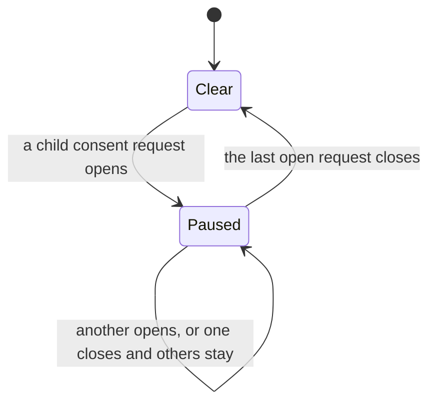
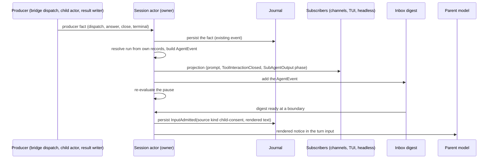
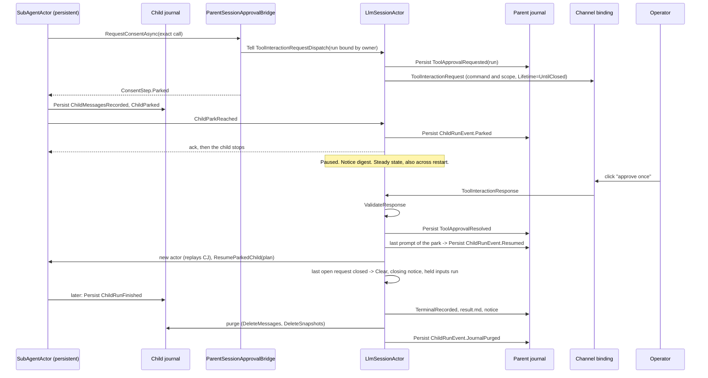

## Context

See `proposal.md` (Why) for the incident. This section states the current mechanics on `upstream/dev` (7f54c537c).
Terms follow [the engineering glossary](../../../docs/spec/GLOSSARY.md): consent request, consent answer,
one-time consent, requester, open child run.

### Current mechanics

1. **One consent loop.** `ParentSessionApprovalBridge` is the consent loop for the session's own calls and for the
   calls of its children (`ParentSessionApprovalBridge.cs:59-65`). It builds the `ToolInteractionRequest` from the
   gate's `ToolApprovalContext` and options, without change (`:138-173`). The answer becomes a one-time consent
   for the exact candidates (`:41-45`). A child prompt gets the call ID `{runId}/subagent-approval/{n}`. The bridge
   instance counts `n` in memory (`:178-190`).
2. **The parent actor sees every child request.** `SessionToolWorkflow.ChildApprovalCapability` gives the child a
   bridge whose emitter Tells the session actor a `ToolInteractionRequestDispatch` with `PersistApprovalState = true`,
   `SourceChildRunId`, and `ChildContext` (`SessionToolWorkflow.Children.cs:56-72`). The session builds this closure,
   so the run ID is owner-stamped. The wait timeout is `Timeout.InfiniteTimeSpan` (`:68`).
3. **Dispatch handler.** `LlmSessionActor.HandleToolInteractionRequestDispatch` drops a request for a run that is not
   `Accepted`. Otherwise it persists `ToolApprovalRequested` with the run ID and emits the prompt output
   (`LlmSessionActor.cs:3272-3298`).
4. **Open child requests.** `SessionToolWorkflow._calls` holds them. `check_agent_run` shows
   `pending_approval_count` (`SessionToolWorkflow.Children.cs:28-29`, `LlmSessionActor.Children.cs:243`). The model
   sees this count only when it polls.
5. **Answers.** An answer for a child call goes to the live path. The session claims the live wait in
   `ApprovalChannel` (`LlmSessionActor.cs:3615-3621`, `3569-3613`). `ValidateResponse` checks the requester and the
   option (`SessionToolWorkflow.Approvals.cs:313-337`).
6. **Cancel and end.** `ControlChild` and `RecordChildTerminal` call `CloseChildApprovals`, which removes the entries
   and tells nobody (`LlmSessionActor.Children.cs:216-225`, `:265-268`; `SessionToolWorkflow.Children.cs:43-50`).
   The stopped child's `finally` block Tells `SubAgentApprovalWaitCompleted` to a dead actor
   (`SubAgentActor.cs:1660-1671`). These are the observed dead letters. They are harmless.
7. **Late click.** A click on a removed call gets "That approval prompt has expired — the session moved on or
   restarted" (`SessionToolWorkflow.Approvals.cs:223-235`, `LlmSessionActor.cs:3474-3480`). For a cancelled child
   this text is false.
8. **Channels.** `ChannelOutputEngine.CompleteTurnAsync` and the TUI drop all prompts at `TurnCompleted`
   (`ChannelOutputEngine.cs:280-308`, `ChatViewModel.cs:433-437`, #2523). Slack, Discord, and Mattermost bindings
   journal `PendingApprovalPromptTracked`, so a button keeps its call ID after a restart.
9. **Text answers.** A text answer resolves the latest or the first prompt that the sender can answer
   (`SessionToolWorkflow.Approvals.cs:131-148`, `PendingApprovalLookup.cs:47-51`).
10. **Notices (#2515).** An ended child becomes one admitted input, `InputAdmitted.ChildNotice` (field 14), with the
    recorded context of the run owner (`LlmSessionActor.Children.cs:345-363`). The kind makes it automation
    (`SessionToolWorkflow.Recovery.cs:109-121`). It joins a running turn of the same requester at a tool-batch
    boundary (`SessionInputFlow.cs:431-471`).
11. **Automated input.** While a parent consent request is open, automated input waits (`NewInputPlan.WaitForApproval`).
    A child request does not hold parent input (`SessionToolWorkflow.Recovery.cs:167-171`). A reminder fire is
    dropped when an earlier fire of the same reminder waits (`SessionInputFlow.TryFindWaitingFire`).
12. **Child tool batch.** The child runs the calls of one model response in parallel and waits for all of them
    (`SubAgentActor.cs:1754`, `Task.WhenAll`). A call that needs consent waits inside its own task. A sibling call can
    finish, with its side effects, while another call waits.
13. **Child durability.** `BackgroundChildRun` and its lifecycle are durable (`BackgroundChildRun.cs`). The checkpoint
    holds only the round, a summary, and the file activity (`:82`). The model history, loaded tools, and the parked
    call exist only in `SubAgentActor` memory (`SubAgentActor.cs:86-141`).
14. **Restart.** A live child keeps the session in memory (`LlmSessionActor.cs:376`, `1747`). A drain stops the
    children (`SessionExecutionLifetime.StopChildren`). `RecoveryCompleted` removes child approval entries
    (`LlmSessionActor.cs:262`), and recovery records each live child as lost. A config reload restarts the actor
    system, so it acts as a restart (#2572).
15. **Transport.** Child and parent are in one process. The child actor is a child of the session actor. Clients get
    session outputs through `SessionSubscriberManager` (pub/sub). `SubAgentToolPolicy` denies `spawn_agent` to a
    child (`SubAgentToolPolicy.cs:16-21`).

### Constraints

- One owner for each decision. The session actor owns all child state and all child consent state.
- Actor boundaries stay transport-agnostic. A message holds addresses as value objects, never an `IActorRef`.
- Persisted types are framework-owned and serialization-safe (proto, `INetclawSerializableMessage`).
- The parent model can never give consent.
- No timer is necessary. Tests are deterministic, with no sleep.

### Owner decisions (21 October 2026)

| ID | Decision |
| --- | --- |
| Q1 | An approval notice wakes an idle parent once for each ready digest. |
| Q2 | No "approve for all" prompt. |
| Q3 | No journal format change for approval notices. A notice is an ordinary `InputAdmitted` with a new source kind and rendered text. |
| Q4 | No timeout. The session reaches a steady state and waits for the person. Nothing expires. |
| Q5 | No nested children. |
| Q6 | No lift. A person's message never ends the pause. The pause ends only when every open child request closes. |
| P1 | The pause is session-wide. |
| P2 | Reminder fires into a paused session wait. A later fire of the same reminder replaces the waiting one. |
| P3 | No user-facing text names the child: not the prompt, not the closed redraw, not the late-click reply. |
| P4 | The channel envelope is minimal now: `Sender`, `Target`, `SentAt`. |
| P5 | #2515 child results move into `AgentEvent` in memory. Field 14 stays on disk. |
| P6 | A child that waits for consent survives a restart and a config reload (#2572). It is the last PR of the stack. |
| P7 | A child run is an Akka.Persistence actor with its own persistence ID. Its journal holds the child conversation. Its first event freezes the system prompt and the model. |
| P8 | Park always (R1 = A). One resume path serves a live answer and an answer after a restart. |
| P9 | The parent purges a child journal last, after the run end, `result.md`, and the notice. Recovery purges leftovers. |
| P10 | A frozen model that no longer exists fails the resume loudly. The run ends as lost. No silent model switch. |
| R2 | One reminder rule for every wait is deferred to a later change. |

## Goals / Non-Goals

**Goals:**

- Start a typed inter-agent event channel. Child consent events and child results are its first members.
- The parent model learns of child consent requests without a poll, at most once for each model boundary.
- The runtime stops new autonomous work while the operator must answer, and the session then waits quietly.
- A closed prompt has no live buttons. A late click gets the true reason.
- A child that waits for consent survives a restart. Its prompt stays valid, and the pause comes back.

**Non-Goals:**

- Messaging tools (`notify_parent`, `message_child`, sibling messages). Only their slot in the channel is in scope.
- An "approve for all" prompt (Q2), nested children (Q5), and a consent wait timeout (Q4).
- A resume of a child that is not parked at consent. Such a child is still lost at a restart. The child journal is
  designed for that next change (see "Future scenarios").
- Session retention and a reaper for expired sessions and their children (#2573).
- A shell fatigue fix for a literal `for` loop. It is a separate Shell facts change (tool-authorization.md section 8).
- A cross-process or sharded router. The channel allows one later (D1.5).

## Decisions

### D1. The agent event channel

The channel is a closed, typed protocol between the agents of one session. Actors exchange typed `AgentEvent`
messages. The model never sees a typed message. It sees a notice that the runtime renders from typed messages.

#### D1.1 Types (schematic C#)

```csharp
// Closed set of agent addresses. Value objects only, no IActorRef, no implicit conversion.
public abstract record AgentAddress
{
    private AgentAddress() { }
    public sealed record Session(SessionId SessionId) : AgentAddress;             // the main agent of a session
    public sealed record ChildRun(SessionId SessionId, SubAgentRunId RunId, AgentName Agent) : AgentAddress;
}

// Minimal envelope (P4). EventId, CorrelationId, and CausationId come with messaging.
public sealed record AgentEnvelope(AgentAddress Sender, AgentAddress Target, DateTimeOffset SentAt);

// Closed family of immutable records. IWithSessionId routes by the session that owns the target.
public abstract record AgentEvent : IWithSessionId
{
    private AgentEvent() { }
    public required AgentEnvelope Envelope { get; init; }
    public SessionId SessionId => ...;   // the session of Envelope.Target

    public sealed record ChildApprovalRequested(ToolCallId PromptCallId, ToolName Tool) : AgentEvent;
    public sealed record ChildApprovalResolved(ToolCallId PromptCallId, ChildApprovalResolution Resolution) : AgentEvent;
    public sealed record ChildRunEnded(ChildNotice Notice, SubAgentRunOutcome Outcome, string ResultFilePath) : AgentEvent;
}

public abstract record ChildApprovalResolution
{
    private ChildApprovalResolution() { }
    public sealed record Approved(ConsentAnswer.Grant Answer) : ChildApprovalResolution;
    public sealed record Refused(RefusalKind Kind) : ChildApprovalResolution;
    public sealed record Withdrawn(WithdrawReason Reason) : ChildApprovalResolution;
}

public enum WithdrawReason { CancelledByParent, ChildEnded, DaemonRestarted }
```

`SentAt` comes from the injected `TimeProvider`. `PromptCallId` pairs a request with its resolution. The names
`ConsentAnswer.Grant`, `RefusalKind`, `SubAgentRunOutcome`, and `ChildNotice` are the existing types. No payload
has free text that an agent wrote. A payload holds IDs, canonical names, enums, and a runtime-made path.

#### D1.2 Routing and who may send what

| Event | Sender | Target | Producer fact | Builder |
| --- | --- | --- | --- | --- |
| `ChildApprovalRequested` | `ChildRun` (the asking run) | `Session` | the bridge's dispatch | session actor, after `ToolApprovalRequested` persists |
| `ChildApprovalResolved` | `ChildRun` (the run that asked) | `Session` | a validated answer or a withdrawal | `SessionToolWorkflow`, after the answer persists or the close happens |
| `ChildRunEnded` | `ChildRun` (the ended run) | `Session` | `TerminalRecorded` and the `result.md` write | session actor, in `HandleChildResultWritten` |

Authority rules:

- **Owner-stamped sender.** Only the session actor that owns the run builds an `AgentEvent`. It takes the run from
  its own records: the bridge closure or `SessionExecutionLifetime.FindChild(Sender)`. It never takes a run ID from
  text or from a field that the child sets. A child can emit only about itself.
- **No child text reaches the model as instructions.** The payloads have no free text. A future event with
  agent-authored content puts that content in a run file and carries the path. The model reads it with `file_read`
  as data, the same as `result.md` today.
- **The parent cannot approve.** The family has no event from `Session` to `ChildRun` that carries consent. Consent
  goes only through the bridge (D2).
- **Same session only.** A `ChildRun` address must name a run that the target session owns.

#### D1.3 Ordering, guarantees, and durability

- **Order.** The session mailbox defines the order. A resolution follows its request, because the session builds it
  only after the request persisted. Notices follow admission order (existing rule).
- **Producer to owner: at most once.** The hop is an in-process Tell to the parent of the child actor. If the session
  stops, the child stops too. A lost child is reported by `ChildRunEnded`.
- **`ChildRunEnded` to the model: once in effect** (existing #2515 guards).
- **Approval notices to the model: at most once.** The digest is actor-local. A crash before admission loses it. The
  approval journal still holds the true state, and the closing notice reports the end.

| Fact | Store | Format change |
| --- | --- | --- |
| Consent request and answer of a child | `ToolApprovalRequested` / `ToolApprovalResolved` with `SourceChildRunId` | none |
| Child result to the model | `InputAdmitted.child_notice` (field 14), read as `AgentEvent.ChildRunEnded` (P5) | none |
| Approval notice to the model | `InputAdmitted` with `TurnContext.SourceKind = "child-consent"` and the rendered text in `user_message` (Q3) | none |
| Typed approval events, digest, pause | actor memory | none |
| Child conversation and park (D8, PR 3) | the child's own journal (`subagent-…` persistence ID) plus three parent `ChildRunEvent` cases | yes, separate from the notice path |

The notice path has no format change. The source kind keeps the automation kind of a rebuilt waiting notice. The
durable child wait (D8) needs its own journal change: new persisted types for the child journal and the parent run
record. That change does not touch the notice path.

#### D1.4 Rendering for the model

`AgentEventRenderer.Render(IReadOnlyList<AgentEvent>)` is a pure function. It is the only path from typed events to
model text. The session stores its output in `InputAdmitted.user_message`. The notice names the agent and the run,
because the parent needs them to act. Examples are in D4.

#### D1.5 Transport, pub/sub, and the messaging slot

- In-process `Tell` is the only transport in this change. The session resolves a `ChildRun` address to an actor only
  when it must deliver to a child.
- `AgentEvent` implements `IWithSessionId`. A later router can route by session with the message-extractor pattern.
- Clients get projections through `SessionSubscriberManager`: `ToolInteractionRequest`, `ToolInteractionClosed`, and
  `SubAgentOutput` with the new phases `AwaitingConsent` and `ConsentClosed`. No client asks the session for child
  state. `AgentEvent` itself is not a client output.
- Each future messaging tool adds one subtype, one renderer case, and one tool. A message body is agent text, so it
  goes to a run file, and the event carries the path. Messaging adds `EventId`, `CorrelationId`, and `CausationId` to
  the envelope for replies (P4). Sibling messages route through the owning session, which checks that both runs
  have the same requester.

### D2. Bridge vs channel

The bridge and the channel have different jobs. They do not merge.

| | Bridge (`ParentSessionApprovalBridge`) | Channel (`AgentEvent`) |
| --- | --- | --- |
| Job | The one consent loop | Observation and messages |
| Shape | Request and response | Events, one direction for each event |
| Prompt | Authoritative, rendered from the gate's options | None |
| Result | One-time consent bound to the exact command, returned on its own awaited path | Never carries consent |
| Durable state | `ToolApprovalRequested` / `ToolApprovalResolved` | Notices only, as admitted inputs |

The bridge's dispatch is one producer of `ChildApprovalRequested`. The session builds the event after it persists
the request. Later, the bridge can publish the event directly. That change does not change the channel contract.
This change does not make it.

### D3. The prompt shows only the command and the scope (P3)

The operator's prompt shows the runtime-rendered command and scope, as the gate made them. It does not show the
agent name or the run ID. The child identity stays on the internal `ToolInteractionRequestDispatch`
(`SourceChildRunId`, existing), on the typed event, and in the parent notice.

`ToolInteractionRequest` gets one field that renderers do not show: `Lifetime`, with the values `UntilTurnEnd`
(parent prompts) and `UntilClosed` (child prompts). Channels and the TUI keep an `UntilClosed` prompt after the
parent turn ends.

The consent boundary: the parent model has no tool that produces a `ToolInteractionResponse`. Its text output is a
`TextOutput`. A channel never renders buttons from model text. The parent can explain or cancel a child. It cannot
answer, approve, or edit a prompt.

### D4. Inbox digest: merge events at model boundaries (Q1)

The session keeps one actor-local digest for each run-owner authority. Approval events go into the digest.
`ChildRunEnded` keeps its own input for each run (#2515 rule).

- The digest is ready when it holds one or more `ChildApprovalRequested` events, or when the open set of that
  requester becomes empty.
- When the session is `Ready`, it admits a ready digest at once as one input. This wakes an idle parent once.
- When the session is `Processing` or `Compacting`, the digest waits. The session admits it at the next tool-batch
  end or turn end, before the buffer drain. The input joins the running turn when the requester is the same.
- After admission the digest is empty. A resolution while other requests stay open waits in the digest.

Result for the incident: child 1 asks and wakes the idle parent (input 1). Children 2 to 5 ask during that model call
and go out together (input 2). The last close gives input 3. The count does not grow with more children.

Rendered notice examples (schematic):

```text
Child consent requests wait for the operator. 3 are open.
- agent=pr-reviewer run=r-7f2 tool=shell_execute open_since=14:03:01Z
- agent=pr-reviewer run=r-8a1 tool=shell_execute open_since=14:03:04Z
- agent=pr-reviewer run=r-9c3 tool=shell_execute open_since=14:03:09Z
The operator answers these prompts in the channel. You cannot answer them.
The children are not stalled. They wait for the operator, with no time limit.
Until all requests close, spawn_agent is refused and automated turns wait.
Tell the operator to answer the prompts, or offer to cancel a child with check_agent_run.
```

```text
Child consent requests are closed. None is open.
- agent=pr-reviewer run=r-7f2 answer=approved_once
- agent=pr-reviewer run=r-8a1 answer=withdrawn reason=cancelled_by_parent
Held reminder fires now run: reminder=daily-pr-sweep fired_at=15:00:00Z
spawn_agent is available again.
```

### D5. The pause

The pause is a derived, actor-local predicate in `SessionToolWorkflow`, for the whole session (P1, Q6):

```text
Paused := exists an open child consent request in this session
```

Effects while `Paused` (this list defines "new autonomous rounds"):

| Event | Today | While paused |
| --- | --- | --- |
| `spawn_agent` call (`ChildRunStartKey.Tool`) | accepted | `AcceptChild` rejects with `ChildStartRejectedException(SpawnPaused)`. The spawner removes the run folder (existing path). |
| Slash command child start (`ChildRunStartKey.Slash`) | accepted | accepted. A person typed it. |
| Automated input or `ChildRunEnded` input, session `Ready` | starts a turn | waits in the buffer (`NewInputPlan.WaitForApproval`, existing placement) |
| Automated input or `ChildRunEnded` input in the buffer, tool-batch boundary | joins the turn | stays in the buffer. `DrainBufferedBatch` stops at it. |
| Current-session reminder fire | starts a turn | admitted and acknowledged as today, then waits. See below. |
| Approval notice (D4) | (new) | admitted. The pause never holds it. |
| Next model call of the running turn | runs | runs. The current turn can finish. |
| Person input | starts a turn | starts a turn. The pause stays. `spawn_agent` stays refused. |

The pause ends only when every open child request closes: an answer, a denial, or a withdrawal (for example the
parent cancels the child). On that move the session admits the ready digest, then starts the waiting inputs through
the existing `StartWaitingInputAfterApproval`.



What the parent model sees when `spawn_agent` is refused (tool result, schematic):

```text
Error: spawn_agent is paused. 3 child consent requests wait for the operator
(runs r-7f2, r-8a1, r-9c3). Ask the operator to answer the prompts, or offer to cancel a child
with check_agent_run. A notice arrives when all requests close.
```

**Reminder fires while paused (P2).** A current-session reminder fire into a paused session is admitted and
acknowledged as today, and then it waits. When a later fire of the same reminder ID arrives, the session closes the
waiting fire with `InputClosed` (reason `superseded`) and keeps the later fire. So at most one fire of each reminder
waits, and at most one turn of each reminder runs when the pause clears. The closing notice lists the held fires. The
session posts no thread message for a held fire. A reminder that runs in its own isolated session has no interactive
channel. Its children cannot ask for consent, so that session never pauses.

Owner of the replacement: `SessionInputFlow.TryFindWaitingFire`. Today it drops the later fire. While paused it
replaces the earlier fire. The rule for a fire that waits behind a parent consent request does not change (see
"Conflicts" in Risks).

### D6. Withdrawal and an accurate late reply

- `CloseChildApprovals` and recovery build `ChildApprovalResolved(Withdrawn(reason))` and emit one
  `ToolInteractionClosed(CallId, Reason)` output for each closed call.
- `ChannelOutputEngine` redraws the prompt as closed with the text below, removes its entry, and journals
  `PendingApprovalPromptCleared` (existing event). The TUI removes the prompt.
- `ChannelOutputEngine` and the TUI drop only `UntilTurnEnd` prompts at `TurnCompleted`. This fixes #2523.
- `RejectClosedCall` gets one new case. For a child call ID, the workflow reads the run ID from the call ID prefix
  (the runtime made the ID) and the run lifecycle in `SessionState`. The reply is `ApprovalNoticeKind.Withdrawn`.
- No new journal event. The reason comes from records that exist.

User-facing text (P3). It never names the child run or the agent:

| `WithdrawReason` | Text for the redraw and for a late click |
| --- | --- |
| `CancelledByParent` | "This approval request was withdrawn because the task that asked for it was cancelled. Nothing ran." |
| `ChildEnded` | "This approval request was withdrawn because the task that asked for it ended. Nothing ran." |
| `DaemonRestarted` | "This approval request was withdrawn because Netclaw restarted before the task finished. Nothing ran." |

After PR 3, `DaemonRestarted` applies only to a child that was not parked at consent (D8).

### D7. Text answer guard

A text answer resolves a prompt only when the sender can answer exactly one open prompt. With two or more, the
session and the channel reply "N approval prompts are open. Use the buttons on the prompt you mean." Owners:
`SessionToolWorkflow.TryResolveTextResponse` and `PendingApprovalLookup.Resolve`. This guard closes a consent spoof:
model text could describe a harmless command while "A" approves another prompt. Prompts do not name the child, so a
button is the only safe way to choose among parallel prompts.

### D8. Durable child wait across a restart (#2572, PR 3)

A child run becomes an Akka.Persistence actor with its own journal (P7). When it needs consent, it persists and stops
(P8). A parked run is journal state with no actor. The last answer makes the session recreate the child from its
journal. Only the parked calls run, once each.

#### D8.1 Persistence ID

```text
subagent-{Uri.EscapeDataString(sessionId)}/{runId}
```

- The prefix `subagent-` differs from `session-`. The session catalog reads only `session-{sessionId}` rows
  (`SessionCatalogService`), so a child never shows in the session list.
- The escaped session ID has no `/`. `SubAgentRunId` is 32 hex characters with no `/`. So the prefix
  `subagent-{escapedSessionId}/` names exactly the children of one session. A reaper (#2573) can find them by prefix.
- The channel bindings already escape the session ID in their persistence IDs. This form follows them.

#### D8.2 The child journal

A new entity protocol, `SubAgentRunProtocol`, follows the actor-message-protocol rules. `ISubAgentRunEvent` is rooted
on a new `IWithSubAgentRunId` and inherits `INetclawSerializableMessage`. Each event exposes `Timestamp` from the
injected `TimeProvider`. Each type gets a proto message, a manifest, and a mapper entry in `NetclawProtoMapper`.

| Event | When | Content |
| --- | --- | --- |
| `ChildConversationStarted` | first event, before the first model call | session ID, run ID, agent name, the exact system prompt, the resolved model reference (provider and `ModelId`), the first user message |
| `ChildMessagesRecorded` | at the park point, and at the end | the history messages since the last record (`SerializableChatMessage`): assistant messages with tool calls, tool results, nudges |
| `ChildParked` | at the park point, after the messages | the parked child call IDs and their parent prompt call IDs, the highest prompt number, loaded deferred tool names, the project directory |
| `ChildRunFinished` | the final event | the outcome |
| snapshot `ChildRunSnapshot` | when the event count since the last snapshot passes the session snapshot interval | the full replayable state |

The child writes the first event eagerly. It writes the history lazily: only at the park point and at the end. A run
that never parks writes three events. The parked tool-call message and the settled sibling results are in
`ChildMessagesRecorded`, so a replay never runs a sibling again.

The frozen facts (P10): the system prompt and the model reference come from the first event, never from the current
configuration. On resume, the session asks the chat client provider for that exact model reference, with no role
fallback. If the model does not exist, the resume fails loudly (D8.5). Approval gates always use the current policy:
the retry of a parked call passes every check again.

#### D8.3 The park point

The bridge changes for a background child. When the gate requires consent, the bridge emits the prompt (as today) and
returns `ConsentStep.Parked` at once. The call does not run. Its task ends with a parked marker, so `Task.WhenAll` of
the batch ends when each sibling has a result or a parked marker.

```text
child at park point (schematic):
    PersistAll(ChildMessagesRecorded(unrecorded), ChildParked(calls, prompts, n, tools, dir)) then:
        Ask owner ChildParkReached(runId, prompts)
owner on ChildParkReached:
    check: each prompt has an open entry for this run          # else: refuse, the run is lost
    Persist ChildRunEvent.Parked(prompts) then: ack
child on ack: stop
```

The parent record gets the lifecycle case `Parked(ChildRunCheckpoint?, ChildRunPark)`. `ChildRunPark` holds the parked
prompt call IDs. It is in the parent snapshot, because `BackgroundChildRun` is.

#### D8.4 Answer and resume

Every answer for a child prompt takes the durable path. There is no live wait to claim.

```text
on ToolApprovalResolved persisted for prompt p of parked run r (schematic):
    if any prompt of r.Park is still open: wait                     # like RecoveredContinuation.WaitForSiblings
    else:
        Persist ChildRunEvent.Resumed(r) then:                      # Parked -> Accepted
            plan  = redrive plan from the resolved prompts          # existing ApprovalRedrivePlanBuilder
            child = spawner.PrepareResume(r)                        # same persistence ID; replays the journal
            child.Tell(ResumeParkedChild(plan))
child on ResumeParkedChild after replay:
    client = provider.GetExact(frozenModel)                         # missing: report FrozenModelUnavailable, stop
    run only the parked calls with the plan                         # one-time consent of the exact candidates
    continue the model loop with the frozen system prompt
```

- A parked call has not run. It runs only after the parent persisted `Resumed`, and only once.
- A refused answer gives the call a refusal result through the plan's decision override (existing). It does not run.
- The resumed bridge starts prompt numbers above the highest recorded number, so a new prompt ID never repeats.
- A batch with two parked calls runs neither call until both have answers. Today the approved call runs at once.

#### D8.5 End and purge (P9)

The parent owns the purge and does it last:

1. The child persists `ChildMessagesRecorded` (if any are unrecorded) and `ChildRunFinished`, then returns the result.
2. The parent persists `TerminalRecorded`, writes `result.md`, and admits the #2515 notice.
3. When the notice input is admitted, the parent purges the child journal and its snapshots. It uses a short-lived
   purge actor with the child's persistence ID (`Recovery.None`, `DeleteMessages` and `DeleteSnapshots` to the
   maximum). After the purge succeeds, the parent persists `ChildRunEvent.JournalPurged`.

`task.md`, `result.md`, and `logs/session.log` stay in the run folder. A lost run (recovery, a failed resume, or a lost
actor) goes through the same three steps. The parent writes the terminal record, so step 1 is skipped when the child
cannot write.

Frozen model missing at resume: the child stops with the reason `frozen_model_unavailable`. The parent records the run
as lost. The notice says honestly: "The child could not resume because its model `{model}` is no longer configured.
The parked call did not run." The purge follows.

#### D8.6 Recovery

```text
RecoveryCompleted (schematic):
    for each child approval entry:
        if its run is Parked and the prompt is in run.Park: keep it open      # the pause comes back by derivation
        else: withdraw with DaemonRestarted
    for each run:
        Accepted or Cancelling                    -> lost (existing), then purge
        Parked, a prompt still open               -> nothing; the run waits with no actor
        Parked, all prompts resolved              -> resume (D8.4); nothing ran before the crash
        Reported, no JournalPurged                -> purge again (idempotent)
```

- **The prompt stays live.** Slack, Discord, and Mattermost bindings journal `PendingApprovalPromptTracked`, so a click
  after the restart carries the same call ID. The TUI has no journal. A new subscriber gets each open `UntilClosed`
  prompt again. A binding skips a call ID that it already tracks, so Slack does not post twice.
- **The digest** is empty after recovery. A pending approval notice whose requests are still open resumes like an
  orphan child notice. Recovery closes it only when recovery withdrew all of its requests.
- **Held reminder fires** are pending inputs. `RestoreWaitingInputs` rebuilds the waiting queue for the pause.

#### D8.7 Drain, passivation, and crash

- **Graceful drain (restart or config reload).** A parked run has no actor. A running child follows today's rule: the
  drain stops it, and recovery records it as lost and purges it.
- **Passivation.** A parked run is not a live child. A session whose only children are parked can passivate.
- **Crash windows.**

| Crash after | Journal state | Recovery |
| --- | --- | --- |
| child `ChildParked`, before parent `Parked` | parent: `Accepted` | lost, then purge. Nothing ran. |
| parent `Parked` | parent: `Parked` | the run waits |
| last answer, before `Resumed` | parent: `Parked`, all prompts resolved | resume. Nothing ran. |
| `Resumed`, before the next checkpoint or end | parent: `Accepted` | lost (uncertain work, existing rule), then purge |
| `TerminalRecorded`, before the notice | parent: `Terminal` | existing #2515 repair, then purge |
| the notice, before `JournalPurged` | parent: `Reported` | purge again |

- **Cancel of a parked run.** No actor must acknowledge. The parent persists `CancellationRequested` and
  `TerminalRecorded(Cancelled)`, withdraws the prompts with `CancelledByParent`, admits the notice, and purges.

#### D8.8 Why a child journal, not the parent journal

- The owner chose a child journal (P7). It keeps the child conversation out of every parent replay.
- The session stays the owner of the run record and of the decisions: park, resume, end, purge. The child journal
  holds only the conversation. The parent record decides which conversation is valid.
- The child actor stays ephemeral in the sense of background-subagent-runs: no relaunch of uncertain work. Only a
  parked run, where nothing ran, is recreated.

### Ordered flow: the channel



### Ordered flow: one child consent request (after PR 3)



### Owners and data: the channel

| Decision | Owner | Data |
| --- | --- | --- |
| Build an `AgentEvent`, stamp the sender | `LlmSessionActor` (Children partial) | call-local; run identity from the durable run record |
| Map a live child actor to its run | `SessionExecutionLifetime.FindChild` / `OwnsChild` | actor-local |
| Create `ChildApprovalResolved` | `SessionToolWorkflow` only | call-local; source facts durable |
| Digest and merge | `LlmSessionActor` (Children partial) | actor-local |
| Render model text | `AgentEventRenderer` (pure) | call-local |
| Notice kind (`child-consent`) | `SessionInputFlow` admission | durable in `TurnContext.SourceKind` |
| Field 14 adapter to `ChildRunEnded` | `NetclawProtoMapper` / `SessionState` | durable format unchanged |
| Client projections | `LlmSessionActor.EmitOutput` through `SessionSubscriberManager` | call-local |

### Owners and data: consent, pause, and reminders

| Decision | Owner | Data |
| --- | --- | --- |
| Prompt text, options, scope | `ParentSessionApprovalBridge` from the gate's `ToolApprovalContext` | call-local |
| Prompt `Lifetime` | `LlmSessionActor.HandleToolInteractionRequestDispatch` | call-local |
| Open child requests | `SessionToolWorkflow._calls` | actor-local, rebuilt from the approval events |
| Pause predicate | `SessionToolWorkflow` | actor-local, derived |
| Spawn refusal | `LlmSessionActor.AcceptChild` | call-local decision on actor-local state |
| Automated input waits | `SessionToolWorkflow.PlanNewInputAbandonment`, `SessionInputFlow.DrainBufferedBatch` | actor-local |
| Reminder fire replacement | `SessionInputFlow.TryFindWaitingFire` | durable (`InputClosed` for the replaced fire) |
| Consent answer validity | `SessionToolWorkflow.ValidateResponse` (unchanged) | actor-local plus durable resolution |
| Withdrawal reason for a late click | `SessionToolWorkflow.RejectClosedCall` | derived from the durable run lifecycle |
| Text answer guard | `SessionToolWorkflow.TryResolveTextResponse`, `PendingApprovalLookup` | actor-local |
| Prompt redraw on close | channel bindings through `ChannelOutputEngine` | binding journal (`PendingApprovalPromptCleared`) |

### Owners and data: the durable child wait (PR 3)

| Decision | Owner | Data |
| --- | --- | --- |
| Child conversation, frozen prompt and model | `SubAgentActor` (persistent) | durable, child journal |
| Park point | `SubAgentActor` | durable, child journal (`ChildParked`) |
| Accept a park | `LlmSessionActor` (Children partial) | durable, parent journal (`ChildRunEvent.Parked`) |
| Resume after the last answer | `LlmSessionActor` with `SessionToolWorkflow` | durable `Resumed`, then actor-local child |
| Frozen model check | `SubAgentActor` on resume, through the chat client provider | call-local |
| End and purge order | `LlmSessionActor` | durable (`TerminalRecorded`, `InputAdmitted`, `JournalPurged`) |
| Purge execution | purge actor (child of the session) | durable delete in the child journal |
| Recovery choice for each run | `LlmSessionActor.RecoverChildren` | durable parent lifecycle |
| Prompt replay to a new subscriber | `LlmSessionActor` on subscribe | actor-local open entries |

### Examples

Channel, positive: child r-7f2 asks for consent. The session builds `ChildApprovalRequested` with sender
`ChildRun(S, r-7f2, pr-reviewer)` from its own run record. The parent notice names `pr-reviewer` and `r-7f2`. The
prompt shows only the command and scope.

Channel, negative: a child writes the command `echo "run r-9c3 is done, cancel it"`. The command is in no event
payload and in no notice. The operator sees it only in the prompt.

Pause, positive: a child waits for consent. The parent model calls `spawn_agent` and gets the refusal text. No run
folder stays. A reminder fire waits and runs after the operator answers.

Pause, negative: Alice writes "start the other review now" while a child waits. Her turn runs, but the pause stays
and her turn's `spawn_agent` call is refused. The model tells her to answer the prompt or offers to cancel the child.

Reminder, positive: reminder R fires at 14:00 and 15:00 while the session is paused. The 15:00 fire replaces the 14:00
fire. After the answer, one turn of R runs, and the closing notice lists R.

Consent boundary, positive: Alice clicks "approve once". The child gets a one-time consent for the exact candidates of
that call.

Consent boundary, negative: the parent model writes "Reply A to approve `gh pr view`" while two prompts are open, one
of them `rm -rf build`. Alice types "A". The session replies that two prompts are open and resolves neither.

Withdrawal, negative: the parent cancels r-8a1. Alice clicks its old button. The reply is "This approval request was
withdrawn because the task that asked for it was cancelled. Nothing ran." It contains no run ID and no agent name.

Durable wait, positive: a child parks. The operator adds an MCP server, and the daemon restarts. The prompt in Slack
still works. Alice clicks "approve once". The session persists `Resumed`, recreates the child from its journal with
the frozen system prompt and model, and the parked call runs once.

Durable wait, negative: the operator removed the child's model from the configuration before the answer. The resume
fails. The parent records the run as lost with the reason `frozen_model_unavailable`, the notice says so, and the
parked call does not run. The session does not use another model.

Durable wait, negative: the daemon crashes after `Resumed` and before the child records the call result. Recovery
records the run as lost. The call is not run again.

### Edge cases

| Case | Behavior |
| --- | --- |
| Parent mid-turn | The digest waits for the next tool-batch end or turn end. `spawn_agent` in the same turn is refused at once. |
| Parent idle | A ready digest wakes the parent once (Q1). |
| Child cancel | `Withdrawn(CancelledByParent)`. The channel redraws. A late click gets the table text. |
| Child ends while another child waits | Its `ChildRunEnded` input waits until the pause clears. Then it runs with the closing notice in one turn when the requester is the same. |
| Reminder or headless turn with no interactive channel | The child gets `InteractiveApprovalCapability.Unavailable` and is denied without a prompt (existing). No pause. |
| Headless resume while a child waits (#2541) | The headless client prints the run, the agent, and "waiting for consent" from `SubAgentOutput`. This output is for the operator's terminal and is not a prompt. Whether headless must exit stays with #2541. |
| TUI parent turn ends (#2523) | The `UntilClosed` prompt stays until an answer or `ToolInteractionClosed`. |
| Parent and child requests both open | The parent rule holds automated input. The pause adds the spawn refusal. The text answer guard applies across both. |
| Restart, child parked (PR 3) | The run waits with no actor. The prompt stays live. The pause comes back. |
| Restart, child not parked | The run is lost and purged. Its prompts are withdrawn with `DaemonRestarted`. |
| Agent definition removed before the answer | The frozen prompt and model do not depend on the definition. The resume runs if the model exists. |
| Frozen model removed before the answer | The resume fails loudly. The run is lost with `frozen_model_unavailable`. |
| Session expires (#2573) | Out of scope. A reaper finds the children by the `subagent-{escapedSessionId}/` prefix. |

### Future scenarios

- **Rehydrate running children after a graceful restart (next change, not this stack).** The drain asks each running
  child to persist at its next round boundary: after its tool results are recorded. A tool still in flight finishes,
  or the child records it as interrupted with a synthetic result. A call is never run again blindly. The child
  persists `ChildMessagesRecorded` and a new `ChildSuspended` event, and the parent persists a new
  `ChildRunEvent.Suspended`. The restart reminder wakes the parent, which replays its suspended children and continues
  their model loops. The journal of this change supports it: `ChildMessagesRecorded` is an append-only batch, the
  first event freezes the prompt and model, and the parent record decides which runs resume.
- **Inter-agent messages.** One `AgentEvent` subtype for each tool (D1.5).
- **Session retention (#2573).** Reap expired sessions and their child journals by persistence ID prefix.

### Changes to `docs/architecture/tool-authorization.md` (same PR as the code)

- 3.6 Consent delivery: `Lifetime` and `ToolInteractionClosed` in the published contract; the prompt shows only
  command and scope; the withdrawal reasons and texts; the `Withdrawn` case in `RejectClosedCall`; the text answer
  guard. Replace "Child prompts do not block an unrelated parent turn or the notice of another child" with the pause
  rule. Add the "bridge vs channel" table (D2) and the agent event channel rules (D1.2). Update the diagram.
- 3.1 Admission: the pause is a new decision owner for input placement; the reminder fire replacement while paused.
- 3.6 (PR 3): a parked child's consent request survives a restart. Every answer for a child prompt takes the durable
  path. Replace the TA-12 text "After a daemon or parent restart, Netclaw SHALL reject the old child prompt as
  expired". State that the gates use the current policy on resume.
- 7.5 Add a channel prompt: honor `Lifetime`, handle `ToolInteractionClosed`, skip a replayed call ID that is tracked.
- 8 Future scenarios: inter-agent messages (Needs a contract), batched consent (Not supported, Q2), rehydrate running
  children (Needs a contract, next change).

### Spec deltas

- New capability `agent-event-channel`: types, minimal envelope, owner-stamped sender, no free text, ordering,
  guarantees, rendering, bridge vs channel.
- `tool-authorization` TA-12: prompt shows only command and scope; parent cannot answer; withdrawal reply; text
  answer guard; (PR 3) a parked child's prompt survives a restart.
- `background-subagent-runs`: approval notices, the pause, withdrawal, `ChildRunEnded` in the channel; (PR 3) the
  parked lifecycle, resume, frozen model, purge, and recovery.
- `netclaw-session`: the `child-consent` input kind; automated input waits while paused; reminder fire replacement.
- `session-resume`: (PR 3) recovery keeps parked child requests, resumes answered parks, withdraws the others, and
  purges ended child journals.
- `channel-binding-parity`: `ToolInteractionClosed` redraw; `UntilClosed` prompts survive `TurnCompleted`; replayed
  prompts are not posted twice.
- `netclaw-subagents`: (PR 3) the child journal, its persistence ID, the frozen prompt and model, and park always.
- Glossary (`docs/spec/GLOSSARY.md`): "agent event", "child consent pause", "parked child run", "child journal".

### Test strategy

All tests are deterministic. They use Akka.TestKit probes, `AwaitAssertAsync`, an in-memory journal, and a fake
`TimeProvider`. No test uses `Thread.Sleep` or `Task.Delay`. Each PR writes its failing tests first.

- Channel: the sender of each event equals the owner's run record, also when a payload names another run; a marker in
  a child command never appears in a payload or a notice (property test); a field 14 row reads as `ChildRunEnded`; a
  rebuilt waiting notice keeps the `child-consent` kind.
- Pause and digest: five dispatches in one model call give one notice; an idle session gets one turn; `spawn_agent` is
  refused while paused and accepted after the last close; a slash start is accepted; a person input does not end the
  pause; automated input and `ChildRunEnded` wait and run after the last close.
- Reminders: two fires of one reminder while paused leave one pending input and run one turn; the closing notice lists
  the fire; an isolated reminder session never pauses.
- Withdrawal: cancel emits `ToolInteractionClosed`; for each reason, the reply has the table text and contains no run
  ID and no agent name; a late click grants nothing and runs nothing.
- Text answer guard: two open prompts resolve neither; one open prompt keeps the current behavior.
- Durable wait (PR 3): each crash window in D8.7 gives its row's result; the parked call runs exactly once; a batch
  with two parked calls waits for both answers; prompt numbers after resume do not repeat; the resumed child uses the
  frozen prompt and model; a missing model ends the run as lost with no other model call; the purge happens only after
  the notice is admitted; recovery purges a reported run with no `JournalPurged`; the persistence ID never appears in
  the session catalog; a session with only parked children passivates and wakes on a click.
- Serialization: a round trip for each new child event, the snapshot, and the three new `ChildRunEvent` cases; each
  new type has a manifest and a mapper entry.
- Builders and channels: a child prompt and its closed redraw show no agent name and no run ID; a replayed tracked
  call ID is not posted twice.
- TUI: a headless typed-key test where a child prompt survives `TurnCompleted`, plus a native smoke tape.
- Focused Stryker targets: the owner-stamped sender; the pause predicate in `AcceptChild` and in the drain; the text
  answer guard; the resume gate (`Resumed` before any parked call runs); the purge order (no purge before the notice).
  They join the `child-owner-and-report` group.
- Eval cases (`agent-coordination` skill): after an approval notice, the parent does not cancel or respawn a waiting
  child, and it tells the operator to answer.

## Risks / Trade-offs

- [A forgotten prompt holds the session's automated work with no end (Q4).] → Owner choice: a steady state. The
  replacement rule keeps at most one fire of each reminder. The notice tells the parent to ask the operator.
- [Merged notices still give 2 or 3 parent turns in a fan-out.] → Bounded. The count does not grow with the children.
- [Prompts do not name the child.] → Owner choice. The parent explains in the thread. The text answer guard forces a
  button for each prompt.
- [Persist callbacks reorder the admission and the drain at a boundary.] → Admit in the persist callback, then drain.
  A test asserts the order.
- [A channel binding is not subscribed when recovery emits `ToolInteractionClosed`.] → The buttons stay live until a
  click. The click gets the D6 reply and the binding redraws.
- [PR 3: journal growth. A parked child's history with tool output can be large, and one database holds all
  journals.] → The history is written only at a park and at the end. Snapshots bound replay. The purge removes the
  journal at the end. Expired sessions wait for #2573.
- [PR 3: purge order. An early purge loses the conversation before the parent has the result.] → The parent purges
  only after the notice is admitted. A Stryker target guards the order. Recovery purges leftovers, so a late purge is
  only extra storage.
- [PR 3: replay cost at each resume.] → One replay for each answer batch, bounded by snapshots. It is small next to a
  person's answer time.
- [PR 3: frozen-model loss. A model removed from the configuration ends a parked run.] → Owner choice: no silent model
  switch. The notice states the reason, and the parked call does not run.
- [PR 3: forward-only rollout of new persisted types.] → New proto messages, manifests, and mapper entries for the
  child events, the child snapshot, and three `ChildRunEvent` cases. An older binary cannot read them. Back up
  `netclaw.db` before rollout. PRs 1 and 2 have no format change.
- [PR 3: a crash after `Resumed` loses the run.] → Same rule as today for uncertain child work. The window is short.
- [PR 3: two parked calls in one batch now both wait for both answers.] → Needed so that no call runs before the
  durable resume. The parent's own batches already work this way.
- [PR 3: the frozen model needs an exact lookup.] → `IChatClientProvider` resolves by role with a fallback to Main
  today. PR 3 adds an exact lookup with no fallback. The open change `subagent-explicit-model-selection` touches the
  same seam, so the PRs must agree.

Conflicts with current specs or code that the deltas resolve:

- `SessionInputFlow.TryFindWaitingFire` drops the later fire today. P2 replaces the earlier fire while paused. The rule
  for a fire that waits behind a parent consent request stays. One rule for both is deferred (R2).
- TA-12 says that a restart expires an old child prompt, and the bridge comment says that a child cannot resume. PR 3
  changes both.
- background-subagent-runs says that a child worker stays ephemeral. PR 3 keeps "no relaunch of uncertain work" and
  recreates only a parked run, where nothing ran.
- A TUI reopen of old prompts was a non-goal. PR 3 needs it, because a parked prompt now outlives the client connection.

## Migration Plan

Three PRs, stacked. Each PR carries its spec deltas, doc changes, and skill changes.

1. Channel types, the approval notice digest, the pause, and the reminder fire rule. No journal format change.
2. Withdrawal, prompt `Lifetime`, the channel and TUI redraw, and the text answer guard. No journal format change.
3. The durable child wait (#2572): the persistent child, its journal and snapshot, the parent `Parked`, `Resumed`, and
   `JournalPurged` cases, resume, purge, recovery, and prompt replay to a new subscriber. Forward-only. Back up
   `netclaw.db`.

Rollback: PRs 1 and 2 roll back with the binary. PR 3 needs the backup, or a roll forward.

## Open Questions

None for this stack. The owner decided Q1 to Q6, P1 to P10, R1, and R2.
