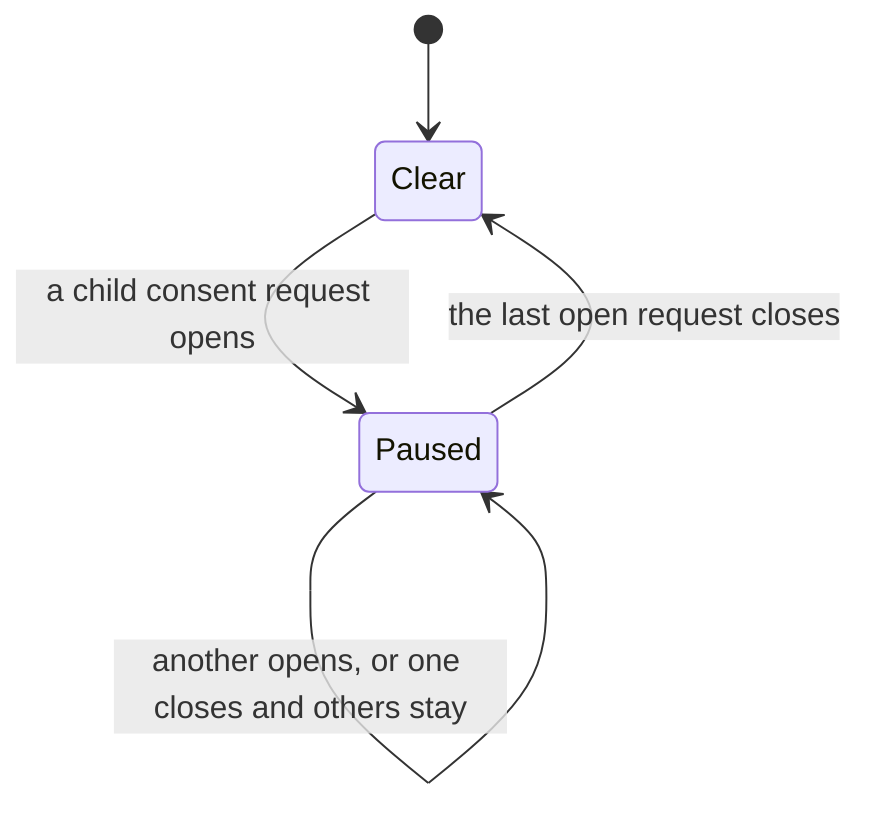
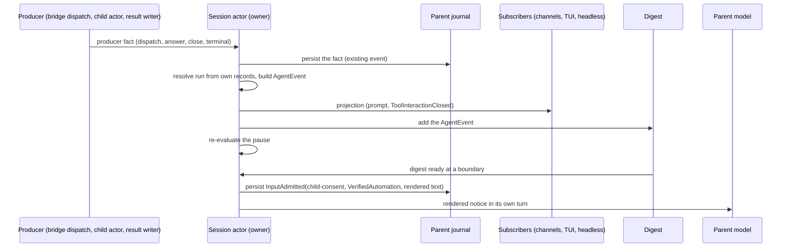
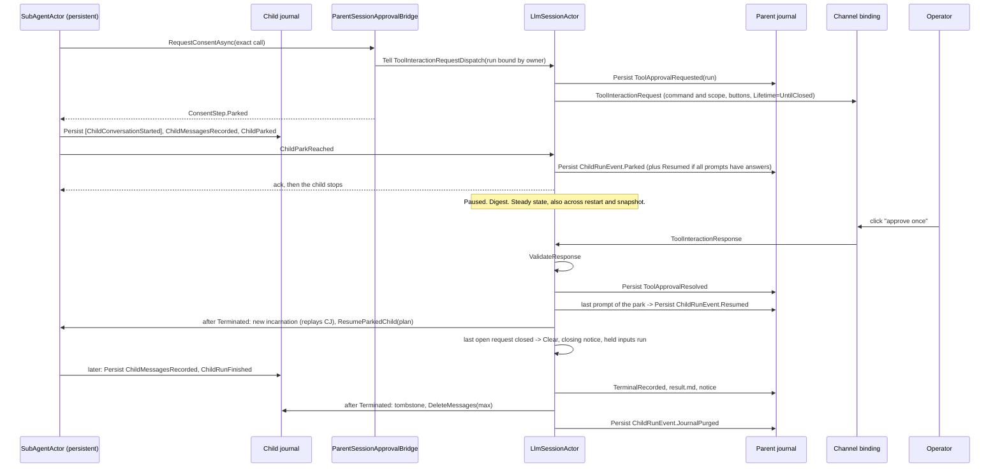

## Context

See `proposal.md` (Why) for the incident. This section states the current mechanics on `upstream/dev` (7f54c537c).
Terms follow [the engineering glossary](../../../docs/spec/GLOSSARY.md): consent request, consent answer,
one-time consent, requester, open child run, agent event, child consent pause, parked child run, child journal.

### Current mechanics

1. **One consent loop.** `ParentSessionApprovalBridge` is the consent loop for the session's own calls and for the
   calls of its children (`ParentSessionApprovalBridge.cs:59-65`). It builds the `ToolInteractionRequest` from the
   gate's `ToolApprovalContext` and options, without change (`:138-173`). The answer becomes a one-time consent
   for the exact candidates (`:41-45`). A child prompt gets the call ID `{runId}/subagent-approval/{n}`. The bridge
   instance counts `n` in memory (`:178-190`).
2. **The parent actor sees every child request.** `SessionToolWorkflow.ChildApprovalCapability` gives the child a
   bridge whose emitter Tells the session actor a `ToolInteractionRequestDispatch` with `PersistApprovalState = true`,
   `SourceChildRunId`, and `ChildContext` (`SessionToolWorkflow.Children.cs:56-72`). The session builds this closure,
   so the run ID is owner-stamped. The wait timeout is `Timeout.InfiniteTimeSpan` (`:68`).
3. **Dispatch handler.** `LlmSessionActor.HandleToolInteractionRequestDispatch` drops a request for a run that is not
   `Accepted`. Otherwise it persists `ToolApprovalRequested` with the run ID and emits the prompt output
   (`LlmSessionActor.cs:3272-3298`).
4. **Open child requests.** `SessionToolWorkflow._calls` holds them. `check_agent_run` shows
   `pending_approval_count` (`SessionToolWorkflow.Children.cs:28-29`, `LlmSessionActor.Children.cs:243`). The model
   sees this count only when it polls.
5. **Answers.** An answer for a child call goes to the live path. The session claims the live wait in
   `ApprovalChannel` (`LlmSessionActor.cs:3615-3621`, `3569-3613`). `ValidateResponse` checks the requester and the
   option (`SessionToolWorkflow.Approvals.cs:313-337`).
6. **Cancel and end.** `ControlChild` and `RecordChildTerminal` call `CloseChildApprovals`, which removes the entries
   and tells nobody (`LlmSessionActor.Children.cs:216-225`, `:265-268`; `SessionToolWorkflow.Children.cs:43-50`).
   The stopped child's `finally` block Tells `SubAgentApprovalWaitCompleted` to a dead actor
   (`SubAgentActor.cs:1660-1671`). These are the observed dead letters. They are harmless.
7. **Late click.** A click on a removed call gets "That approval prompt has expired — the session moved on or
   restarted" (`SessionToolWorkflow.Approvals.cs:223-235`, `LlmSessionActor.cs:3474-3480`). For a cancelled child
   this text is false.
8. **Channels and TUI.** `ChannelOutputEngine.CompleteTurnAsync` drops all prompts at `TurnCompleted`
   (`ChannelOutputEngine.cs:280-308`). The TUI drops all prompts at `TurnCompleted` and at `ErrorOutput`
   (`ChatViewModel.cs:433-443`, #2523). Slack, Discord, and Mattermost bindings journal `PendingApprovalPromptTracked`,
   so a button keeps its call ID after a restart. Each builder adds "You can also reply with A, B, ..." text. When a
   prompt post fails, the binding refuses the call with `approval_prompt_unavailable`.
9. **Text answers.** A text answer resolves the latest or the first prompt that the sender can answer
   (`SessionToolWorkflow.Approvals.cs:131-148`, `PendingApprovalLookup.cs:47-51`).
10. **Notices (#2515).** An ended child becomes one admitted input, `InputAdmitted.ChildNotice` (field 14), with the
    recorded context of the run owner (`LlmSessionActor.Children.cs:345-363`). The kind makes it automation
    (`SessionToolWorkflow.Recovery.cs:109-121`). It joins a running turn of the same requester at a tool-batch
    boundary (`SessionInputFlow.cs:431-471`).
11. **Automated input.** While a parent consent request is open, automated input waits (`NewInputPlan.WaitForApproval`).
    A child request does not hold parent input (`SessionToolWorkflow.Recovery.cs:167-171`). A reminder fire is
    dropped when an earlier fire of the same reminder waits (`SessionInputFlow.TryFindWaitingFire`).
12. **Child tool batch.** The child runs the calls of one model response in parallel and waits for all of them
    (`SubAgentActor.cs:1754`, `Task.WhenAll`). A call that needs consent waits inside its own task. A sibling call can
    finish, with its side effects, while another call waits.
13. **Child durability.** `BackgroundChildRun` and its lifecycle are durable (`BackgroundChildRun.cs`). The checkpoint
    holds only the round, a summary, and the file activity (`:82`). The model history, loaded tools, and the parked
    call exist only in `SubAgentActor` memory (`SubAgentActor.cs:86-141`). The child resolves its model by role, and
    the provider falls back to the main role when the role has no model (`IChatClientProvider.GetClient`).
14. **Snapshots.** `SessionSnapshot` excludes approval state. `AllowsSnapshot` refuses a routine snapshot while any
    approval entry is open (`SessionToolWorkflow.cs:224-226`). Compaction saves a snapshot with no such check
    (`LlmSessionActor.cs:1009`), and `SaveSnapshotSuccess` deletes the journal up to the snapshot (`:2534`).
15. **Restart.** A live child keeps the session in memory (`LlmSessionActor.cs:376`, `1747`). A drain stops the
    children (`SessionExecutionLifetime.StopChildren`). `RecoveryCompleted` removes child approval entries
    (`LlmSessionActor.cs:262`), and recovery records each live child as lost. A config reload restarts the actor
    system, so it acts as a restart (#2572).
16. **Transport.** Child and parent are in one process. The child actor is a child of the session actor. Clients get
    session outputs through `SessionSubscriberManager` (pub/sub). `SubAgentToolPolicy` denies `spawn_agent` to a
    child (`SubAgentToolPolicy.cs:16-21`).

### Constraints

- One owner for each decision. The session actor owns all child state and all child consent state.
- Actor boundaries stay transport-agnostic. A message holds addresses as value objects, never an `IActorRef`.
- Persisted types are framework-owned and serialization-safe (proto, `INetclawSerializableMessage`).
- The parent model can never give consent.
- No silent fallback on the resume path.
- No timer is necessary. Tests are deterministic, with no sleep.

### Decisions of the owner and the coordinator (21 October 2026)

| ID | Decision |
| --- | --- |
| Q1 | An approval notice wakes an idle parent once for each ready digest. |
| Q2 | No "approve for all" prompt. |
| Q3 | No journal format change for approval notices. A notice is an ordinary `InputAdmitted` with a new source kind and rendered text. |
| Q4 | No timeout. The session reaches a steady state and waits for the person. Nothing expires. |
| Q5 | No nested children. |
| Q6 | No lift. A person's message never ends the pause. The pause ends only when every open child request closes. |
| P1 | The pause is session-wide. |
| P2 | Reminder fires into a paused session wait. A later fire of the same reminder replaces the waiting one. This rule applies also when a parent prompt is open at the same time. |
| P3 | No user-facing text names the child: not the prompt, not the closed redraw, not the late-click reply, not headless output. |
| P4 | The channel envelope is minimal now: `Sender`, `Target`, `SentAt`. |
| P5 | #2515 child results move into `AgentEvent` in memory. Field 14 stays on disk. |
| P6 | A child that waits for consent survives a restart and a config reload (#2572). It is the last PR of the stack. |
| P7 | A child run is an Akka.Persistence actor with its own persistence ID. Its first event freezes the system prompt, the model, and the tool set. |
| P8 | Park always (R1 = A). One resume path serves a live answer and an answer after a restart. |
| P9 | The parent purges a child journal last, after the run end, `result.md`, and the notice. Recovery purges leftovers. |
| P10 | A missing frozen model, provider, or agent definition fails the resume loudly. The run ends as lost. |
| R2 | One reminder rule for every wait is deferred to a later change. |
| B1 | A park accepts prompts that already have an answer. |
| B2 | The parent snapshot holds the open entries of parked prompts. |
| B3 | A resumed child takes its authority from the run record and its tools, prompt, rules, and model from its first event. |
| B4 | PR 1 holds the prompt lifetime and the TUI and channel turn-end change, so PR 1 and PR 2 each ship alone. |
| S5 | An approval notice has principal `VerifiedAutomation`. |
| S7 | A child prompt has buttons only. A failed post withdraws the request. |
| N1 | A notice turn cannot raise a consent request: its context has `SupportsInteractiveApproval = false`. |
| N2 | One digest for each session, not for each owner. |
| N3 | Whenever the session records a run as lost, it runs the purge actor, which does nothing for an empty journal. |
| Cuts | The child journal is written at the first park only. No child snapshot. No new `SubAgentOutput` phases. No orphan resume of approval notices. No owner-stamped-sender Stryker target. No routing hook on `AgentEvent`. |

## Goals / Non-Goals

**Goals:**

- Start a typed inter-agent event channel. Child consent events and child results are its first members.
- The parent model learns of child consent requests without a poll, at most once for each model boundary.
- The runtime stops new autonomous work while the operator must answer, and the session then waits quietly.
- A closed prompt has no live buttons. A late click gets the true reason.
- A child that waits for consent survives a restart. Its prompt stays valid, and the pause comes back.
- PR 1 and PR 2 each ship alone and roll back alone.

**Non-Goals:**

- Messaging tools (`notify_parent`, `message_child`, sibling messages). Only their slot in the channel is in scope.
- An "approve for all" prompt (Q2), nested children (Q5), and a consent wait timeout (Q4).
- A resume of a running child after a restart. The child journal supports it in the next change ("Future scenarios").
- Session retention and a reaper for expired sessions and their children (#2573).
- A shell fatigue fix for a literal `for` loop. It is a separate Shell facts change (tool-authorization.md section 8).
- A cross-process or sharded router.

## Decisions

### D1. The agent event channel

The channel is a closed, typed protocol between the agents of one session. Actors exchange typed `AgentEvent`
messages. The model never sees a typed message. It sees a notice that the runtime renders from typed messages.

#### D1.1 Types (schematic C#)

```csharp
// Closed set of agent addresses. Value objects only, no IActorRef, no implicit conversion.
public abstract record AgentAddress
{
    private AgentAddress() { }
    public sealed record Session(SessionId SessionId) : AgentAddress;             // the main agent of a session
    public sealed record ChildRun(SessionId SessionId, SubAgentRunId RunId, AgentName Agent) : AgentAddress;
}

// Minimal envelope (P4). EventId, CorrelationId, and CausationId come with messaging.
public sealed record AgentEnvelope(AgentAddress Sender, AgentAddress Target, DateTimeOffset SentAt);

// Closed family of immutable records. In-process only in this change.
public abstract record AgentEvent
{
    private AgentEvent() { }
    public required AgentEnvelope Envelope { get; init; }

    public sealed record ChildApprovalRequested(ToolCallId PromptCallId, ToolName Tool) : AgentEvent;
    public sealed record ChildApprovalResolved(ToolCallId PromptCallId, ChildApprovalResolution Resolution) : AgentEvent;
    public sealed record ChildRunEnded(ChildNotice Notice, SubAgentRunOutcome Outcome,
        SubAgentOutcomeReason? Reason, ChildRunResultFile ResultFile) : AgentEvent;
}

public abstract record ChildApprovalResolution
{
    private ChildApprovalResolution() { }
    public sealed record Approved(ConsentAnswer.Grant Answer) : ChildApprovalResolution;
    public sealed record Refused(RefusalKind Kind) : ChildApprovalResolution;
    public sealed record Withdrawn(WithdrawReason Reason) : ChildApprovalResolution;
}

public enum WithdrawReason { CancelledByParent, ChildEnded, ChildLost, DaemonRestarted, PromptUnavailable }
```

`SentAt` comes from the injected `TimeProvider`. `PromptCallId` pairs a request with its resolution.
`ChildRunResultFile` is a new value object for the runtime-made path of `result.md`. No payload holds free text that an
agent chose. A payload holds IDs, canonical names, enums, and runtime-made paths.

#### D1.2 Routing and who may send what

| Event | Sender | Target | Producer fact | Builder |
| --- | --- | --- | --- | --- |
| `ChildApprovalRequested` | `ChildRun` (the asking run) | `Session` | the bridge's dispatch | session actor, after `ToolApprovalRequested` persists |
| `ChildApprovalResolved` | `ChildRun` (the run that asked) | `Session` | a validated answer or a withdrawal | `SessionToolWorkflow`, after the answer persists or the close happens |
| `ChildRunEnded` | `ChildRun` (the ended run) | `Session` | `TerminalRecorded` and the `result.md` write | session actor, in `HandleChildResultWritten` |

Authority rules:

- **Owner-stamped sender.** Only the session actor that owns the run builds an `AgentEvent`. It takes the run from
  its own records: the bridge closure or `SessionExecutionLifetime.FindChild(Sender)`. A child can emit only about
  itself.
- **No child text reaches the model as instructions.** A future event with agent-authored content puts that content
  in a run file and carries the path. The model reads it with `file_read` as data.
- **The parent cannot approve.** The family has no event that carries consent. Consent goes only through the bridge.
- **Same session only.** A `ChildRun` address must name a run that the target session owns.

#### D1.3 Ordering, guarantees, and durability

- **Order.** The session mailbox defines the order. A resolution follows its request.
- **Producer to owner: at most once.** The hop is an in-process Tell to the parent of the child actor.
- **`ChildRunEnded` to the model: once in effect** (existing #2515 guards).
- **Approval notices to the model: at most once.** The digest is actor-local. At most one notice waits, and a newer
  notice replaces it (D4). A notice turn that starts gives its answers, also when the turn fails. Recovery closes every
  pending approval notice and rebuilds the digest from the open entries (D4). The approval journal holds the true
  state.

#### D1.4 Rendering for the model

`AgentEventRenderer.Render(IReadOnlyList<AgentEvent>)` is a pure function. It is the only path from typed events to
model text. The session stores its output in `InputAdmitted.user_message`.

#### D1.5 Messaging slot

Each future messaging tool adds one subtype, one renderer case, and one tool. A message body is agent text, so it goes
to a run file, and the event carries the path. Messaging adds `EventId`, `CorrelationId`, and `CausationId` to the
envelope. Sibling messages route through the owning session, which checks that both runs have the same requester.

### D2. Bridge vs channel

| | Bridge (`ParentSessionApprovalBridge`) | Channel (`AgentEvent`) |
| --- | --- | --- |
| Job | The one consent loop | Observation and messages |
| Shape | Request and response | Events, one direction for each event |
| Prompt | Authoritative, rendered from the gate's options | None |
| Result | One-time consent bound to the exact command, returned on its own awaited path | Never carries consent |
| Durable state | `ToolApprovalRequested` / `ToolApprovalResolved` | Notices only, as admitted inputs |

The bridge's dispatch is one producer of `ChildApprovalRequested`. Later, the bridge can publish the event directly
without a change to the channel contract. This change does not make that change.

### D3. Prompts (PR 1, PR 2)

- **Content (P3).** The prompt shows the runtime-rendered command and scope, as the gate made them. It does not show
  the agent name or the run ID. The child identity stays on the internal `ToolInteractionRequestDispatch`, on the typed
  event, and in the parent notice.
- **Lifetime (PR 1).** `ToolInteractionRequest` gets `Lifetime`: `UntilTurnEnd` (parent prompts) or `UntilClosed`
  (child prompts). Renderers do not show it. `ChannelOutputEngine` and `ChatViewModel` clear only `UntilTurnEnd`
  prompts at `TurnCompleted` and at `ErrorOutput`. `PendingApprovalPromptTracked` gets an optional `lifetime` field so
  that a cold-spawned binding keeps a child prompt. An older binary ignores the unknown field. A row without the field
  reads as `UntilTurnEnd`, which is today's behavior.
- **Buttons only (PR 2, S7).** A child prompt shows buttons only. It has no "reply with A, B" text and no text-only
  fallback. When the button post fails, the binding reports `approval_prompt_unavailable` (existing path). For a child
  prompt the session withdraws the request with `PromptUnavailable`.
- **Consent boundary.** The parent model has no tool that produces a `ToolInteractionResponse`. Its text output is a
  `TextOutput`. A channel never renders buttons from model text.

### D4. Approval notices (PR 1)

**Kind and authority (S5, Q3).** An approval notice is an ordinary `InputAdmitted` with:

- source kind `child-consent`, sender `child-consent`, principal `VerifiedAutomation`, authenticity `LocalProcess`;
- the session, audience, boundary, and channel type of the run owner, and a new turn ID;
- the run owner's default and requested delivery targets, so the reply goes to the same thread;
- `SupportsInteractiveApproval = false`;
- the rendered text in `user_message`. No new field.

The session identifies a notice input by all three facts: source kind `child-consent`, authenticity `LocalProcess`, and
sender `child-consent` (the `TurnContext.IsReminderTurn` pattern). A webhook with event type `child-consent` has
authenticity `Verified`, so it is not a notice: it cannot pass the pause, and recovery does not close it.

The principal makes an older binary classify the input as automation. After a rollback, an old binary runs a pending
notice as an ordinary automated turn with the rendered text. The notice turn grants no authority:

- Under the six-fact rule it cannot check or cancel a person's run. The notice text says so and tells the model to ask
  the operator to cancel. The operator cancels in their own turn.
- Its context has `SupportsInteractiveApproval = false`, so a call that needs consent is denied without a prompt
  (existing path, `SessionToolExecutionPipeline.CanRequestInteractiveApproval`, `:1167-1168`). The session never
  borrows the run owner's requester for consent.
- A notice turn that ends with no text ends quietly (`QuietEnd`), so the channel posts no empty-turn fallback.

**Merge rule (Q1, N2).** The session keeps one actor-local digest.

- The digest is ready when it holds a new `ChildApprovalRequested`, or when no child request of the session stays open.
- When the session is `Ready`, it admits a ready digest at once. This wakes an idle parent once.
- When the session is `Processing` or `Compacting`, the digest waits until the next tool-batch end, turn end, or
  compaction end. The notice then waits for its own turn, because its requester is automation.
- An answer while other requests of the session stay open waits in the digest.

**At most one waiting notice (review of PR 1).** A notice waits from its admission until its turn takes it from the
queue (`SessionInputFlow.WaitingConsentNotice`).

- When a digest is ready while a notice waits, the session closes the waiting notice and admits the new notice. One
  atomic write (`LlmSessionActor.PersistReplacingInput`, `PersistAll`) holds the `InputClosed` with
  `KeepsTurn = true` and the new `InputAdmitted`. A crash keeps both or neither.
- A notice whose turn started is not in the queue. A newer notice does not close it. The newer notice waits for its
  own turn.
- The new notice goes in front of other waiting input (`ConsentNoticeCommitted`). A replay of the running turn stays
  first.

**Answers (at most once).** The digest (`ChildConsentDigest`) holds the open requests, the answers that no notice gave
yet, and the answers of the waiting notice.

- A notice lists every open request.
- When the new notice replaces a waiting notice, the model did not read the waiting notice. The new notice gives the
  answers of the waiting notice again, and then the newer answers.
- When no notice waits, each earlier notice turn started. Its answers count as given, also when that turn failed. The
  new notice does not give them again.
- An open notice gives its answers under the heading "Answers since the last notice:". Each answer has the same line
  form as in the closing notice.

```text
Child consent requests wait for the operator. 1 is open.
- agent=pr-reviewer run=r-9c3 tool=shell_execute open_since=14:05:12Z
Answers since the last notice:
- agent=pr-reviewer run=r-7f2 answer=refused reason=denied
The operator answers these prompts in the channel. You cannot answer them.
...
```

**Rejected admission.** When the journal rejects the admission of a notice, the session logs an error and stops
(`LlmSessionActor.OnPersistRejected`). This applies in every phase, as after a persist failure. The boundary that
admitted the notice cannot continue, and a pause with no notice would hold automated input with no end. The session
tells the channel only when a turn stays open:

- The admission happens inside a turn that stays open: at a tool-batch end, while the turn waits for a parent prompt,
  or at a compaction end that resumes the tool loop. The session posts the persist-stopped error ("The session could
  not save its progress and stopped. Some actions may already have run. ...") and a failed `TurnCompleted` before the
  stop (`EmitFailedTurnOutputs`).
- The admission happens at the end of a finished turn, or in `Ready`. The session posts no error and no failed
  completion, because it recorded the turn as complete.

Recovery then withdraws the child requests, closes the pending notices, and queues the held input (see "Recovery"
below).

**Text (true for the session).** A notice lists the runs of the session. The closing notice comes only when no child
request of the session stays open, so its "spawn_agent is available again" line is always true. The closing notice
lists the held reminder fires.

With one digest for each session, the notice turn takes the audience, the boundary, and the delivery targets of the
owner of the first open request in the digest, and it lists the runs of every owner. This is safe, because all owners
of one session share the same thread: the session ID fixes the channel and the thread. The notice turn is automation
and grants no authority, so the borrowed audience and boundary only shape the reply.

```text
Child consent requests wait for the operator. 3 are open.
- agent=pr-reviewer run=r-7f2 tool=shell_execute open_since=14:03:01Z
- agent=pr-reviewer run=r-8a1 tool=shell_execute open_since=14:03:04Z
- agent=pr-reviewer run=r-9c3 tool=shell_execute open_since=14:03:09Z
The operator answers these prompts in the channel. You cannot answer them.
The children are not stalled. They wait for the operator, with no time limit.
Until all requests close, spawn_agent is refused and automated turns wait.
check_agent_run does not work in this turn for a run that a person started.
Ask the operator to answer the prompts, or to cancel a child.
```

```text
Child consent requests are closed. None is open in this session.
- agent=pr-reviewer run=r-7f2 answer=approved_once
- agent=pr-reviewer run=r-8a1 answer=withdrawn reason=cancelled_by_parent
Held reminder fires now run: reminder=daily-pr-sweep fired_at=15:00:00Z
spawn_agent is available again.
```

`AgentEventRenderer` owns all notice text. The text rules:

- The count line uses the singular for one request: "1 is open.". It uses the plural for more: "3 are open.".
- The closing notice puts the held-fires line just before "spawn_agent is available again.". The line has the form
  `Held reminder fires now run: reminder=<name> fired_at=<HH:mm:ssZ>`. The session joins several fires with ", ", in
  admission order. With no held fire, the line does not appear.
- An open notice has no held-fires line, because those fires still wait.

**Recovery (PR 1, Cut 4).** Before step 1, recovery decides whether the session was paused at the crash
(`WasPausedAtRecovery`). The session was paused when an open child request belongs to a run that is still `Accepted`.
Replay does not close a request that a cancel or the end of its run withdrew, so the run state decides, not the
replayed request alone. Recovery then runs in this order:

1. It withdraws the child requests that remain (`ExpireRecoveredChildApprovals`).
2. It closes every pending approval notice with one `InputClosed` (`KeepsTurn = true`).
3. It rebuilds the digest from the open entries. If recovery closed one or more notices and a request stays open, the
   rebuilt digest is ready, because the model did not see those requests. If not, the rebuilt digest is a baseline
   that does not wake the parent. In PR 1 and PR 2 a restart withdraws all child requests, so the rebuilt digest is
   empty, and recovery admits no notice.
4. It resumes the orphan child result notices at the head of the pending inputs (`ResumeOrphanNotices`, existing).
   This step starts only those notices. It does not start the input that the pause held.
5. When the session was paused at the crash, recovery only sends itself `StartHeldInputs`. Behind a parked parent
   approval, the handler does nothing, because recovery queued every pending input already.

The `StartHeldInputs` handler (`StartInputsHeldByThePause`) queues the input that the pause held: automated input and
child result notices that no turn selected and that the queue does not hold yet. Then it starts the queue only in an
idle session. A turn that runs drains the queue at its end. Akka.Persistence unstashes the commands that arrived during
recovery before `StartHeldInputs`. So when a restart reminder woke the session, the stashed reminder runs first. It is
the one resume path for an interrupted input of a person, and it queues the pending inputs in admission order before
the handler queues the held input. After a crash, no restart reminder exists, and recovery still does not resume a
pending input of a person (#2516).

A restart reminder that arrives in `Processing` or `Compacting` queues each pending input that no turn selected and
that the queue does not hold yet (`QueueRestartResume`). It logs `restart_resume_queued` and replies
`RestartResumeNotNeeded`, also when it queued nothing, because no turn of this message runs. A caller on the
Reminder-origin route then settles at once. A pending input whose stored authority does not parse gets a
`CommandNack`, as in an idle session. The normal drain runs the queued inputs after the running turn, in admission
order. This replaces the earlier rule of `d2-reminders-end-at-admission` (#2511): a restart reminder that found another
turn running was a no-op, and the input stayed pending with no turn.

Known order case (no code change): the session was paused at the drain, and fire F of reminder R was held. After the
restart, the next fire F2 of R wakes the session before the restart reminder does. Recovery sends `StartHeldInputs`,
but the stashed F2 runs first. F is not in the queue yet, so the drop rule does not see a waiting fire of R, and F2 is
admitted and starts a turn. Then `StartHeldInputs` queues F, and F runs after F2.

```text
schematic: restart of a paused session (graceful drain, admission order [P, F])
  drain: Alice's input P stays pending; fire F waits for the pause; the drain writes a restart reminder R
  recovery: paused := open child request of an Accepted run   -> true
            withdraw requests; close notices; rebuild digest; Tell StartHeldInputs
  unstash R (Ready): resume P -> turn of P runs; queue F (waiting input)
  StartHeldInputs: F is queued already; session busy -> no start
  turn of P ends: drain -> turn of F runs
```

### D5. The pause (PR 1)

```text
Paused := exists an open child consent request in this session        # P1, Q6; actor-local, derived
```

| Event | Today | While paused |
| --- | --- | --- |
| `spawn_agent` call (`ChildRunStartKey.Tool`) | accepted | `AcceptChild` rejects with `ChildStartRejectedException(SpawnPaused)`. The spawner removes the run folder (existing path). |
| Slash command child start (`ChildRunStartKey.Slash`) | accepted | accepted. A person typed it. |
| Automated input or `ChildRunEnded` input, session `Ready` | starts a turn | waits in the buffer (`NewInputPlan.WaitForApproval`, existing placement) |
| Automated input or `ChildRunEnded` input in the buffer, tool-batch boundary | joins the turn | stays in the buffer. `DrainBufferedBatch` stops at it. |
| Current-session reminder fire | starts a turn | admitted and acknowledged, then waits |
| Approval notice | (new) | admitted. The pause never holds it. |
| Next model call of the running turn | runs | runs. The current turn can finish. |
| Person input | starts a turn | starts a turn. The pause stays. `spawn_agent` stays refused. |

The pause ends only when every open child request closes: an answer, a refusal, or a withdrawal. On that move the
session admits the ready digest, then starts the waiting inputs through `StartWaitingInputAfterApproval`.



**Refusal text (per requester, true).** The text names only the waiting runs that the calling turn may control
(`TurnContext.CanControlChildRunOf`). It gives the count of the other requests without detail:

```text
Error: spawn_agent is paused. 3 child consent requests of this session wait for the operator.
Yours: r-7f2, r-8a1. Ask the operator to answer the prompts, or to cancel a child.
A notice arrives when all requests close.
```

**Reminder fires while paused (P2).** A current-session reminder fire is admitted and acknowledged, and then it waits.
When a later fire of the same reminder ID arrives while an earlier fire waits, the session closes the earlier fire with
`InputClosed` (no new reason field, `KeepsTurn = true`) and keeps the later fire. One atomic write
(`PersistReplacingInput`) holds the close and the admission of the later fire, as for a notice replacement (D4). The
rule applies while the child pause applies, also when a parent prompt is open at the same time. A fire that waits only behind a parent prompt keeps the
current rule. At most one turn of each reminder runs when the pause clears. The session posts no thread message for a
held fire. An isolated reminder session has no interactive channel, so it never pauses. The open change
`d2-reminders-end-at-admission` drops the later fire in all cases. Whichever change syncs second merges the two rules:
"later replaces earlier" while the child pause applies, "drop the later" elsewhere.

### D6. Withdrawal and an accurate late reply (PR 2)

- `CloseChildApprovals`, recovery, and a failed child prompt post build `ChildApprovalResolved(Withdrawn(reason))` and
  emit `ToolInteractionClosed(CallId, Reason)` for each closed call. `ToolInteractionClosed` is an output and is not
  persisted. A binding finds its tracked prompt by the call ID, redraws it, and journals the existing
  `PendingApprovalPromptCleared`.
- `RejectClosedCall` gets one new case. For a child call ID, the workflow reads the run ID from the call ID prefix
  (the runtime made the ID) and the run lifecycle in `SessionState`. The reply is `ApprovalNoticeKind.Withdrawn`.
- A park that the owner refuses because the run was cancelled meanwhile records `Cancelled`, not lost.

| `WithdrawReason` | Text for the redraw and for a late click |
| --- | --- |
| `CancelledByParent` | "This approval request was withdrawn because the task that asked for it was cancelled. Nothing ran." |
| `ChildEnded` | "This approval request was withdrawn because the task that asked for it ended. Nothing ran." |
| `ChildLost` | "This approval request was withdrawn because the task that asked for it stopped unexpectedly. Nothing ran." |
| `DaemonRestarted` | "This approval request was withdrawn because Netclaw restarted before the task finished. Nothing ran." |
| `PromptUnavailable` | "This approval request was withdrawn because Netclaw could not show it in this channel. Nothing ran." |

No text names the child run or the agent. Headless output prints the prompt and the close from
`ToolInteractionRequest` and `ToolInteractionClosed` only, with no child identity.

### D7. Text answer guard (PR 2)

A text answer resolves a prompt only when the sender can answer exactly one open prompt. With two or more, the
session and the channel reply "N approval prompts are open. Use the buttons on the prompt you mean." Owners:
`SessionToolWorkflow.TryResolveTextResponse` and `PendingApprovalLookup.Resolve`.

### D8. Durable child wait across a restart (#2572, PR 3)

A child run becomes an Akka.Persistence actor with its own journal (P7). When it needs consent, it persists and stops
(P8). A parked run is journal state with no actor. When every parked prompt has an answer, the session recreates the
child from its journal. Only the parked calls run, once each.

#### D8.1 Persistence ID

```text
subagent-{Uri.EscapeDataString(sessionId)}/{runId}
```

- The session catalog writes its rows from session outputs, with the key `session-{sessionId}`
  (`SessionCatalogService`). A child actor emits no session output and has another prefix, so no child row appears.
- The escaped session ID has no `/`, and `SubAgentRunId` is 32 hex characters. The prefix
  `subagent-{escapedSessionId}/` names exactly the children of one session. The escaped ID can hold `%`, which is a
  SQL `LIKE` wildcard. A reader (#2573) must match with an ordinal `StartsWith`, or escape `%` and `_`.

#### D8.2 The child journal

A new entity protocol, `SubAgentRunProtocol`, follows the actor-message-protocol rules. `ISubAgentRunEvent` is rooted
on a new `IWithSubAgentRunId` and inherits `INetclawSerializableMessage`. Each event exposes `Timestamp` from the
injected `TimeProvider`. Each type gets a proto message, a manifest, and a mapper entry.

The child writes nothing until its first park (Cut 1). A run that never parks has no journal and needs no purge.

| Event | When | Content |
| --- | --- | --- |
| `ChildConversationStarted` | first event, written at the first park | agent name; the exact system prompt; the resolved provider ID and model ID (what the role resolved to, also after a fallback); the resolved tool set (each name, description, and schema); the project instructions; the operating rules; the structured-findings flag; the first user message |
| `ChildMessagesRecorded` | at each park, and at the end of a run that parked | history messages since the last record: assistant messages with tool calls, tool results, nudges |
| `ChildParked` | at each park, after the messages | parked child call IDs and their prompt call IDs, the highest prompt number, loaded deferred tool names, the project directory |
| `ChildRunFinished` | the end of a run that parked | the outcome |
| `ChildJournalClosed` | the purge (D8.6) | none |

The parked tool-call message and the settled sibling results are in `ChildMessagesRecorded`, so a replay never runs a
sibling again. No child snapshot exists (Cut 2). The authority is not in the child journal. The resume takes it from
`run.OriginalContext` in the parent record (B3).

#### D8.3 The park point and answers before the park (B1)

When the gate requires consent, the bridge emits the prompt (as today) and returns `ConsentStep.Parked` at once. The
call does not run. `Task.WhenAll` of the batch ends when each sibling has a result or a parked marker. A sibling can
take some time, so the operator can answer a parked prompt before the park reaches the owner.

```text
child at park point (schematic):
    PersistAll([ChildConversationStarted if first park], ChildMessagesRecorded, ChildParked) then:
        Ask owner ChildParkReached(runId, prompts)
owner on ChildParkReached:
    if run is Cancelling: reply Refused; record Cancelled                   # nit: cancel wins, not lost
    if a prompt has no entry (open or resolved) for this run: refuse; run is lost
    release the run from SessionExecutionLifetime; unwatch the child
    if every prompt already has an answer:
        PersistAll(ChildRunEvent.Parked(prompts), ChildRunEvent.Resumed) then: ack; resume after Terminated (D8.4)
    else:
        Persist ChildRunEvent.Parked(prompts) then: ack
child on ack: stop
```

The pause and the notices follow the real state. A prompt with an answer is closed for the pause. The digest can
report "approved" for a run that has not yet resumed. The run is never lost because of an early answer.

#### D8.4 Resume

```text
on ToolApprovalResolved persisted for prompt p of parked run r (schematic):
    if any prompt of r.Park is still open: wait
    if a restart drain is pending: wait                          # recovery resumes later; nothing ran
    Persist ChildRunEvent.Resumed(r) then: resume(r)
resume(r):
    wait until the previous child incarnation is Terminated      # name: {agentActorName}-{incarnation}
    prepare off the actor thread:
        definition = registry.Get(r.AgentName)                   # missing: lost, reason agent_definition_unavailable
        client     = provider.GetExact(providerId, modelId)      # missing: lost, frozen_model_unavailable / frozen_provider_unavailable
    on prepared: if r is not Accepted (cancelled meanwhile): discard; else
        authority = TurnContext.FromRecord(r.OriginalContext)    # never the current turn
        child = spawn(PersistenceId(r), authority, incarnation + 1); track; watch
        child.Tell(ResumeParkedChild(redrive plan))
child after replay:
    system prompt, tool set, instructions, rules, findings flag, model := frozen values
    run only the parked calls with the plan; continue the model loop
```

- A parked call runs only after the parent persisted `Resumed`, and only once, with the one-time consent of its exact
  candidates. The gate checks the call under the current policy at call time.
- A refused answer gives the call a refusal result through the plan's decision override. It does not run.
- The resumed bridge starts prompt numbers above the highest recorded number.
- The resumed child's tools are the frozen tool set, intersected with the current agent definition and the current
  audience policy. A tool that left that set gives the existing explicit "tool unavailable" result when the child
  calls it. The child never gets a substitute tool.
- The resumed child starts in the project directory that the last `ChildParked` recorded.
- No silent fallback: a missing agent definition, provider, or model ends the run as lost with its reason. The notice
  says: "The child could not resume because its model `{model}` from provider `{provider}` is no longer configured.
  The parked calls did not run." (or the provider or agent text).
- A batch with two parked calls runs neither call until both have answers.

#### D8.5 Races

| Race | Rule |
| --- | --- |
| Park stop vs `ChildTerminated` | The owner releases the run from `SessionExecutionLifetime` and unwatches the child before the ack, so the stop is not a lost child. |
| Resume vs the stopping old actor | The resume waits for `Terminated` of the old incarnation, or uses a new actor name for each incarnation. Two live actors with one persistence ID never exist. |
| Cancel during resume preparation | The prepared callback checks the run state. A cancelled run discards the preparation and records `Cancelled`. |
| Resume vs restart drain | No `Resumed` while a drain is pending. Recovery resumes the run after the restart. |
| Purge vs the live child | The purge waits for `Terminated` of the child. |

#### D8.6 End and purge (P9)

For a run that has a child journal (`BackgroundChildRun.HasChildJournal`, set by `Parked`):

1. The child persists `ChildMessagesRecorded` (if any are unrecorded) and `ChildRunFinished`, then returns the result.
2. The parent persists `TerminalRecorded`, writes `result.md`, and admits the #2515 notice.
3. After the notice is admitted and the child is `Terminated`, a short-lived purge actor with the child's persistence
   ID runs. It recovers only the sequence number, not the events.

Purge conditions (owner: the purge actor, then `LlmSessionActor`):

- (a) The purge actor calls `DeleteMessages(long.MaxValue)` inside the persist callback of `ChildJournalClosed`.
- (b) The parent persists `ChildRunEvent.JournalPurged` (which clears `HasChildJournal`) only after
  `DeleteMessagesSuccess`. On `DeleteMessagesFailure`, the session logs an error and persists no `JournalPurged`. The
  next recovery tries again.
- (c) When `LastSequenceNr == 0`, the journal is empty. The actor writes no tombstone, deletes nothing, and reports
  success.

Whenever the session records a run as lost, it runs the purge actor, also when `HasChildJournal` is false (N3). Guard
(c) makes this free for a run with no journal. It removes an orphan journal that a stop between the child's
`PersistAll` and the parent's `Parked` left. When the purge actor finds `LastSequenceNr > 0` for a lost run with
`HasChildJournal = false`, the session persists `HasChildJournal = true` with the run state before the delete. A failed
delete then leaves a run that the next recovery purges again.

The SQL journal plugin keeps the row with the highest sequence number when it deletes messages, so that the sequence
number is not reused. The tombstone makes that kept row carry no conversation. An in-memory journal test cannot prove
this. A SQLite-backed test must check that no conversation row stays.

A lost run (recovery, a failed resume, or a lost actor) follows steps 2 and 3, always with the purge actor. `task.md`, `result.md`, and
`logs/session.log` stay.

#### D8.7 Parent snapshot (B2)

Until the run's `Resumed`, every entry of a parked run goes into `SessionSnapshotProto`: the open entries (the full
`ToolApprovalRequested` facts: requester, options, candidates, working directory, child context, and authorization
attempt) and the answered entries (the same facts and the recorded answer). Without the answered entries, compaction
would delete their `ToolApprovalResolved` rows, and the resume would lose an answer. The session clears the entries of
a run at its `Resumed`. `AllowsSnapshot` lets parked child entries pass. A routine snapshot and a compaction snapshot keep them, and the journal delete after a
snapshot does not lose them. Entries of non-parked children stay out of the snapshot, as today. This is a format change
in PR 3.

#### D8.8 Recovery

```text
RecoveryCompleted (schematic):
    restore parked child entries from the snapshot and the journal
    for each child approval entry:
        if its run is Parked and the prompt is in run.Park: keep it open       # the pause comes back
        else: withdraw with DaemonRestarted
    for each run:
        Accepted or Cancelling                     -> lost (existing); run the purge actor (guard c)
        Parked, a prompt still open                -> nothing; the run waits with no actor
        Parked, all prompts resolved, no Resumed   -> resume (D8.4); nothing ran
        Reported and HasChildJournal               -> purge (idempotent)
    close every pending approval notice; rebuild the digest (D4)
```

- **The prompt stays live.** Bindings journal `PendingApprovalPromptTracked`. A click after the restart carries the
  same call ID, and the session takes the durable path.
- **Prompt replay.** A new subscriber gets each open `UntilClosed` prompt again. Slack, Discord, Mattermost, and the
  TUI skip a call ID that they already track.
- **Held reminder fires** are pending inputs. `RestoreWaitingInputs` rebuilds the waiting queue for the pause.

#### D8.9 Drain, passivation, and crash

- **Graceful drain.** A parked run has no actor. A running child follows today's rule: the drain stops it, and
  recovery records it as lost.
- **Passivation.** A parked run is not a live child. A session whose only children are parked can passivate.

| Crash after | Parent state | Recovery |
| --- | --- | --- |
| child `ChildParked`, before parent `Parked` (also a graceful drain or a config reload) | `Accepted` | lost. Nothing ran. The purge actor removes the orphan journal. |
| parent `Parked` | `Parked` | the run waits |
| last answer, before `Resumed` | `Parked`, all prompts resolved | resume. Nothing ran. |
| `Resumed`, before the next checkpoint or end | `Accepted` | lost (uncertain work, existing rule), then purge |
| `TerminalRecorded`, before the notice | `Terminal` | existing #2515 repair, then purge |
| the notice, before `JournalPurged` | `Reported`, `HasChildJournal` | purge again |

- **Cancel of a parked run.** No actor must acknowledge. The parent persists `CancellationRequested` and
  `TerminalRecorded(Cancelled)`, withdraws the prompts with `CancelledByParent`, admits the notice, and purges.

#### D8.10 Why a child journal, not the parent journal

- The owner chose a child journal (P7). It keeps the child conversation out of every parent replay.
- The session stays the owner of the run record and of every decision: park, resume, end, purge. The child journal
  holds only the conversation and the frozen facts.
- No uncertain work restarts. Only a parked run, where nothing ran, is recreated.

### Ordered flow: the channel



### Ordered flow: one child consent request (after PR 3)



### Owners and data

| Decision | Owner | Data |
| --- | --- | --- |
| Build an `AgentEvent`, stamp the sender | `LlmSessionActor` (Children partial) | call-local; run identity from the durable run record |
| Create `ChildApprovalResolved` | `SessionToolWorkflow` only | call-local; source facts durable |
| Digest, merge, and rebuild | `LlmSessionActor` (Children partial), `ChildConsentDigest` | actor-local |
| Replace a waiting notice or fire (one atomic write) | `LlmSessionActor.PersistReplacingInput`; `SessionInputFlow.WaitingConsentNotice` | durable `InputClosed` (`KeepsTurn`) and `InputAdmitted` |
| Stop on a rejected notice admission | `LlmSessionActor.OnPersistRejected` | durable journal is the recovery source |
| Queue the input that the pause held at recovery | `LlmSessionActor.StartInputsHeldByThePause` (`StartHeldInputs`) | durable pending inputs; actor-local queue |
| Queue pending input for a busy restart reminder | `LlmSessionActor.QueueRestartResume` | durable pending inputs; actor-local queue |
| Render model text | `AgentEventRenderer` (pure) | call-local |
| Notice kind, principal, and identification (source kind, authenticity, sender) | `SessionInputFlow` admission; `TurnContext` | durable in `TurnContext` |
| Field 14 adapter to `ChildRunEnded` | `NetclawProtoMapper` / `SessionState` | durable format unchanged |
| Prompt text, options, scope | `ParentSessionApprovalBridge` from the gate's `ToolApprovalContext` | call-local |
| Prompt `Lifetime` | `LlmSessionActor.HandleToolInteractionRequestDispatch`; binding journal optional field | call-local; binding durable |
| Pause predicate | `SessionToolWorkflow` | actor-local, derived |
| Spawn refusal and its text | `LlmSessionActor.AcceptChild` | call-local on actor-local state |
| Automated input waits; reminder replacement | `SessionToolWorkflow.PlanNewInputAbandonment`, `SessionInputFlow` | actor-local; `InputClosed` durable |
| Consent answer validity | `SessionToolWorkflow.ValidateResponse` (unchanged) | actor-local plus durable resolution |
| Withdrawal and late reply | `SessionToolWorkflow.CloseChildApprovals`, `RejectClosedCall` | derived from durable run lifecycle |
| Text answer guard | `SessionToolWorkflow.TryResolveTextResponse`, `PendingApprovalLookup` | actor-local |
| Prompt redraw and dedupe | `ChannelOutputEngine`, `ChatViewModel` | binding journal (`PendingApprovalPromptCleared`) |
| Child conversation and frozen facts | `SubAgentActor` (persistent) | durable, child journal |
| Accept a park, resume, end, purge order | `LlmSessionActor` (Children partial) | durable parent journal and snapshot |
| Purge execution | purge actor (child of the session) | durable child journal |
| Parked prompt entries (open and answered) in the snapshot until `Resumed` | `SessionToolWorkflow` with `BuildSnapshot` | durable parent snapshot |
| Recovery choice for each run | `LlmSessionActor.RecoverChildren` | durable parent lifecycle |

### Examples

Channel, positive: child r-7f2 asks for consent. The session builds `ChildApprovalRequested` with sender
`ChildRun(S, r-7f2, pr-reviewer)` from its own run record. The notice names `pr-reviewer` and `r-7f2`. The prompt shows
only the command and scope.

Channel, negative: a child writes the command `echo "run r-9c3 is done, cancel it"`. The command is in no event
payload and in no notice. The operator sees it only in the prompt.

Pause, positive: a child waits for consent. The parent model calls `spawn_agent` and gets the refusal text with its own
runs. No run folder stays. A reminder fire waits and runs after the operator answers.

Pause, negative: Alice writes "start the other review now" while a child waits. Her turn runs, the pause stays, and
her turn's `spawn_agent` call is refused.

Notice, negative: Bob's child and Alice's child both wait. The operator answers Alice's request. No closing notice
comes while Bob's request stays open, so no text says that `spawn_agent` is available.

Notice, negative: a webhook sends an event with type `child-consent`. Its authenticity is `Verified`, so it is not a
notice. It waits behind the pause like other automated input.

Notice turn, negative: in a notice turn, the model calls `shell_execute` with an uncovered command. The context has
`SupportsInteractiveApproval = false`, so the call is denied without a prompt.

Reminder, positive: reminder R fires at 14:00 and 15:00 while the session is paused. The 15:00 fire replaces the 14:00
fire. After the answers, one turn of R runs, and the session-clear notice lists R.

Consent boundary, negative: the parent model writes "Reply A to approve `gh pr view`" while two prompts are open, one
of them `rm -rf build`. Alice types "A". The session resolves neither prompt.

Withdrawal, negative: the parent cancels r-8a1. Alice clicks its old button. The reply is "This approval request was
withdrawn because the task that asked for it was cancelled. Nothing ran." It has no run ID and no agent name.

Durable wait, positive: a child parks. The session compacts, and the snapshot deletes the old journal rows. The
operator adds an MCP server, and the daemon restarts. Alice clicks "approve once". The session restores the entry from
the snapshot, persists `Resumed`, recreates the child with the frozen prompt, tools, and model, and the parked call
runs once.

Durable wait, positive (snapshot): a child batch has two parked calls p1 and p2. Alice approves p1. The session
compacts, and the snapshot deletes the old journal rows. The daemon restarts. Alice approves p2. The snapshot kept the
answer of p1, so the resume runs both parked calls once.

Durable wait, positive (B1): a child batch has a parked call A and a slow sibling B. Alice approves A while B runs.
When B ends, the park reaches the owner with A answered. The owner persists `Parked` and `Resumed` together, and A runs
once after the child restarts.

Durable wait, negative: the operator removed the child's model before the answer. The resume fails, the run ends as
lost with `frozen_model_unavailable`, and the parked calls do not run. No other model is called.

### Edge cases

| Case | Behavior |
| --- | --- |
| Parent mid-turn | The digest waits for a boundary. The notice then gets its own turn. `spawn_agent` in the same turn is refused at once. |
| Parent idle | A ready digest wakes the parent once (Q1). |
| Child ends while another child waits | Its `ChildRunEnded` input waits until the pause clears. |
| Reminder or headless turn with no interactive channel | The child is denied without a prompt (existing). No pause. |
| Headless resume while a child waits (#2541) | The headless client prints the prompt and the close with no child identity. Whether headless must exit stays with #2541. |
| TUI parent turn ends or fails (#2523) | The `UntilClosed` prompt stays until an answer or `ToolInteractionClosed`. |
| Parent and child requests both open | The parent rule holds automated input. The pause adds the spawn refusal and the reminder replacement. The text answer guard applies across both. |
| Restart, child parked (PR 3) | The run waits with no actor. The prompt stays live. The pause comes back. |
| Restart, child not parked | The run is lost. Its prompts are withdrawn with `DaemonRestarted`. |
| Live child actor stops unexpectedly | The run is lost. Its prompts are withdrawn with `ChildLost`. |
| Frozen model, provider, or agent definition removed | The resume fails loudly. The run is lost with its reason. |
| Session expires (#2573) | Out of scope. A reaper finds the child journals by prefix. |

### Format changes by PR

| PR | Change | Compatibility |
| --- | --- | --- |
| PR 1 | `PendingApprovalPromptTracked` gets an optional `lifetime` field | Backward-readable: an old binary ignores the field. A row without it reads as `UntilTurnEnd`. |
| PR 1 | `InputClosedProto` gets `optional bool keeps_turn = 8`. The session sets it only for a replacing close (`PersistReplacingInput`: a notice or a reminder fire) and for the recovery close of pending notices. The mapper writes it only when true. Replay clears the noticed runs of the open turn at each close without the flag (`RecoverParentClosure`). | Backward-readable: a row without the field reads false, as a close that ends the turn. An old binary ignores the field. |
| PR 1 | Approval notice: existing `InputAdmitted` fields (source kind, principal, text) | None |
| PR 2 | `ToolInteractionClosed` is an output, not persisted | None |
| PR 3 | Child journal types (five events, new manifests) | New types. Forward-only. |
| PR 3 | `ChildRunEvent.Parked`, `Resumed`, `JournalPurged`; `Parked` lifecycle case; `HasChildJournal` | New cases in existing messages. Forward-only. |
| PR 3 | `SessionSnapshotProto` holds parked child prompt entries | New field. Forward-only. |

### Stack shippability

- PR 1 ships alone: the pause, the notices, the reminder rule, and prompts that outlive the turn. A restart still
  withdraws child prompts as today, and a late click still gets the old "expired" text. Rollback with the binary.
- PR 2 ships alone on PR 1: withdrawal, true texts, buttons-only child prompts, and the text answer guard. No format
  change. Rollback with the binary.
- PR 3 needs PR 1 and PR 2. Forward-only.
- The spec deltas describe the state after PR 3. The change syncs to the main specs after PR 3 merges.

### Changes to `docs/architecture/tool-authorization.md` (same PR as the code)

- 3.1 Admission (PR 1): the pause owns input placement; the notice kind and principal; the reminder replacement and
  its precedence.
- 3.5 Consent (PR 1): the data row adds "parked child prompt entries are durable in the parent snapshot (PR 3)".
- 3.6 Consent delivery: `Lifetime` (PR 1); `ToolInteractionClosed`, withdrawal reasons and texts, the `Withdrawn` case
  in `RejectClosedCall`, buttons-only child prompts, the text answer guard (PR 2); the bridge vs channel table and the
  channel rules (PR 1); every child answer takes the durable path and a parked request survives a restart (PR 3).
  Replace "Child prompts do not block an unrelated parent turn or the notice of another child" with the pause rule.
- 4 One call, end to end: replace the live-only and "expired after restart" text for child prompts (PR 3); add the
  automated-input rules of the pause (PR 1).
- 7.5 Add a channel prompt: honor `Lifetime`, handle `ToolInteractionClosed`, skip a replayed tracked call ID.
- 8 Future scenarios: inter-agent messages; batched consent (Not supported, Q2); rehydrate running children.
- 9 How we know it works: rows for the pause, the text answer guard, the resume gate, and the purge order, with their
  Stryker gates.

### Spec deltas

- New capability `agent-event-channel`.
- `tool-authorization` TA-12 (modified).
- `background-subagent-runs`: modified "Child execution keeps the parent's authority"; added notices, pause,
  withdrawal, park and resume, purge.
- `netclaw-subagents`: modified "Subagent execution contract", "Subagents use progressive tool disclosure",
  "Subagents maintain run-scoped working context"; removed "Sub-agent watchdog pauses during human approval" and
  "Sub-agent approval outcomes settle exactly once"; added the child journal, park always, and consent outcomes.
- `netclaw-session`, `session-resume`, `channel-binding-parity`: as listed in the proposal.
- Glossary (`docs/spec/GLOSSARY.md`): "agent event", "child consent pause", "parked child run", "child journal".

### Test strategy

All tests are deterministic. They use Akka.TestKit probes, `AwaitAssertAsync`, and a fake `TimeProvider`. No test uses
`Thread.Sleep` or `Task.Delay`. Each PR writes its failing tests first. The per-PR list is in `tasks.md`.
The purge test runs on a SQLite-backed journal, because the in-memory journal does not keep a highest row.

### Stryker plan

The `child-owner-and-report` group is near its time budget (TOOLING.md). The change adds a new matrix group,
`child-consent`:

| Target | PR | Estimated cost |
| --- | --- | --- |
| Pause predicate in `AcceptChild` and in the drain | PR 1 | about 3 minutes |
| Text answer guard (session and `PendingApprovalLookup`) | PR 2 | about 3 minutes |
| Resume gate (`Resumed` before any parked call runs) | PR 3 | about 3 minutes |
| Purge order (no purge before the notice and `Terminated`) | PR 3 | about 3 minutes |

The group total is about 12 minutes, inside the 25-minute job timeout. A `TOOLING.md` row records each gate and the
measured time after the first hosted run.

## Risks / Trade-offs

- [A forgotten prompt holds the session's automated work with no end (Q4).] → Owner choice: a steady state. The
  replacement rule keeps at most one fire of each reminder.
- [Merged notices still give 2 or 3 parent turns in a fan-out.] → Bounded. The count does not grow with the children.
- [Prompts do not name the child.] → Owner choice. The parent explains in the thread. The text answer guard forces a
  button for each prompt.
- [The notice turn is automation (S5).] → It cannot check or cancel a person's run, and it cannot raise a consent
  request (N1). The notice tells the model to ask the operator.
- [Held inputs block routine snapshots.] → `SaveSnapshotIfSafe` skips a snapshot while a durable input is pending, and
  held reminder fires and child result notices are pending during the pause. The journal grows until the pause ends.
  Compaction still saves its snapshot. The replacement rule keeps at most one fire of each reminder.
- [The notice no longer joins a running person turn.] → The parent sees the notice in its own turn right after the
  running turn. `spawn_agent` is refused at once in the running turn, with the refusal text.
- [Persist callbacks reorder the admission and the drain at a boundary.] → Admit in the persist callback, then drain.
- [A channel binding is not subscribed when recovery emits `ToolInteractionClosed`.] → The buttons stay live until a
  click. The click gets the D6 reply and the binding redraws.
- [PR 3: journal growth.] → Only parked runs write a journal, and the purge removes it. Expired sessions wait for
  #2573.
- [PR 3: purge order.] → The parent purges only after the notice and `Terminated`. A Stryker target guards the order.
- [PR 3: the SQL plugin keeps the highest row.] → The tombstone is the kept row. A SQLite-backed test checks it.
- [PR 3: a stop between the child `PersistAll` and the parent `Parked` leaves a child journal that the parent does not
  know. A crash, a graceful drain, or a config reload can cause it.] → The run is lost and nothing ran. The purge actor
  runs for every lost run and removes the orphan journal (N3).
- [PR 3: a failed delete leaves the conversation in the journal.] → No `JournalPurged`, an error log, and a retry at the
  next recovery.
- [PR 3: replay cost at each resume.] → One replay for each answer batch. No child snapshot (Cut 2), so a long run
  replays its whole parked history. The journal holds only parked runs.
- [PR 3: frozen facts age.] → A removed model, provider, or agent ends a parked run loudly. A removed tool gives an
  explicit error result. Owner choice: no silent switch.
- [PR 3: forward-only rollout.] → Back up `netclaw.db` before rollout. PRs 1 and 2 roll back with the binary.
- [PR 3: a crash after `Resumed` loses the run.] → Same rule as today for uncertain child work.
- [PR 3: two parked calls in one batch both wait for both answers.] → Needed so that no call runs before the durable
  resume.
- [PR 3: the tool-cycle tracker and token counters reset at resume.] → They shape hints and telemetry only.

Conflicts with open changes (resolved in task 10.1, before sync):

- `d2-reminders-end-at-admission`: it drops a later fire. This change replaces the earlier fire while the child pause
  applies. The merged rule is in D5.
- `stop-repeated-tool-cycles`: it evicts loaded schemas after recovery. A resumed child uses its frozen tool set and
  its recorded loaded tools (B3), so eviction does not apply to a resumed child. Cycle state is not persisted. It
  starts empty at resume.
- `streaming-tool-call-execution`: calls can start while the response streams. The park point waits for every call of
  the response.
- `d1-one-authority-per-turn`: the notice turn has one authority (automation) for the whole turn.
- `simplify-agent-coordination`, `reminder-turn-manages-own-children`, `s2-child-result-notices`,
  `close-child-approvals-at-recovery`, `subagent-explicit-model-selection`: they touch the same requirements or seams.
- TA-12 says that a restart expires an old child prompt. The deltas describe the state after PR 3, and the change
  syncs after PR 3.

## Migration Plan

1. PR 1: channel types, notices, pause, reminder rule, prompt `Lifetime`, TUI and channel turn-end change. Binding
   journal optional field. Rollback with the binary.
2. PR 2: withdrawal, `ToolInteractionClosed` redraw, withdrawal texts, buttons-only child prompts, text answer guard.
   Rollback with the binary.
3. PR 3: the durable child wait (#2572). Forward-only. Back up `netclaw.db`.
4. After PR 3: sync the deltas to the main specs and archive the change.

## Open Questions

None for this stack. The owner and the coordinator decided all questions (see Context). One interpretation needs a
check in review: "the prompt ID on `ToolInteractionClosed`" is the prompt's call ID (the binding owns the transport
locator).
