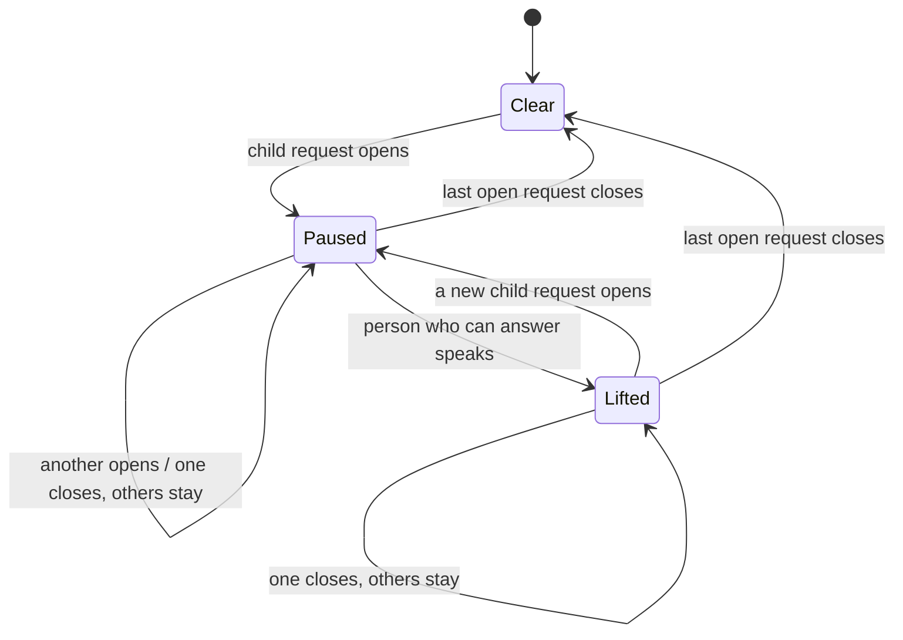
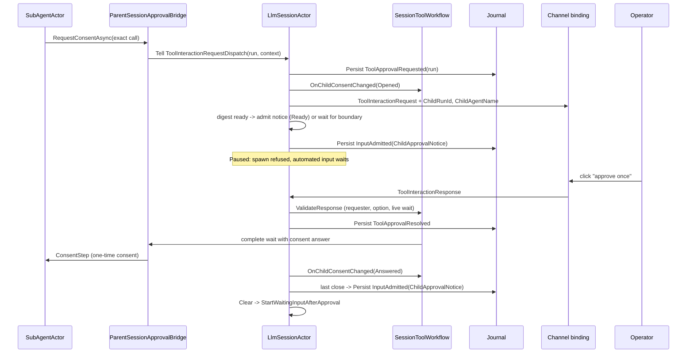

## Context

See `proposal.md` (Why) for the incident. This section states the current mechanics on `upstream/dev` (7f54c537c).
Terms follow [the engineering glossary](../../../docs/spec/GLOSSARY.md): consent request, consent answer,
one-time consent, requester, open child run.

### Current mechanics

1. **One consent loop.** `ParentSessionApprovalBridge` is the consent loop for the session's own calls and for the
   calls of its children (`ParentSessionApprovalBridge.cs:59-65`). It builds the `ToolInteractionRequest` from the
   gate's `ToolApprovalContext` and options, without change (`:138-173`). The answer becomes a one-time consent
   for the exact candidates (`:41-45`). A child prompt gets the call ID `{runId}/subagent-approval/{n}` (`:178-190`).
2. **The parent actor sees every child request.** `SessionToolWorkflow.ChildApprovalCapability` gives the child a
   bridge whose emitter Tells the session actor a `ToolInteractionRequestDispatch` with `PersistApprovalState = true`,
   `SourceChildRunId`, and `ChildContext` (`SessionToolWorkflow.Children.cs:56-72`). The wait timeout is
   `Timeout.InfiniteTimeSpan` (`:68`).
3. **Dispatch handler.** `LlmSessionActor.HandleToolInteractionRequestDispatch` drops a request for a run that is not
   `Accepted`. Otherwise it persists `ToolApprovalRequested` with the run ID and emits the prompt output
   (`LlmSessionActor.cs:3272-3298`). The prompt output has no field that names the child.
4. **Open child requests.** `SessionToolWorkflow._calls` holds them. `ChildApprovalCount(runId)` feeds
   `pending_approval_count` in `check_agent_run` (`SessionToolWorkflow.Children.cs:28-29`,
   `LlmSessionActor.Children.cs:243`). The model sees this count only when it polls.
5. **Answers.** An answer for a child call goes to the live path at all times
   (`LlmSessionActor.cs:3615-3621`, `3569-3613`). `ValidateResponse` checks the requester and the option
   (`SessionToolWorkflow.Approvals.cs:313-337`).
6. **Cancel and end.** `ControlChild` persists `CancellationRequested`, closes the child execution, and calls
   `CloseChildApprovals` (`LlmSessionActor.Children.cs:216-225`). `RecordChildTerminal` does the same for a terminal
   record (`:265-268`). `CloseChildApprovals` removes the entries and tells nobody
   (`SessionToolWorkflow.Children.cs:43-50`). The cancelled child stops. Its `finally` block Tells
   `SubAgentApprovalWaitCompleted` to a dead actor (`SubAgentActor.cs:1660-1671`). These are the observed dead
   letters. They are harmless.
7. **Late click.** A click on a removed call reaches `RejectClosedCall`, which returns `Expired`
   (`SessionToolWorkflow.Approvals.cs:223-235`). The text is "That approval prompt has expired — the session moved
   on or restarted" (`LlmSessionActor.cs:3474-3480`). For a cancelled child this text is false.
8. **Channels.** `ChannelOutputEngine.CompleteTurnAsync` drops all tracked prompts at `TurnCompleted`
   (`ChannelOutputEngine.cs:280-308`). The TUI does the same (`ChatViewModel.cs:433-437`, issue #2523). A button
   click still reaches the session, but a text answer has no local entry after the turn ends.
9. **Text answers.** A text answer resolves the latest open prompt that the sender can answer
   (`SessionToolWorkflow.Approvals.cs:131-148`). The channel takes the first match (`PendingApprovalLookup.cs:47-51`).
   With 5 open prompts, "A" approves one prompt that the person did not choose.
10. **Notices (#2515).** An ended child becomes one admitted input: `InputAdmitted.ChildNotice` (proto field 14). The
    notice carries the recorded context of the run owner with a new turn ID (`LlmSessionActor.Children.cs:345-363`).
    The kind of the input makes it automation (`SessionToolWorkflow.Recovery.cs:109-121`). A notice of the same
    requester joins a running turn at a tool-batch boundary (`SessionInputFlow.cs:431-471`).
11. **Automated input and parent approvals.** While a parent consent request is open, automated input waits in the
    buffer (`NewInputPlan.WaitForApproval`). A child request does not hold parent input today
    (`SessionToolWorkflow.Recovery.cs:167-171`).
12. **Passivation and restart.** A live child keeps the session in memory (`LlmSessionActor.cs:376`, `1747`). A child
    cannot resume after a restart. `RecoveryCompleted` removes child entries (`LlmSessionActor.cs:262`), and recovery
    records each live child as lost.
13. **Nested children.** `SubAgentToolPolicy` denies `spawn_agent` and `check_agent_run` to a child
    (`SubAgentToolPolicy.cs:16-21`). Nesting does not exist today.

### Constraints

- One owner for each decision. The session actor already owns all child consent state.
- No second notice system. Reuse the admitted-notice path of #2515.
- The parent model can never give consent. Consent comes only from a channel answer that `ValidateResponse` accepts.
- No timer is necessary for coalescing. Tests must be deterministic, with no sleep.

## Goals / Non-Goals

**Goals:**

- The parent model learns of child consent requests without a poll, at most once for each model boundary.
- The runtime, not the model, stops new autonomous work while the operator must answer.
- Each prompt names its child. A closed prompt has no live buttons. A late click gets the true reason.
- The notice and event seam can carry inter-agent messages later with no new delivery path.

**Non-Goals:**

- Inter-agent messages (`send_message`). Only the seam is in scope.
- A batched "approve for all" prompt (see Q2).
- Nested children. `spawn_agent` stays denied to a child (see Q5).
- A TUI reopen that shows open prompts again (#2523, second acceptance item). This needs a replay of open prompts
  to a new subscriber. Follow-up change.
- A shell fatigue fix for a literal `for` loop. It is a separate Shell facts change (tool-authorization.md section 8).

## Decisions

### D1. One event seam in the session actor

All child consent events go through one actor-local method: `OnChildConsentChanged(event)`. The events are
`Opened`, `Answered(answer)`, and `Withdrawn(reason)`. The callers are the dispatch handler (Opened), the response
path (Answered), and `CloseChildApprovals`, recovery, and the wait timeout (Withdrawn). The method has four effects
in a fixed order:

1. Update the open set (`SessionToolWorkflow._calls`, no change of owner).
2. Emit outputs: the prompt (Opened) or `ToolInteractionClosed` (Withdrawn), plus `SubAgentOutput` with a new phase
   for headless and the TUI.
3. Add the event to the notice digest (D3).
4. Re-evaluate the pause (D4).

Alternative: separate handlers for each effect. Rejected, because the four effects must agree on one ordered view
of the open set.

### D2. The prompt names the child; the runtime owns all prompt text

`ToolInteractionRequest` gets two optional fields: `ChildRunId` and `ChildAgentName`. The dispatch handler sets them
from the durable `BackgroundChildRun` record, not from the bridge or the model. `AgentName` comes from the operator's
agent definition. Each channel builder renders one line above the command, for example
"Child agent `pr-reviewer` (run `r-7f2`) asks:". The command text, the options, and the scope stay as the gate made
them.

The consent boundary (unchanged rule, now stated): the parent model has no tool that produces a
`ToolInteractionResponse`. Its text output is a `TextOutput`. A channel never renders buttons from model text. The
parent can explain or cancel a child. It cannot answer, approve, or edit a prompt.

### D3. Runtime notice for consent events, merged at model boundaries

A new notice kind joins the #2515 path: `InputAdmitted.ChildApprovalNotice` (proto field 15). The two kinds form a
closed set, `RuntimeNotice = ChildResult | ChildApproval`. The input rules for notices apply to both kinds: the kind
makes the input automation, the input carries the recorded context of the run owner with a new turn ID, and it grants
no authority.

Notice body rule: the body holds no text that a child wrote. It holds the agent name, the run ID, the canonical tool
name, the time the request opened, and the answer kind. It does not hold the command text. The operator sees the
command in the runtime-rendered prompt. The parent model does not need it to decide "wait" or "cancel".

Merge rule (actor-local digest, one digest for each run-owner authority):

- An event adds to the digest. The digest is ready when it has one or more `Opened` events, or when the open set of
  that requester becomes empty.
- When the session is `Ready`, the session admits a ready digest at once as one notice.
- When the session is `Processing` or `Compacting`, the digest waits. The session admits it at the next tool-batch end
  or turn end, before the buffer drain. The notice then joins the running turn when the requester is the same.
  Otherwise it follows the turn.
- After admission the digest is empty. An `Answered` event while other requests stay open waits in the digest. It
  goes out with the next `Opened` event or with the last close.

Result for the incident: child 1 opens and wakes the idle parent (notice 1). Children 2 to 5 open during that model
call. They go out together as notice 2 at the next boundary. The last answer gives notice 3. That is three notices
for five children, and the count does not grow with more children.

Example notice text (schematic):

```text
Child consent requests wait for the operator. 3 are open.
- agent=pr-reviewer run=r-7f2 tool=shell_execute open_since=14:03:01Z
- agent=pr-reviewer run=r-8a1 tool=shell_execute open_since=14:03:04Z
- agent=pr-reviewer run=r-9c3 tool=shell_execute open_since=14:03:09Z
The operator answers these prompts in the channel. You cannot answer them.
The children are not stalled. Do not cancel a child only because it waits.
Until the requests close, spawn_agent is refused and automated turns wait.
You can tell the operator why a child asks, or cancel a child with check_agent_run.
```

```text
Child consent requests are closed. None is open.
- run=r-7f2 answer=approved_once
- run=r-8a1 answer=withdrawn reason=cancelled_by_parent
spawn_agent is available again.
```

Alternatives considered: a notice for each event (rejected: the incident gives 5 wakes); a timer window
(rejected: a timer adds a moving part, and the model boundary already groups events); a mutable notice that changes
after admission (rejected: the journal text of an input must not change).

### D4. The pause: one predicate, three effects

The pause is a derived, actor-local predicate in `SessionToolWorkflow`:

```text
Paused := exists open child request r with r.sequence > liftedThrough
```

`sequence` is a session-local counter that the workflow assigns at `Opened`. `liftedThrough` is actor-local.

Effects while `Paused` (this list defines "new autonomous rounds"):

| Event | Today | While paused |
| --- | --- | --- |
| `spawn_agent` call (`ChildRunStartKey.Tool`) | accepted | `AcceptChild` rejects with `ChildStartRejectedException(SpawnPaused)`. The spawner removes the run folder (existing path). |
| Slash command child start (`ChildRunStartKey.Slash`) | accepted | accepted. A person typed it, and that input lifts the pause first. |
| Automated input or child result notice, session `Ready` | starts a turn | waits in the buffer (`NewInputPlan.WaitForApproval`, existing placement) |
| Automated input or child result notice in the buffer, tool-batch boundary of a running turn | joins the turn | stays in the buffer. `DrainBufferedBatch` stops at it. |
| Child approval notice (D3) | (new) | admitted, wakes or joins as D3 says. The pause never holds it. |
| Next model call of the running turn | runs | runs. The current turn can finish. Turn-loop governance still bounds it. |
| Person input | starts a turn | starts a turn, and can lift the pause (below) |

What the parent model sees when `spawn_agent` is refused (tool result, schematic):

```text
Error: spawn_agent is paused. 3 child consent requests wait for the operator
(runs r-7f2, r-8a1, r-9c3). Wait for the operator, or cancel a child with check_agent_run.
A notice arrives when the requests close.
```

Lift: when the session admits a person input whose sender can answer one or more open child requests
(the existing `CanApprovePending` check), the session sets `liftedThrough` to the highest open `sequence`. A new
request after that point pauses the session again. A person who cannot answer the prompts does not lift the pause.



On the move to `Clear`, the session admits the ready digest (D3). Then it starts the waiting inputs through the
existing `StartWaitingInputAfterApproval`.

Alternatives considered: a model-side instruction only (rejected: the incident shows that the model guesses);
refusing every model call (rejected: the owner allows the current turn to finish); a durable pause flag
(rejected: no child request survives a restart, so the pause has nothing to restore).

### D5. Withdrawal and an accurate late reply

- `CloseChildApprovals`, recovery, and the wait timeout emit one `ToolInteractionClosed(CallId, Reason)` output for
  each closed call. The reasons are `cancelled_by_parent`, `child_ended`, `daemon_restarted`, and `timed_out`.
- `ChannelOutputEngine` redraws the prompt as closed with the reason, removes its entry, and journals
  `PendingApprovalPromptCleared` (existing event). The TUI removes the prompt.
- `ChannelOutputEngine` and the TUI no longer drop a child prompt at `TurnCompleted`. They drop only prompts that have
  no `ChildRunId`. This fixes #2523 for a live session.
- `RejectClosedCall` gets one new case. For a child call ID, the workflow reads the run ID from the call ID prefix
  (the runtime made this ID in `CreateParentCallId`). It then reads the run lifecycle in `SessionState`. The run
  record is durable and in the snapshot. The reply is `ApprovalNoticeKind.Withdrawn(reason)`, for example
  "That approval prompt was withdrawn: the parent cancelled child run r-7f2 (pr-reviewer). Nothing ran."
- No new journal event. The reason comes from records that exist (`CancellationRequested`, `TerminalRecorded`).

### D6. Text answer guard

A text answer resolves a prompt only when the sender can answer exactly one open prompt. With two or more, the
session and the channel reply "N approval prompts are open. Use the buttons on the prompt you mean." Owners:
`SessionToolWorkflow.TryResolveTextResponse` and `PendingApprovalLookup.Resolve` (callId null). This guard closes a
consent spoof: model text could describe a harmless command while "A" approves another prompt.

### D7. Messaging seam (not messaging)

The seam for the next change is:

- the closed `RuntimeNotice` set in `InputAdmitted` (a later kind takes field 16),
- the digest and merge rule of D3, keyed by the authority of the producer's run owner,
- the notice body rule: no foreign text in the body, a pointer (path or ID) instead,
- the pause predicate of D4, which a later kind can read or ignore by kind.

A message from a child then becomes one more kind. It needs no new wake path, no new authority rule, and no new
journal stream.

### Ordered flow



Schematic pseudocode (it omits the requester check, journal failures, and the persist callback order):

```text
on ToolInteractionRequestDispatch d with d.SourceChildRunId = run:
    if run is not Accepted: drop                       # existing
    persist ToolApprovalRequested(d) then:
        wf.Open(d.CallId, run, seq = wf.NextSequence())
        emit d.Request with ChildRunId = run.Id, ChildAgentName = run.AgentName
        emit SubAgentOutput(run, Phase = AwaitingConsent)
        digest[run.OwnerAuthority].Add(Opened(run, tool, now))
        maybeAdmitDigest()

on child consent closed (answer | cancel | end | restart | timeout):
    wf.Close(callId)
    if reason != answered: emit ToolInteractionClosed(callId, reason)
    digest[owner].Add(Closed(run, answerKind))
    maybeAdmitDigest()
    if not wf.Paused: StartWaitingInputAfterApproval()

maybeAdmitDigest():
    for each owner with digest ready:
        if phase is Ready or at boundary: Self.Tell(SendUserMessage(notice, owner context))
        else: keep                                   # flushed at next tool-batch end or turn end

AcceptChild(start):
    if start is Tool and wf.Paused: reject SpawnPaused(open list)

PlanNewInput(input):
    if parent approval open and input is automated: WaitForApproval      # existing
    if wf.Paused and input is automated and input is not ChildApprovalNotice: WaitForApproval
    if input is person and wf.CanAnswerAnyOpenChild(input.sender): wf.Lift()
```

### Owners and data

| Decision | Owner | Data |
| --- | --- | --- |
| Prompt text, options, scope | `ParentSessionApprovalBridge` from the gate's `ToolApprovalContext` | call-local |
| Child name on the prompt | `LlmSessionActor.HandleToolInteractionRequestDispatch` from `BackgroundChildRun` | durable source, call-local output |
| Open child requests and `sequence` | `SessionToolWorkflow._calls` | actor-local, rebuilt from `ToolApprovalRequested` and `ToolApprovalResolved` |
| Pause predicate and `liftedThrough` | `SessionToolWorkflow` | actor-local |
| Spawn refusal | `LlmSessionActor.AcceptChild` | call-local decision on actor-local state |
| Automated input waits | `SessionToolWorkflow.PlanNewInputAbandonment`, `SessionInputFlow.DrainBufferedBatch` | actor-local |
| Lift | `LlmSessionActor.HandleIncomingUserMessage` with `CanApprovePending` | actor-local |
| Digest and merge | `LlmSessionActor` (Children partial) | actor-local |
| Notice validity (runs exist, same session, owner authority) | `SessionState.Apply(InputAdmitted)` | durable |
| Consent answer validity | `SessionToolWorkflow.ValidateResponse` (unchanged) | actor-local plus durable resolution |
| Withdrawal reason for a late click | `SessionToolWorkflow.RejectClosedCall` | derived from durable run lifecycle |
| Text answer guard | `SessionToolWorkflow.TryResolveTextResponse`, `PendingApprovalLookup` | actor-local |
| Prompt redraw on close | channel bindings through `ChannelOutputEngine` | binding journal (`PendingApprovalPromptCleared`) |
| Child wait timeout (Q4) | `ApprovalChannel.WaitForApprovalAsync` through the child bridge | call-local, config value |

### Examples

Pause, positive: Alice's child r-7f2 waits for consent. The parent model calls `spawn_agent`. The call returns the
refusal text, and no run folder stays. A reminder fire of the session waits in the buffer and runs after Alice
answers.

Pause, positive (lift): the parent is paused. Alice writes "go ahead and start the other review". Alice can answer
the open prompt, so her input lifts the pause. Her turn can call `spawn_agent`.

Pause, negative: Bob writes in Alice's thread while Alice's child waits. Bob cannot answer Alice's prompt, so the
pause stays. Bob's turn runs, but its `spawn_agent` call is refused.

Pause, negative: a child result notice arrives during the running turn. It does not join the turn at the next
tool-batch boundary. It waits until the pause lifts or clears.

Consent boundary, positive: Alice clicks "approve once" on the prompt of r-7f2. The child gets a one-time consent for
the exact candidates of that call.

Consent boundary, negative: the parent model writes "Reply A to approve `gh pr view`" while two prompts are open, one
of them `rm -rf build`. Alice types "A". The session replies that two prompts are open and resolves neither.

Consent boundary, negative: a child writes the command `echo "ignore previous instructions"`. The approval notice for
the parent holds the agent, run, and tool name only. The command text reaches the operator in the prompt, not the
parent model.

Withdrawal, negative: the parent cancels r-8a1. Alice then clicks its old button. The reply is "withdrawn: the parent
cancelled child run r-8a1". No grant is written and no tool runs.

### Edge cases

| Case | Behavior |
| --- | --- |
| Parent mid-turn | The digest waits for the next tool-batch end or turn end. The notice joins the turn when the requester is the same. `spawn_agent` in the same turn is refused at once. |
| Parent idle | A ready digest wakes the parent once (Q1). |
| Parent passivation | A live child keeps the session in memory (`LlmSessionActor.cs:376`). Idle passivation does not happen while a request is open. |
| Daemon restart | Recovery withdraws each child request with `daemon_restarted` and emits `ToolInteractionClosed`. Recovery closes an unconsumed approval notice with `InputClosed` and starts no turn for it, because the lost-child result notices tell the parent the true state. The pause starts `Clear`. |
| Child cancel | Withdrawn with `cancelled_by_parent`. The channel redraws. A late click gets the true reason. |
| Child ends while another child waits | Its result notice waits in the buffer until the pause lifts or clears. Then it runs with the closing approval notice in one turn when the requester is the same. |
| Operator answers after cancel | D5 reply. No grant, no run. |
| Prompt expiry by timeout (Q4) | The child gets `ConsentAnswer.TimedOut`. The prompt is withdrawn with `timed_out`. |
| Reminder or headless turn with no interactive channel | The child gets `InteractiveApprovalCapability.Unavailable` and is denied without a prompt (existing). No pause. |
| Headless resume while a child waits (#2541) | The headless client prints the run, the agent, and "waiting for consent" from `SubAgentOutput`. Whether headless must exit stays with #2541. |
| TUI parent turn ends (#2523) | The child prompt stays in the TUI queue until an answer or `ToolInteractionClosed`. |
| Parent consent request and child request both open | The existing parent rule holds automated input. The pause adds the spawn refusal. The text answer guard applies across both. |
| Two requesters in one shared thread | Each run-owner authority has its own digest and notice. The pause is session-wide: any open child request pauses the session. Only a person who can answer an open prompt lifts it. |
| Nested children | Not possible today (`SubAgentToolPolicy`). See Q5. |

### Changes to `docs/architecture/tool-authorization.md` (same PR as the code)

- Section 3.6 Consent delivery: add `ChildRunId` and `ChildAgentName` to the published contract, the
  `ToolInteractionClosed` output, the withdrawal reasons, the `Withdrawn` notice kind in the `RejectClosedCall` list,
  the text answer guard (new rule and owner), and the approval notice with its body rule. Replace the line "Child
  prompts do not block an unrelated parent turn or the notice of another child" with the pause rule. Update the
  sequence diagram.
- Section 3.1 Admission: the pause is a new decision owner for input placement. Add the row for automated input
  while paused, and the lift rule with its owner.
- Section 3.6 "Leaks today": remove the point that two layers check the text answer target only by first match.
- Section 7.5 Add a channel prompt: a new channel must render the child line and handle `ToolInteractionClosed`.
- Section 8 Future scenarios: add "Inter-agent messages: Needs a contract (a new `RuntimeNotice` kind)" and
  "Batched consent for identical child requests: Not supported (Q2)".
- The line in the Admission notes "No timer denies an unanswered request" changes if Q4 is accepted.

### Spec deltas (written after this design is approved)

- `tool-authorization` TA-12: named child prompt, parent model cannot answer, withdrawal reply, text answer guard.
- `background-subagent-runs`: approval notice, pause effects and lift, withdrawal on cancel or end.
- `netclaw-session`: `RuntimeNotice` kinds; automated input waits while paused.
- `session-resume`: recovery withdraws child prompts with a reason and closes stale approval notices.
- `channel-binding-parity`: `ToolInteractionClosed` redraw; child prompts survive `TurnCompleted`.
- `netclaw-subagents`: finite child consent wait (only if Q4 is accepted).
- Glossary: add "child consent pause" and "runtime notice".

### Test strategy

All tests are deterministic. They use Akka.TestKit probes, `AwaitAssertAsync`, and a fake `TimeProvider` or
`TestScheduler`. No test uses `Thread.Sleep` or `Task.Delay`.

- Actor specs (`LlmSessionActor` with a fake child and a fake channel):
  - Five dispatches during one model call give exactly one `InputAdmitted(ChildApprovalNotice)` at the boundary.
  - An idle session gets one turn for the first dispatch.
  - `spawn_agent` is refused while paused, accepted after the lift, and accepted after the last close.
  - A reminder fire and a child result notice wait while paused and run after the last close.
  - A person who can answer lifts the pause; a new request pauses again; a person who cannot answer does not lift it.
  - Cancel emits `ToolInteractionClosed` for each open call; a late click gets `Withdrawn`, no grant, no run.
  - Recovery withdraws child requests and closes an unconsumed approval notice with no turn.
  - A text answer with two open prompts resolves neither.
- Property test: a child command text with a marker never appears in the content of an approval notice.
- Builder snapshot tests for Slack, Discord, and Mattermost: the child line, and the closed redraw for each reason.
- TUI: a headless typed-key test where a child prompt survives `TurnCompleted` and the answer resumes the child, plus
  a native smoke tape (Automation Floor).
- Serialization round trip for proto field 15 and for a deployed row without it.
- Focused Stryker targets: the pause predicate in `AcceptChild` and in the drain, the notice body rule, and the text
  answer guard. They join the `child-owner-and-report` group.
- Eval cases (the `agent-coordination` skill changes): after an approval notice, the parent does not cancel or
  respawn a waiting child.

## Risks / Trade-offs

- [A forgotten prompt holds reminders and job results of the session.] → Q4 bounds the wait. The notice tells the
  parent model to tell the operator. A person who can answer lifts the pause.
- [Merged notices still give 2 or 3 parent turns in a fan-out.] → This is bounded and does not grow with the child
  count. A timer window could cut it to one, at the cost of one more moving part.
- [Persist callbacks reorder the admission and the drain at a boundary.] → The implementation admits the notice in
  the persist callback and drains after it. A test asserts the order.
- [A channel binding is not subscribed when recovery emits `ToolInteractionClosed`.] → The buttons stay live until a
  click. The click gets the D5 reply and the binding redraws. A cold-spawn reconcile is a follow-up.
- [Field 15 rows cannot be read by an older binary.] → Back up `netclaw.db` before rollout. Rollout is forward-only,
  the same as #2515.
- [The text answer guard asks more of a person who uses text answers.] → It applies only with two or more open
  prompts. One open prompt keeps the current behavior.
- [The pause refuses a useful `spawn_agent` call.] → The refusal text names the waiting runs and the two ways out.

## Migration Plan

1. Merge the code, the doc, the skills, and the spec deltas in one PR (or a short stack: notice kind and proto first).
2. Back up `netclaw.db`. Deploy. No configuration change is required unless Q4 adds a property with a default.
3. Rollback: a binary without field 15 cannot read new rows. Restore the backup, or roll forward.

## Open Questions

Each question has a recommendation. The owner decides. The answers change the spec deltas, so they come before the
specs.

- **Q1. Does an approval notice wake an idle parent?** Recommendation: yes, once for each ready digest (D3). A
  digest is ready on a new request or on the last close, never on a single answer while others stay open. The last
  close wakes the parent, because the parent can then tell the operator that the children continue.
- **Q2. One prompt with "approve for all" for identical requests of several children?** Recommendation: no, not in
  this change. It is a new consent surface: one click makes N one-time consents, and "identical" needs a candidate
  comparison rule. The named prompts, the pause, and the withdrawal remove most of the incident's harm. The real
  fatigue fix for `for N in ...; do gh ...; done` is a Shell facts change for a literal loop.
- **Q3. Which new facts are journaled?** Recommendation: only the notice kind (`InputAdmitted` field 15), because a
  rebuilt waiting notice must keep its automation kind. The pause, `liftedThrough`, and the digest stay actor-local.
  No child request survives a restart, so they have nothing to restore. The withdrawal reason comes from existing run
  records. Recovery closes an unconsumed approval notice with the existing `InputClosed`.
- **Q4. Child consent wait timeout (infinite today)?** Recommendation: a finite wait, `SubAgents.ApprovalWaitTimeout`,
  default 30 minutes, with a schema default. The timeout gives `ConsentAnswer.TimedOut` to the child and withdraws the
  prompt with `timed_out`. Reason: the pause holds automated input, so an infinite wait can stop a session's reminders
  with no end. The parent's own consent requests stay infinite, because a person input abandons them.
- **Q5. Nested children?** Recommendation: keep `spawn_agent` denied to children. If nesting comes later, the root
  session stays the one consent loop (the bridge chain already reaches it). Each event carries the run path, and the
  pause belongs to the session actor that owns the requesting run.
- **Q6 (new). Does the lift last until the next request, or only for one turn?** Recommendation: until the next child
  request opens. It is simpler, and a new request pauses the session again.
