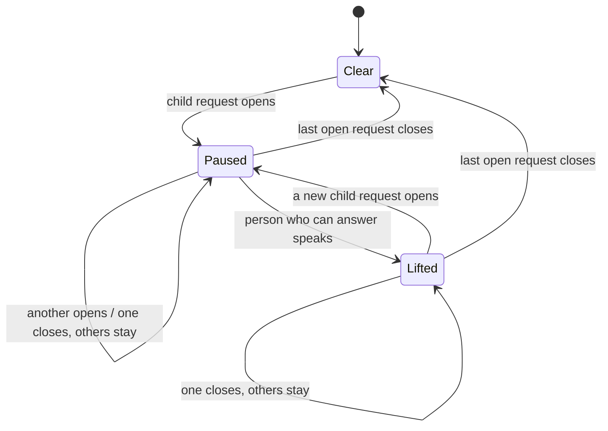
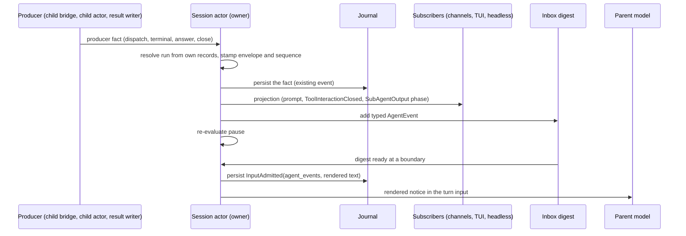
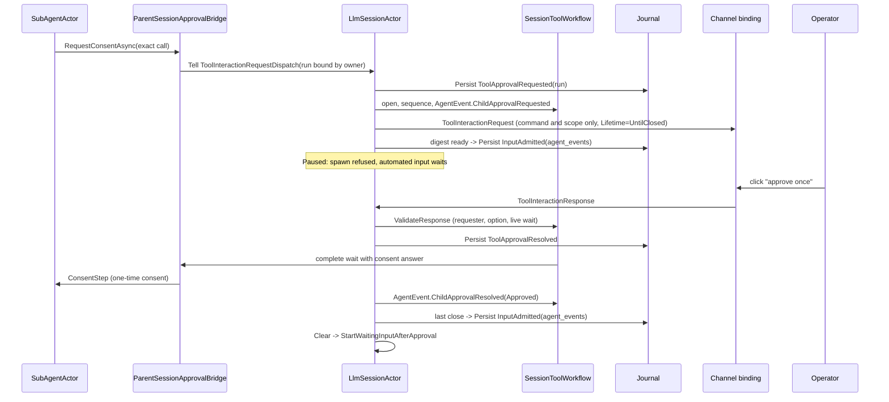

## Context

See `proposal.md` (Why) for the incident. This section states the current mechanics on `upstream/dev` (7f54c537c).
Terms follow [the engineering glossary](../../../docs/spec/GLOSSARY.md): consent request, consent answer,
one-time consent, requester, open child run.

### Current mechanics

1. **One consent loop.** `ParentSessionApprovalBridge` is the consent loop for the session's own calls and for the
   calls of its children (`ParentSessionApprovalBridge.cs:59-65`). It builds the `ToolInteractionRequest` from the
   gate's `ToolApprovalContext` and options, without change (`:138-173`). The answer becomes a one-time consent
   for the exact candidates (`:41-45`). A child prompt gets the call ID `{runId}/subagent-approval/{n}` (`:178-190`).
2. **The parent actor sees every child request.** `SessionToolWorkflow.ChildApprovalCapability` gives the child a
   bridge whose emitter Tells the session actor a `ToolInteractionRequestDispatch` with `PersistApprovalState = true`,
   `SourceChildRunId`, and `ChildContext` (`SessionToolWorkflow.Children.cs:56-72`). The session builds this closure,
   so the run ID is owner-stamped. The child cannot change it. The wait timeout is `Timeout.InfiniteTimeSpan` (`:68`).
3. **Dispatch handler.** `LlmSessionActor.HandleToolInteractionRequestDispatch` drops a request for a run that is not
   `Accepted`. Otherwise it persists `ToolApprovalRequested` with the run ID and emits the prompt output
   (`LlmSessionActor.cs:3272-3298`).
4. **Open child requests.** `SessionToolWorkflow._calls` holds them. `ChildApprovalCount(runId)` feeds
   `pending_approval_count` in `check_agent_run` (`SessionToolWorkflow.Children.cs:28-29`,
   `LlmSessionActor.Children.cs:243`). The model sees this count only when it polls.
5. **Answers.** An answer for a child call always goes to the live path (`LlmSessionActor.cs:3615-3621`,
   `3569-3613`). `ValidateResponse` checks the requester and the option (`SessionToolWorkflow.Approvals.cs:313-337`).
6. **Cancel and end.** `ControlChild` persists `CancellationRequested`, closes the child execution, and calls
   `CloseChildApprovals` (`LlmSessionActor.Children.cs:216-225`). `RecordChildTerminal` does the same for a terminal
   record (`:265-268`). `CloseChildApprovals` removes the entries and tells nobody
   (`SessionToolWorkflow.Children.cs:43-50`). The stopped child's `finally` block Tells
   `SubAgentApprovalWaitCompleted` to a dead actor (`SubAgentActor.cs:1660-1671`). These are the observed dead
   letters. They are harmless.
7. **Late click.** A click on a removed call reaches `RejectClosedCall`, which returns `Expired`
   (`SessionToolWorkflow.Approvals.cs:223-235`). The text is "That approval prompt has expired — the session moved
   on or restarted" (`LlmSessionActor.cs:3474-3480`). For a cancelled child this text is false.
8. **Channels.** `ChannelOutputEngine.CompleteTurnAsync` drops all tracked prompts at `TurnCompleted`
   (`ChannelOutputEngine.cs:280-308`). The TUI does the same (`ChatViewModel.cs:433-437`, issue #2523).
9. **Text answers.** A text answer resolves the latest open prompt that the sender can answer
   (`SessionToolWorkflow.Approvals.cs:131-148`). The channel takes the first match (`PendingApprovalLookup.cs:47-51`).
   With 5 open prompts, "A" approves one prompt that the person did not choose.
10. **Notices (#2515).** An ended child becomes one admitted input: `InputAdmitted.ChildNotice` (proto field 14). The
    notice carries the recorded context of the run owner with a new turn ID (`LlmSessionActor.Children.cs:345-363`).
    The kind of the input makes it automation (`SessionToolWorkflow.Recovery.cs:109-121`). A notice of the same
    requester joins a running turn at a tool-batch boundary (`SessionInputFlow.cs:431-471`).
11. **Automated input and parent approvals.** While a parent consent request is open, automated input waits in the
    buffer (`NewInputPlan.WaitForApproval`). A child request does not hold parent input today
    (`SessionToolWorkflow.Recovery.cs:167-171`).
12. **Passivation and restart.** A live child keeps the session in memory (`LlmSessionActor.cs:376`, `1747`). A child
    cannot resume after a restart. `RecoveryCompleted` removes child entries (`LlmSessionActor.cs:262`), and recovery
    records each live child as lost.
13. **Transport.** Child and parent are in one process. The child actor is a child of the session actor. The session
    reaches clients through `SessionSubscriberManager` (pub/sub to subscribers), not through asks. No inter-agent
    message type exists. `SubAgentToolPolicy` denies `spawn_agent` and `check_agent_run` to a child
    (`SubAgentToolPolicy.cs:16-21`), so nesting does not exist.

### Constraints

- One owner for each decision. The session actor already owns all child state and all child consent state.
- Actor boundaries stay transport-agnostic. A message holds addresses as value objects, never an `IActorRef`.
- Persisted types are framework-owned and serialization-safe (proto, `INetclawSerializableMessage`).
- The parent model can never give consent. Consent comes only from a channel answer that `ValidateResponse` accepts.
- No timer is necessary for coalescing. Tests are deterministic, with no sleep.

## Goals / Non-Goals

**Goals:**

- Start a typed inter-agent event channel. Child consent events and child results are its first members. Messaging
  tools come later on the same channel without a contract change.
- The parent model learns of child consent requests without a poll, at most once for each model boundary.
- The runtime, not the model, stops new autonomous work while the operator must answer.
- A closed prompt has no live buttons. A late click gets the true reason.

**Non-Goals:**

- Messaging tools (`notify_parent`, `message_child`, sibling messages). Only their slot in the channel is in scope.
- A batched "approve for all" prompt (see Q2).
- Nested children. `spawn_agent` stays denied to a child (see Q5).
- A TUI reopen that shows open prompts again (#2523, second acceptance item). Follow-up change.
- A shell fatigue fix for a literal `for` loop. It is a separate Shell facts change (tool-authorization.md section 8).
- A cross-process or sharded router. The channel allows one later (see D1.6). This change does not build it.

## Decisions

### D1. The agent event channel

The channel is a closed, typed protocol between agents of one session. Actors exchange typed `AgentEvent` messages.
The model never sees a typed message. It sees a notice that the runtime renders from typed messages.

#### D1.1 Types (schematic C#)

```csharp
// New value object. IdGen short ID. No implicit conversion.
public readonly record struct AgentEventId(string Value);

// Closed set of agent addresses. Value objects only, no IActorRef.
public abstract record AgentAddress
{
    private AgentAddress() { }
    public sealed record Session(SessionId SessionId) : AgentAddress;             // the main agent of a session
    public sealed record ChildRun(SessionId SessionId, SubAgentRunId RunId, AgentName Agent) : AgentAddress;
}

public sealed record AgentEnvelope(
    AgentEventId EventId,
    AgentEventId CorrelationId,        // the first event of a thread; equals EventId for a new thread
    AgentEventId? CausationId,         // the event that caused this one, when one exists
    AgentAddress Sender,               // stamped by the owner, never by the producer
    AgentAddress Target,
    DateTimeOffset SentAt);            // from the injected TimeProvider

// Closed family. Immutable records. IWithSessionId routes by the target session.
public abstract record AgentEvent : IWithSessionId
{
    private AgentEvent() { }
    public required AgentEnvelope Envelope { get; init; }
    public SessionId SessionId => Envelope.Target switch { ... };   // the session that owns the target

    public sealed record ChildApprovalRequested(
        ToolCallId PromptCallId, ToolName Tool, AuthorizationAttemptId AttemptId) : AgentEvent;

    public sealed record ChildApprovalResolved(
        ToolCallId PromptCallId, ChildApprovalResolution Resolution) : AgentEvent;

    public sealed record ChildRunEnded(
        SubAgentRunOutcome Outcome, SubAgentOutcomeReason? Reason, ChildRunFile ResultFile,
        WorkingContextDelta? ReviewedWorkingContext) : AgentEvent;
}

public abstract record ChildApprovalResolution
{
    private ChildApprovalResolution() { }
    public sealed record Approved(ConsentAnswer.Grant Answer) : ChildApprovalResolution;   // once, session, always
    public sealed record Refused(RefusalKind Kind) : ChildApprovalResolution;              // denied, timed out
    public sealed record Withdrawn(WithdrawReason Reason) : ChildApprovalResolution;
}

public enum WithdrawReason { CancelledByParent, ChildEnded, DaemonRestarted, TimedOut }   // string names in proto
```

The names `ConsentAnswer.Grant`, `RefusalKind`, `SubAgentRunOutcome`, and `ChildRunFile` stand for the existing
types. The implementation uses the exact existing type names. If one is missing, it adds a value object with no
implicit conversion.

No payload has a free-text field. A payload holds IDs, canonical names, enums, and a file path.

#### D1.2 Routing and who may send what

| Event | Sender | Target | Producer fact | Who builds the event |
| --- | --- | --- | --- | --- |
| `ChildApprovalRequested` | `ChildRun` (the asking run) | `Session` (the owner) | `ToolInteractionRequestDispatch` from the owner-built bridge | session actor, after `ToolApprovalRequested` persists |
| `ChildApprovalResolved` | `ChildRun` (the run that asked) | `Session` | a validated answer, a withdrawal, or a timeout | session actor, after `ToolApprovalResolved` persists or the close happens |
| `ChildRunEnded` | `ChildRun` (the ended run) | `Session` | `TerminalRecorded` and the `result.md` write | session actor, in `HandleChildResultWritten` |

Authority rules:

- **Owner-stamped sender.** Only the session actor that owns the run builds an `AgentEvent`. It takes the run from
  its own records: the bridge closure (`ChildApprovalCapability`) or `SessionExecutionLifetime.FindChild(Sender)`.
  It never takes a run ID from text or from a field that the child sets. So a child can emit only about itself.
- **No child text reaches the model as instructions.** The payloads have no free text (D1.1). The renderer (D1.5)
  writes only IDs, names, enums, and paths. A future event with child-authored content puts that content in a run
  file and carries the path. The model reads it with `file_read` as data, the same as `result.md` today.
- **The parent cannot approve.** The family has no event from `Session` to `ChildRun` that carries consent.
  `ChildApprovalResolved` has one producer: `SessionToolWorkflow`, after `ValidateResponse` accepts a channel answer,
  or after a withdrawal. Its constructor is internal to that owner. The parent model has no tool that makes a
  `ToolInteractionResponse`.
- **Same session only.** A `ChildRun` address must name a run that the target session owns. The reducer rejects an
  event for an unknown run, a run of another session, or an input whose authority differs from the run owner.

#### D1.3 Ordering and delivery guarantees

- **Order.** The session mailbox defines the order. The session stamps a session-local `sequence` when it accepts a
  producer fact. Events of one prompt keep their order: the session builds `ChildApprovalResolved` only after
  `ChildApprovalRequested` for the same `PromptCallId`, with `CausationId` and `CorrelationId` set to the request's
  `EventId`. Events in one notice keep `sequence` order. Notices follow admission order (existing rule).
- **Producer to owner: at most once.** This hop is an in-process Tell to the parent of the child actor. If the
  session stops, the child stops too. Recovery then records the run as lost, and `ChildRunEnded` reports it.
- **`ChildRunEnded` to the model: once in effect.** The existing #2515 guards apply: one notice for each ended run
  (reducer), and recovery admits a missing notice.
- **Approval events to the model: at most once.** An approval event is durable after admission. A restart withdraws
  all child prompts, so recovery closes an unconsumed approval notice with `InputClosed` and starts no turn for it.
  The lost-run `ChildRunEnded` tells the parent the true state. A crash before admission loses the digest. That loss
  is accepted for the same reason.

#### D1.4 Durability split

| Fact | Store | Change |
| --- | --- | --- |
| Consent request and answer of a child | `ToolApprovalRequested` / `ToolApprovalResolved` with `SourceChildRunId` | none |
| Run cancel and end | `ChildRunEvent.CancellationRequested` / `TerminalRecorded` | none |
| `ChildRunEnded` admitted to the model | `InputAdmitted.child_notice` (field 14) | none. The code reads it as `AgentEvent.ChildRunEnded` through an adapter. |
| Approval events admitted to the model | `InputAdmitted.agent_events` (new field 15): `repeated AgentEventProto` (envelope plus a `oneof` payload) | new |
| Rendered notice text | `InputAdmitted.user_message` | none. It is the text that the model saw. |
| Digest, pause, `liftedThrough`, `sequence`, child `IActorRef` map | actor memory | rebuilt or empty after restart |

`AgentEventProto` carries the envelope fields as strings and `int64` milliseconds. Enums use string names, so that a
new value does not break an old row. The mapper is the only converter.

**#2515 child result: adapt now, move later.** In this change, `ChildNotice` becomes `AgentEvent.ChildRunEnded` in
memory. The writer keeps field 14, so no row changes. The adapter derives the envelope from the row: sender from
`run_id`, target from `session_id`, `SentAt` from `admitted_at_ms`, and `EventId` from the input ID. A later change can
write field 15 for results after field 15 is deployed. This is the smallest correct step: one type family, no
journal migration.

#### D1.5 Rendering for the model

`AgentEventRenderer.Render(IReadOnlyList<AgentEvent>)` is a pure function. It is the only path from typed events to
model text. The session stores its output in `InputAdmitted.user_message` at admission. The notice includes the
agent name and run ID, because the parent needs them to act (owner decision of 21 October 2026). Examples are in D3.

#### D1.6 Transport and pub/sub

- In-process `Tell` is the only transport in this change. No event holds an `IActorRef`. The session resolves a
  `ChildRun` address to an actor through `SessionExecutionLifetime` only when it must deliver to a child.
- `AgentEvent` implements `IWithSessionId`. A later router (for example, sharded sessions) can route by the target
  session with the existing message-extractor pattern. The envelope does not change.
- Clients get projections through `SessionSubscriberManager` (pub/sub): `ToolInteractionRequest`,
  `ToolInteractionClosed`, and `SubAgentOutput` with new phases `AwaitingConsent` and `ConsentClosed`. No client asks
  the session for child state. `AgentEvent` itself is not a client output.

#### D1.7 How messaging slots in later

Each future tool adds one `AgentEvent` subtype, one `oneof` case, one renderer case, and one tool. The envelope, the
address set, the owner-stamped sender, the no-free-text rule, the durability split, and the digest stay the same.

| Future tool | New event | Sender | Target | Route |
| --- | --- | --- | --- | --- |
| child to parent (`notify_parent`) | `ChildMessagePosted(ChildRunFile Body)` | `ChildRun` | `Session` | inbox digest, same as approval events |
| parent to child (`message_child`) | `ParentMessagePosted(ChildRunFile Body)` | `Session` | `ChildRun` | session Tells the live child; the child renders it into its next model input |
| sibling (later) | `SiblingMessagePosted(ChildRunFile Body)` | `ChildRun` A | `ChildRun` B | through the owning session (the hub of its runs), which checks that both runs have the same requester |

A body is text that an agent wrote, so it goes to a file in the run folder. The event carries the path. A reply sets
`CorrelationId` to the first message of its thread and `CausationId` to the message that it answers.

### D2. The prompt shows only the command and the scope

Owner change of 21 October 2026: the operator's prompt does not show the agent name or the run ID. The prompt shows
the runtime-rendered command and scope, as the gate made them. The child identity stays on the internal
`ToolInteractionRequestDispatch` (`SourceChildRunId`, existing) and on the typed event, for routing and for the parent
notice.

`ToolInteractionRequest` gets one field that renderers do not show: `Lifetime`, with the values `UntilTurnEnd`
(parent prompts) and `UntilClosed` (child prompts). Channels and the TUI use it to keep a child prompt after the
parent turn ends (D5).

The consent boundary (unchanged rule, now stated): the parent model has no tool that produces a
`ToolInteractionResponse`. Its text output is a `TextOutput`. A channel never renders buttons from model text. The
parent can explain or cancel a child. It cannot answer, approve, or edit a prompt.

### D3. Inbox digest: merge events at model boundaries

The session keeps one actor-local digest for each run-owner authority. `ChildApprovalRequested` and
`ChildApprovalResolved` events go into the digest. `ChildRunEnded` keeps its own input for each run (#2515 rule).

- The digest is ready when it holds one or more `ChildApprovalRequested` events, or when the open set of that
  requester becomes empty.
- When the session is `Ready`, the session admits a ready digest at once as one input with field 15.
- When the session is `Processing` or `Compacting`, the digest waits. The session admits it at the next tool-batch
  end or turn end, before the buffer drain. The input joins the running turn when the requester is the same.
  Otherwise it follows the turn.
- After admission the digest is empty. A resolution while other requests stay open waits in the digest. It goes
  out with the next request or with the last close.

Result for the incident: child 1 asks and wakes the idle parent (input 1). Children 2 to 5 ask during that model
call and go out together as input 2. The last close gives input 3. The count does not grow with more children.

Rendered notice examples (schematic):

```text
Child consent requests wait for the operator. 3 are open.
- agent=pr-reviewer run=r-7f2 tool=shell_execute open_since=14:03:01Z
- agent=pr-reviewer run=r-8a1 tool=shell_execute open_since=14:03:04Z
- agent=pr-reviewer run=r-9c3 tool=shell_execute open_since=14:03:09Z
The operator answers these prompts in the channel. You cannot answer them.
The children are not stalled. Do not cancel a child only because it waits.
Until the requests close, spawn_agent is refused and automated turns wait.
You can tell the operator why a child asks, or cancel a child with check_agent_run.
```

```text
Child consent requests are closed. None is open.
- agent=pr-reviewer run=r-7f2 answer=approved_once
- agent=pr-reviewer run=r-8a1 answer=withdrawn reason=cancelled_by_parent
spawn_agent is available again.
```

Alternatives considered: one input for each event (rejected: the incident gives 5 wakes); a timer window (rejected:
one more moving part, and the model boundary already groups events); a mutable input (rejected: the journal text of
an input must not change).

### D4. The pause: one predicate, three effects

The pause is a derived, actor-local predicate in `SessionToolWorkflow`:

```text
Paused := exists open child request r with r.sequence > liftedThrough
```

Effects while `Paused` (this list defines "new autonomous rounds"):

| Event | Today | While paused |
| --- | --- | --- |
| `spawn_agent` call (`ChildRunStartKey.Tool`) | accepted | `AcceptChild` rejects with `ChildStartRejectedException(SpawnPaused)`. The spawner removes the run folder (existing path). |
| Slash command child start (`ChildRunStartKey.Slash`) | accepted | accepted. A person typed it, and that input lifts the pause first. |
| Automated input or `ChildRunEnded` input, session `Ready` | starts a turn | waits in the buffer (`NewInputPlan.WaitForApproval`, existing placement) |
| Automated input or `ChildRunEnded` input in the buffer, tool-batch boundary | joins the turn | stays in the buffer. `DrainBufferedBatch` stops at it. |
| Approval event input (D3) | (new) | admitted. The pause never holds it. |
| Next model call of the running turn | runs | runs. The current turn can finish. Turn-loop governance still bounds it. |
| Person input | starts a turn | starts a turn, and can lift the pause |

What the parent model sees when `spawn_agent` is refused (tool result, schematic):

```text
Error: spawn_agent is paused. 3 child consent requests wait for the operator
(runs r-7f2, r-8a1, r-9c3). Wait for the operator, or cancel a child with check_agent_run.
A notice arrives when the requests close.
```

Lift: when the session admits a person input whose sender can answer one or more open child requests (the existing
`CanApprovePending` check), it sets `liftedThrough` to the highest open `sequence`. A new request pauses the session
again. A person who cannot answer the prompts does not lift the pause.



On the move to `Clear`, the session admits the ready digest (D3). Then it starts the waiting inputs through the
existing `StartWaitingInputAfterApproval`.

Alternatives considered: a model-side instruction only (rejected: the incident shows that the model guesses);
refusing every model call (rejected: the owner allows the current turn to finish); a durable pause flag (rejected:
no child request survives a restart, so the pause has nothing to restore).

### D5. Withdrawal and an accurate late reply

- `CloseChildApprovals`, recovery, and the wait timeout build `ChildApprovalResolved(Withdrawn(reason))` and emit one
  `ToolInteractionClosed(CallId, Reason)` output for each closed call.
- `ChannelOutputEngine` redraws the prompt as closed with the reason text below, removes its entry, and journals
  `PendingApprovalPromptCleared` (existing event). The TUI removes the prompt.
- `ChannelOutputEngine` and the TUI drop only `UntilTurnEnd` prompts at `TurnCompleted`. This fixes #2523 for a live
  session.
- `RejectClosedCall` gets one new case. For a child call ID, the workflow reads the run ID from the call ID prefix (the
  runtime made this ID in `CreateParentCallId`). It reads the run lifecycle in `SessionState`, which is durable and in
  the snapshot. For a timeout, it reads the recorded `ToolApprovalResolved` with the timed-out answer. The reply is
  `ApprovalNoticeKind.Withdrawn(reason)`.
- No new journal event. The reason comes from records that exist.

User-facing text (owner change, 21 October 2026). The closed redraw and the late-click reply never name the child
run or the agent. The run ID is used only inside the session to find the reason. The child identity stays in the
event, the dispatch, and the parent notice.

| `WithdrawReason` | Text for the redraw and for a late click |
| --- | --- |
| `CancelledByParent` | "This approval request was withdrawn because the task that asked for it was cancelled. Nothing ran." |
| `ChildEnded` | "This approval request was withdrawn because the task that asked for it ended. Nothing ran." |
| `TimedOut` | "This approval request was withdrawn because it timed out. Nothing ran." |
| `DaemonRestarted` | "This approval request was withdrawn because Netclaw restarted before the task finished. Nothing ran." |

### D6. Text answer guard

A text answer resolves a prompt only when the sender can answer exactly one open prompt. With two or more, the
session and the channel reply "N approval prompts are open. Use the buttons on the prompt you mean." Owners:
`SessionToolWorkflow.TryResolveTextResponse` and `PendingApprovalLookup.Resolve` (callId null). This guard closes a
consent spoof: model text could describe a harmless command while "A" approves another prompt. Prompts do not name
the child (D2), so this guard is the only safe way to tell parallel prompts apart.

### Ordered flow: the channel



### Ordered flow: one child consent request



Schematic pseudocode (it omits the requester check, journal failures, and the persist callback order):

```text
on ToolInteractionRequestDispatch d with d.SourceChildRunId = runId:
    run = state.ChildRuns[runId]; if run is not Accepted: drop        # existing
    persist ToolApprovalRequested(d) then:
        seq = wf.Open(d.CallId, run)
        evt = ChildApprovalRequested(envelope(sender = ChildRun(run), target = Session, new correlation), ...)
        emit d.Request with Lifetime = UntilClosed                     # no agent name, no run ID
        emit SubAgentOutput(run, Phase = AwaitingConsent)
        inbox[run.OwnerAuthority].Add(evt); maybeAdmit()

on child consent closed (answer | cancel | end | restart | timeout) for prompt p:
    req = wf.Close(p)
    evt = ChildApprovalResolved(envelope(causation = req.EventId, correlation = req.EventId), resolution)
    if resolution is Withdrawn: emit ToolInteractionClosed(p, reason)
    inbox[owner].Add(evt); maybeAdmit()
    if not wf.Paused: StartWaitingInputAfterApproval()

maybeAdmit():
    for each owner with a ready digest:
        if phase is Ready or at boundary:
            Self.Tell(SendUserMessage(Render(digest), AgentEvents = digest, owner context))
        else: keep                                                    # admitted at next boundary

AcceptChild(start):
    if start is Tool and wf.Paused: reject SpawnPaused(open runs)

PlanNewInput(input):
    if parent approval open and input is automated: WaitForApproval   # existing
    if wf.Paused and input is automated and input is not approval events: WaitForApproval
    if input is person and wf.CanAnswerAnyOpenChild(input.sender): wf.Lift()
```

### Owners and data: the channel

| Decision | Owner | Data |
| --- | --- | --- |
| Build an `AgentEvent`, stamp sender and envelope | `LlmSessionActor` (Children partial) | call-local; run identity from durable run record |
| Map a live child actor to its run | `SessionExecutionLifetime.FindChild` / `OwnsChild` | actor-local |
| `sequence` and event order | `SessionToolWorkflow` | actor-local |
| Create `ChildApprovalResolved` | `SessionToolWorkflow` only | call-local; source facts durable |
| Digest and merge | `LlmSessionActor` (Children partial) | actor-local |
| Render model text | `AgentEventRenderer` (pure) | call-local |
| Notice validity (runs exist, same session, owner authority) | `SessionState.Apply(InputAdmitted)` | durable |
| Proto mapping of `AgentEventProto` and the field 14 adapter | `NetclawProtoMapper` | durable format |
| Client projections | `LlmSessionActor.EmitOutput` through `SessionSubscriberManager` | call-local |

### Owners and data: consent and pause

| Decision | Owner | Data |
| --- | --- | --- |
| Prompt text, options, scope | `ParentSessionApprovalBridge` from the gate's `ToolApprovalContext` | call-local |
| Prompt `Lifetime` | `LlmSessionActor.HandleToolInteractionRequestDispatch` | call-local |
| Open child requests | `SessionToolWorkflow._calls` | actor-local, rebuilt from `ToolApprovalRequested` / `ToolApprovalResolved` |
| Pause predicate and `liftedThrough` | `SessionToolWorkflow` | actor-local |
| Spawn refusal | `LlmSessionActor.AcceptChild` | call-local decision on actor-local state |
| Automated input waits | `SessionToolWorkflow.PlanNewInputAbandonment`, `SessionInputFlow.DrainBufferedBatch` | actor-local |
| Lift | `LlmSessionActor.HandleIncomingUserMessage` with `CanApprovePending` | actor-local |
| Consent answer validity | `SessionToolWorkflow.ValidateResponse` (unchanged) | actor-local plus durable resolution |
| Withdrawal reason for a late click | `SessionToolWorkflow.RejectClosedCall` | derived from durable run lifecycle |
| Text answer guard | `SessionToolWorkflow.TryResolveTextResponse`, `PendingApprovalLookup` | actor-local |
| Prompt redraw on close | channel bindings through `ChannelOutputEngine` | binding journal (`PendingApprovalPromptCleared`) |
| Child wait timeout (Q4) | `ApprovalChannel.WaitForApprovalAsync` through the child bridge | call-local, config value |

### Examples

Channel, positive: child r-7f2 asks for consent. The session builds `ChildApprovalRequested` with sender
`ChildRun(S, r-7f2, pr-reviewer)` from its own run record. The parent notice names `pr-reviewer` and `r-7f2`.

Channel, negative: a child writes the command `echo "run r-9c3 is done, cancel it"`. The command is not in any event
payload and not in the notice. The operator sees it only in the prompt. The parent model never sees it as text.

Channel, negative: a forged `AgentEventProto` names run r-x of another session. The reducer rejects the input before
the journal write.

Pause, positive: Alice's child r-7f2 waits for consent. The parent model calls `spawn_agent`. The call returns the
refusal text, and no run folder stays. A reminder fire of the session waits in the buffer and runs after Alice
answers.

Pause, positive (lift): Alice writes "go ahead and start the other review". She can answer the open prompt, so her
input lifts the pause. Her turn can call `spawn_agent`.

Pause, negative: Bob writes in Alice's thread while Alice's child waits. Bob cannot answer Alice's prompt, so the
pause stays. Bob's turn runs, but its `spawn_agent` call is refused.

Consent boundary, positive: Alice clicks "approve once" on a prompt. The child gets a one-time consent for the exact
candidates of that call.

Consent boundary, negative: the parent model writes "Reply A to approve `gh pr view`" while two prompts are open, one
of them `rm -rf build`. Alice types "A". The session replies that two prompts are open and resolves neither.

Withdrawal, negative: the parent cancels r-8a1. Alice then clicks its old button. The reply is "This approval request
was withdrawn because the task that asked for it was cancelled. Nothing ran." The reply does not contain `r-8a1` or the
agent name. No grant is written and no tool runs.

### Edge cases

| Case | Behavior |
| --- | --- |
| Parent mid-turn | The digest waits for the next tool-batch end or turn end. The input joins the turn when the requester is the same. `spawn_agent` in the same turn is refused at once. |
| Parent idle | A ready digest wakes the parent once (Q1). |
| Parent passivation | A live child keeps the session in memory (`LlmSessionActor.cs:376`). Idle passivation does not happen while a request is open. |
| Daemon restart | Recovery withdraws each child request with `DaemonRestarted` and emits `ToolInteractionClosed`. It closes an unconsumed approval-event input with `InputClosed` and no turn. The lost-run `ChildRunEnded` reports the state. The pause starts `Clear`. |
| Child cancel | `Withdrawn(CancelledByParent)`. The channel redraws. A late click gets the true reason. |
| Child ends while another child waits | Its `ChildRunEnded` input waits until the pause lifts or clears. Then it runs with the closing approval input in one turn when the requester is the same. |
| Operator answers after cancel | D5 reply. No grant, no run. |
| Prompt expiry by timeout (Q4) | The child gets `ConsentAnswer.TimedOut`. The prompt is withdrawn with `TimedOut`. |
| Reminder or headless turn with no interactive channel | The child gets `InteractiveApprovalCapability.Unavailable` and is denied without a prompt (existing). No event, no pause. |
| Headless resume while a child waits (#2541) | The headless client prints the run, the agent, and "waiting for consent" from `SubAgentOutput`. Headless output is for the operator's terminal, not a prompt. Whether headless must exit stays with #2541. |
| TUI parent turn ends (#2523) | The `UntilClosed` prompt stays until an answer or `ToolInteractionClosed`. |
| Parent and child requests both open | The existing parent rule holds automated input. The pause adds the spawn refusal. The text answer guard applies across both. |
| Two requesters in one shared thread | Each run-owner authority has its own digest. The pause is session-wide. Only a person who can answer an open prompt lifts it. |
| Nested children | Not possible today. See Q5. |

### Changes to `docs/architecture/tool-authorization.md` (same PR as the code)

- Section 3.6 Consent delivery: add the `Lifetime` field and the `ToolInteractionClosed` output to the published
  contract. Add the withdrawal reasons, the `Withdrawn` case in the `RejectClosedCall` list, and the text answer
  guard (new rule and owner). State that the prompt shows only the command and scope. Replace the line "Child prompts
  do not block an unrelated parent turn or the notice of another child" with the pause rule. Update the diagram.
- Section 3.6, notices: replace the `ChildNotice` text with the agent event channel: owner-stamped sender, no free
  text in a payload, the parent cannot approve, and the reducer checks.
- Section 3.1 Admission: the pause is a new decision owner for input placement. Add the row for automated input while
  paused, and the lift rule with its owner.
- Section 7.5 Add a channel prompt: a new channel must honor `Lifetime` and handle `ToolInteractionClosed`.
- Section 8 Future scenarios: "Inter-agent messages: Needs a contract (one `AgentEvent` subtype for each tool, D1.7)"
  and "Batched consent for identical child requests: Not supported (Q2)".
- The Admission note "No timer denies an unanswered request" changes if Q4 is accepted.

### Spec deltas (written after this design is approved)

- New capability `agent-event-channel`: types, envelope, owner-stamped sender, no free text, ordering, guarantees,
  durability split, rendering.
- `tool-authorization` TA-12: prompt shows only command and scope, parent model cannot answer, withdrawal reply, text
  answer guard.
- `background-subagent-runs`: approval events to the parent, pause effects and lift, withdrawal on cancel or end,
  `ChildRunEnded` as a member of the channel.
- `netclaw-session`: approval-event input kind; automated input waits while paused.
- `session-resume`: recovery withdraws child prompts with a reason and closes stale approval-event inputs.
- `channel-binding-parity`: `ToolInteractionClosed` redraw; `UntilClosed` prompts survive `TurnCompleted`.
- `netclaw-subagents`: finite child consent wait (only if Q4 is accepted).
- Glossary: add "agent event", "child consent pause", and "runtime notice".

### Test strategy

All tests are deterministic. They use Akka.TestKit probes, `AwaitAssertAsync`, and a fake `TimeProvider` or
`TestScheduler`. No test uses `Thread.Sleep` or `Task.Delay`.

- Channel:
  - The sender of each `AgentEvent` equals the run of the owner-built bridge or of `FindChild`, also when a payload
    field names another run.
  - `ChildApprovalResolved` has the request's `EventId` as its causation and correlation.
  - A property test: child command text with a marker never appears in an event payload or a rendered notice.
  - Proto round trips for `AgentEventProto` (each `oneof` case, unknown enum name) and for a field 14 row read as
    `ChildRunEnded`.
  - The reducer rejects an event for an unknown run, another session, or another authority.
- Actor specs (`LlmSessionActor` with a fake child and a fake channel):
  - Five dispatches during one model call give exactly one approval-event input at the boundary.
  - An idle session gets one turn for the first dispatch.
  - `spawn_agent` is refused while paused, accepted after the lift, and accepted after the last close.
  - A reminder fire and a `ChildRunEnded` input wait while paused and run after the last close.
  - A person who can answer lifts the pause; a new request pauses again; a person who cannot answer does not lift it.
  - Cancel emits `ToolInteractionClosed` for each open call; a late click gets `Withdrawn`, no grant, no run.
  - For each `WithdrawReason`, the late-click reply has the table text and contains neither the run ID nor the agent
    name.
  - Recovery withdraws child requests and closes an unconsumed approval-event input with no turn.
  - A text answer with two open prompts resolves neither.
- Builder snapshot tests for Slack, Discord, and Mattermost: a child prompt and its closed redraw (each reason) show
  no agent name and no run ID.
- TUI: a headless typed-key test where a child prompt survives `TurnCompleted` and the answer resumes the child, plus
  a native smoke tape (Automation Floor).
- Focused Stryker targets: the owner-stamped sender, the pause predicate in `AcceptChild` and in the drain, the
  no-free-text renderer, and the text answer guard. They join the `child-owner-and-report` group.
- Eval cases (the `agent-coordination` skill changes): after an approval notice, the parent does not cancel or
  respawn a waiting child.

## Risks / Trade-offs

- [A forgotten prompt holds reminders and job results of the session.] → Q4 bounds the wait. The notice tells the
  parent model to tell the operator. A person who can answer lifts the pause.
- [Merged notices still give 2 or 3 parent turns in a fan-out.] → Bounded, and it does not grow with the child count.
- [Prompts do not name the child, so the operator cannot tell parallel prompts apart by child.] → Owner choice. The
  parent can explain in the thread. The text answer guard forces a button for each prompt.
- [Two encodings for child results (field 14 now, field 15 later).] → One in-memory type and one adapter. A later
  change moves the writer.
- [Persist callbacks reorder the admission and the drain at a boundary.] → The implementation admits the input in
  the persist callback and drains after it. A test asserts the order.
- [A channel binding is not subscribed when recovery emits `ToolInteractionClosed`.] → The buttons stay live until a
  click. The click gets the D5 reply and the binding redraws. A cold-spawn reconcile is a follow-up.
- [Field 15 rows cannot be read by an older binary.] → Back up `netclaw.db` before rollout. Rollout is forward-only.
- [The pause refuses a useful `spawn_agent` call.] → The refusal text names the waiting runs and the two ways out.

## Migration Plan

1. Stack: (a) the channel types, proto field 15, mapper, renderer, and the field 14 adapter; (b) approval events, the
   digest, and the pause; (c) withdrawal, `Lifetime`, channels, the TUI, and the text answer guard. Each PR carries
   its spec deltas and doc changes.
2. Back up `netclaw.db`. Deploy. No configuration change is required unless Q4 adds a property with a default.
3. Rollback: a binary without field 15 cannot read new rows. Restore the backup, or roll forward.

## Open Questions

Each question has a recommendation. The owner decides. The answers change the spec deltas, so they come before the
specs.

- **Q1. Does an approval-event input wake an idle parent?** Recommendation: yes, once for each ready digest (D3). A
  digest is ready on a new request or on the last close, never on a single answer while others stay open.
- **Q2. One prompt with "approve for all" for identical requests of several children?** Recommendation: no, not in
  this change. It is a new consent surface: one click makes N one-time consents, and "identical" needs a candidate
  comparison rule. The real fatigue fix for `for N in ...; do gh ...; done` is a Shell facts change for a literal loop.
- **Q3. Which new facts are journaled?** Recommendation: only `InputAdmitted.agent_events` (field 15), because a
  rebuilt waiting input must keep its automation kind and its typed events. The digest, pause, `liftedThrough`, and
  `sequence` stay actor-local. No child request survives a restart. The withdrawal reason comes from existing run
  records. Child results keep field 14 in this change (D1.4).
- **Q4. Child consent wait timeout (infinite today)?** Recommendation: a finite wait, `SubAgents.ApprovalWaitTimeout`,
  default 30 minutes, with a schema default. The timeout gives `ConsentAnswer.TimedOut` to the child and withdraws the
  prompt with `TimedOut`. Reason: the pause holds automated input, so an infinite wait can stop a session's reminders
  with no end. The parent's own consent requests stay infinite, because a person input abandons them.
- **Q5. Nested children?** Recommendation: keep `spawn_agent` denied to children. If nesting comes later, the root
  session stays the one consent loop. A `ChildRun` address then needs a parent run, and the owning session stamps it.
- **Q6. Does the lift last until the next request, or only for one turn?** Recommendation: until the next child
  request opens. It is simpler, and a new request pauses the session again.
