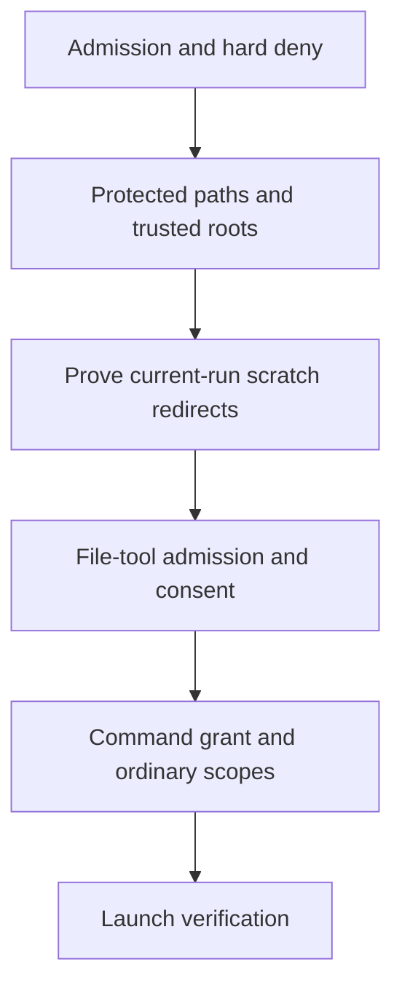

## Context

See proposal.md for the incident and PRD traceability.
The approval matcher currently folds redirect parents into command scopes.
The authorizer already applies file-tool admission and consent to commands that run no program.
The temporary-path policy currently requires the whole operation to stay below a platform temporary root.

## Goals / Non-Goals

Use the existing file-tool checks for proved scratch redirects and preserve ordinary command scopes.
Keep scope decisions explicit and independent from shell executable grammar.
Do not broaden a repository grant or alter its persistent form.
Do not repair unknown-option command-word projection in this change.

## Decisions

### Compose at the existing authorizer seam

ToolAccessPolicy owns the call-local composition decision.
It reads the managed temporary location from the existing invocation storage.
It accepts only Personal Bash occurrences with exact, link-free file targets inside that run's managed directory.
It reuses the matcher's occurrence projection without redirect scopes, so ordinary operand scopes and the occurrence directory retain command consent.
An internal candidate fact selects the existing file-tool redirect checks.
This fact is required because RunsNoProgram cannot describe a command that actually runs a program.
The fact remains call-local and creates no new durable grant type.

The consent actor receives the canonical command words and their ordinary scopes.
The existing file-tool grant lookup supplies independent file consent.
The authorizer denies a forbidden file operation before shell coverage can allow the call.

The diagram omits no authority gate that this change moves.
An unresolved target keeps its ordinary exact-consent path.
A target in another session receives no scratch exemption.

### Extend advice without relocation

TemporaryPathCorrectionPolicy also accepts a project command with proved output redirects under a platform temporary root.
It checks each output target and preserves the command directory and ordinary inputs.
It refuses this advice for input redirects or unknown targets.
The replacement call passes the full gate and can use scratch composition.

### Reuse the consent display

ShellPolicyCoordinator adds bounded reach and mismatch explanations to the existing consent display text.
It uses canonical candidate words and validated near-miss evidence.
It changes neither candidates nor option keys, so parent, child, and channel delivery reuse their existing contracts.

## Risks / Trade-offs

- A path can change after authorization. Existing launch verification repeats path checks.
- A path operand can share a redirect directory. Reprojection preserves every ordinary operand rather than deleting a directory by text.
- File consent can require an exact answer. Existing file-tool consent converts the candidate to an exact request.
- A platform temporary alias can hide a link. Existing filesystem authority must prove the eligible target.
- Additional display text can exceed a channel limit. Bounded explanations preserve the existing full-command limit check.

## Migration Plan

No durable records or configuration values change.
An operator can roll back the binary without a data migration.
A restart reconstructs candidate facts from the source and current filesystem state.
